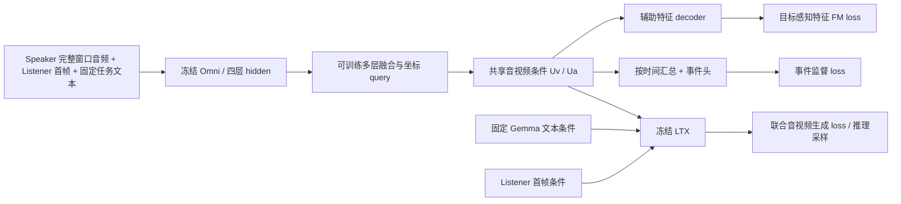

# P2 倾听事件监督：首轮实验计划

> 2026-10-26 用户已选择简化首轮：关闭两个 feature decoder，E0 的 Connector 仅由 AV loss 更新，E1 由 AV＋Event loss 更新；事件头两组均训练，E0 读取 detach(U)。本轮不读取 teacher 特征。实现与验证见 [AV / AV＋Event 简化说明](P2_AV与事件监督简化实现.md)。下文保留此前含 feature loss 的完整方案作为后续消融，不代表当前首轮基础损失。

> 最新修复（2026-10-25）：严格单卡/双卡一致性问题已解决。确定性反向＋FP64 梯度累加/求和后，105 项 CPU 测试、真实 GPU E0/E1 单/双卡各 7 步、恢复重放及独立生成全部通过；E0/E1 最终参数差均为 0，原阈值 2e-5 未放宽。详见[单卡/双卡数值修复与验证](P2_单卡双卡数值一致性修复与验证.md)。下文此前测试数量及失败结论为历史阶段记录；正式效果实验未启动。

> **2026-10-25 用户确认的首轮监督方案：** 使用“事件类型＋起止时间”生成稠密时间标签：已接受事件区间为 1，可用背景按弱监督假设为 0，明确不确定／失败／padding 区域屏蔽，跨边界 bin 用事件占用比例。沿用现有共享 U 上的 MLP 与 masked BCE-with-logits，不新增动作强度标注，不把 Smooth-L1、独立背景降权或人工负例库设为前置条件。目标是生成反应随 **speaker 的语音节奏和内容合理变化**，而不仅是 listener 自身自然。具体见 §5.3–5.4、§6、§8；后续已完成代码接入、91 项 CPU 测试和 50 条真实样本验证，见[弱背景派生实现与验证](P2_弱背景标签派生实现与验证.md)；正式生成效果尚未验证。

> 最新状态（2026-10-25）：50 段真实模型缓存、E0/E1 单卡与双卡 S0、恢复和独立生成已通过，见 [GPU 调试与训练就绪记录](P2_50段真实GPU调试与训练就绪记录.md)。下文关于待运行 S0 的描述保留为早期计划/需求快照；正式数据效果实验尚未开始。

> 2026-10-25衔接：修改旧二类实现请先读[当前打标、原文整合与七类代码迁移说明](P2_多类Backchannel打标整合与代码迁移说明.md)。该文核对了实际代码、当前≥384原框打标范围与原文保留规则；本文旧二类接口/历史整合规则不作为当前实现要求。七类训练接口现已迁移并通过CPU验证，见[实现与验证记录](P2_七类事件监督迁移实现与验证.md)；正文中的二类实现状态为历史快照；七类真实 GPU S0 已完成，弱背景派生接入也已完成验证；正式生成效果仍未验证。

日期：2026-10-23；2026-10-24 更新为用户认可的 **六类视觉反应＋一类音频回应** 方案。已有开放事件小样本标注可用于映射与核验，见 [标注整合报告](../experiments/listen_open_merge_20261024T084253Z/integration_report.json)。七类结果映射、七维训练事件头及真实 GPU S0 已实现/验证（见后续记录），正式效果实验尚未完成；实现状态以 [实现与运行说明](P2_倾听事件监督实现与运行.md) 和实际运行记录为准，尚无本方案的生成效果结论。

本轮任务是形成可执行文档。路线依据用户已确认的讨论：先用较简单的监督学习验证“事件回应监督是否改善倾听生成”，暂不上 RL；原始标注保持开放，首轮训练映射为六类视觉反应和一类音频回应。时间紧迫时优先复用已有标注、完成真实模型 S0 和一个训练 seed 的 E0/E1 成对 pilot，不等待七类全部扩齐或全量数据完成。具体样本量、学习率、损失权重和判定阈值仍为本文提出的默认值，不表述为已经验证的配置。

**版本衔接：** 本文七维协议版本为 `p2-listen-event-v2-visual6-audio1`。七类代码已迁移；配套《代码修改要求》中的旧二类 schema 示例仍为历史草案。本次同步计划、运行说明及代码要求，不修改训练代码或已有数据。旧二类标签、头权重和事件缓存不能直接当作七维版本使用。

- 总索引：[README](../README.md)。
- 配套实施说明：[P2 倾听事件监督代码修改要求](P2_倾听事件监督代码修改要求.md)。
- P2 定义来源：[v4 总览](../../audio-driven-v4/README.md)、[P2 原始设计](../../audio-driven-v4/docs/PIPELINE2_PLAN.md)。
- 当前数据规则：[V8 切分规则](P3_V8_完整句子与声学边界修复.md)、[QC4 验收与全量运行](P3_V8_QC4_第二批音质验收.md)。动态进度以运行文件为准，本计划不复制会过期的完成量。

## 1. 要回答的问题与路线选择

**主假设 H1：在其他训练条件相同的情况下，对实际送入 LTX 的条件表示增加倾听事件监督，能够改善生成音视频中的反应事件及其时机，使其随 speaker 的语音节奏和内容合理变化，并控制无事件区间的误触发。** 单纯更频繁地微笑、点头、发声，或者仅有画面自然度提高，不足以支持 H1。

首先验证 H1，原始标注保留开放描述，但本轮不训练开放词表事件预测，也不同时追求显式文本规划、可学习固定长度 memory、Omni LoRA、在线 VLM reward 和 RL。模型输出仍为 listener 的面部视频与自身音频；沉默也是应学习的行为。

| 路线 | 本轮定位 | 理由与限制 |
|---|---|---|
| P2 多层条件提取 + 事件监督 | 首轮主实验 | 事件梯度直接作用于生成条件；冻结 Omni 后可缓存 hidden；无需迭代规划。仍需训练生成接口，不能保证冻结 LTX 一定足够。 |
| P3 特征规划 + 事件监督 | 后续扩展 | 能进一步研究可采样的规划与渲染一致性；首轮失败来源更多，当前 listen-only 也没有已验证的质量基线。 |
| 显式事件文本计划 → Gemma → LTX | 保留独立对照 | 现有文本通路使改动不大；但 oracle 文本控制能力和自主事件预测是两个问题，不混入 H1 主对照。 |

P2 来源明确为 `audio-driven-v4/README.md` 中的 Pipeline 2，而非 P2.1：冻结 Omni/DiT，融合 Thinker 8/18/28/35 层，最终 U 共享特征 FM 与 AV 监督。旧 P2 已有坐标 query 的跨层提取器，不需要先另造一个压缩模块。其 query 数量随目标布局变化，不等于 OmniPersona 的固定 128 个 memory queries。

研究贡献目前是待验证的假设，不能仅凭“多层 hidden + query + event head”宣布新颖性。GLARE 提供事件辅助监督启发；OmniPersona 提供 query 提取上下文启发；二者均不直接证明本任务的音视频事件监督有效。相关材料见 [GLARE 分析](GLARE_论文与代码详细分析.md)、[GLARE 论文](00_GLARE_local.pdf)、[OmniPersona 论文](OmniPerson.pdf)。

## 2. 当前实现与本次新增的边界

已核对的旧 P2：

1. 冻结 Omni，提取 `[B, 4, L, 2048]` hidden；保留各层有效上下文 token。
2. `LayerMemory` 做逐层归一化、共享投影与层编码；坐标/模态 query 经 attention 得到条件。
3. 最终 `Uv: [B,Nv,4096]`、`Ua: [B,Na,2048]` 同时供辅助特征 decoder 和 LTX 使用。
4. Gemma 文本条件与 U 沿 token 维拼接，进入原有 text cross-attention。
5. 旧数据提取和推理包含 listener 文字回应/行为计划。**本轮必须换成固定任务文本，不可直接运行旧入口。**

现有 v5 的固定提示词、独立音轨处理、首帧推理与原生 LTX 采样可参考复用。现有 P3 的 S0 工程记录不能当作当前任务的质量基线；旧 listen+response 的 P2 权重也不作为本轮主实验初始化。

本轮新增的是：listen-only P2 数据/缓存契约、七维事件标签及开放描述映射、共享条件上的视觉六输出／音频单输出事件头、成对训练协议和生成事件评测。后续实施须独立放入 v5，保留旧实验复现路径。

## 3. 模型与信息边界

- 推理输入仅有 speaker 音频、listener 首帧、固定文本、外部给定时长和输出几何。
- 本轮离线生成，模型可使用整个 speaker 窗口。不能将结果宣称为实时因果 backchannel。
- GT listener 视频、音轨、事件时间表只进入训练目标和离线评测，不能进入 Omni/Gemma 输入、query 布局或推理缓存。
- listener 首帧本身是允许输入；其余目标帧不得泄漏。布局覆盖整个窗口，包括沉默区间，不按 GT VAD 裁掉槽位。
- 冻结 Omni/LTX/Gemma/VAE/感知教师；训练融合提取器、两个辅助特征 decoder 和事件头。LTX 冻结参数，但 AV 梯度必须穿过其计算到达 U。
- 不额外训练 Omni，不加新的固定长度压缩器，不采样辅助特征 decoder，不回填 hidden。
- U 对固定输入是确定性的条件表示，事件头学习事件倾向；视频/音频生成仍有随机性。不能解释为事件头对每个随机生成样本的精确执行计划。

固定提示词沿用 [p3_listen/prompts.py](../src/p3_listen/prompts.py) 中的 `OMNI`、`GEMMA` 全文，并将文本及哈希写入实验契约。不增加逐样本 GT 动作描述、回应转写、类别列表或时间表。时长只用于外部布局与生成，不自动写成新的逐样本文本提示。

## 4. 数据：先做独立小规模证据，不等待全量大训练

### 4.1 来源、质量和划分

- 从当前 V8/QC4 已完成的正常候选中，冻结一份有文件哈希的快照。`candidate` 是候选资格，不等于已准入训练；必须完成本实验的媒体检查、角色检查和准入清单。
- 音质修复储备、说话归属待复核、内容/边界待复核和排除池，不自动加入。整段音质验收不能替代事件标注。
- 主实验不继承旧 V5 的 1160/224/228 窗口或旧 P2 GT 文本缓存。旧材料最多用于明确标识的工程排错。
- 先做参与者/session/源会话连通组隔离，再选片段。重叠片段、同一人的跨会话连通关系必须审计；清单记录 official split 和 experiment split，不能只按 clip 随机划分。
- 首轮可在 official train 的隔离连通组上建立 local train/dev/test，明确 test 是本地留出集。official dev/test 保留给后续正式验证，不能把本地结果冒称官方测试结果。
- 如果连通性使目标组数不可达，减少规模并记录实际组数，不能为凑数拆开连通组。

### 4.2 默认规模与入选方式

| 阶段 | 建议规模 | 用途 |
|---|---|---|
| 标签校准 | 64 段 local train，覆盖可获得的各类正例、无事件、串音/边界难例 | 优先复用已有开放标注并核对映射；不用于留出评测 |
| S0 | 8–16 段 train，另 8 段 dev | 梯度、恢复和实际采样工程检查 |
| 首轮 pilot | train 2048、dev 128、test 128 段 | 第一轮效果证据；不足时如实降规模 |
| 训练重复 | 首个 seed 出现可解释信号后，再做第二个训练 seed 的完整成对对照 | 排除单次初始化偶然性 |

组数建议 train 至少 32、dev/test 各至少 8 个独立连通组；小于此规模的结果只作探索。每类建议 train 至少 100 个已接受的弱标或人工正事件、dev/test 各至少 30 个经核验正事件；这是扩大实验的统计目标，不是首轮 pilot 的人工标注门槛。达不到时报告支持量及结论限制，不宣称该类收益已稳定验证。

七个输出维度固定保留，但不要求为了凑齐皱眉、惊讶等稀有类而推迟首轮。根据 train 标签质量与可用正例冻结本轮启用监督的类别集合 `K_train`；未启用类整类屏蔽事件 loss，其开放记录仍保存。实际正例数、已知覆盖、未启用原因及评测类别集合均写入实验契约，两组完全一致。已有 50 段标注只有通过来源划分和媒体准入后才能计入相应 split，不能因已被查看就直接作为留出 test。

抽样先冻结来源和组划分。train 可以用粗事件候选检索补充稀有正例，但两组必须使用完全相同的样本和采样顺序，并报告相对自然分布的偏移。dev/test 主集合按来源、时长随机抽样，不为提高 F1 专门挑正例；若正例不足，单独增加事件富集诊断集，不并入主集合总体指标。“无检测结果”不能冒充人工沉默真值；正常完成标注的训练片段可按 §5.4 的明确策略生成弱背景 0，失败或未处理的片段不可如此处理。

### 4.3 时长、几何与时间分辨率

- 数据有效区间仍遵循 V8 的完整 speaker 语句和倾听角色边界，通常 2–10 秒，完整句例外最多 11.95 秒。
- 最快 pilot 先选**原本完整长度不超过 8.04 秒**的合格片段，以降低显存与旧配置适配成本；长片段留在原池中，不能硬裁掉句尾来凑 8 秒。后续单列 8.04–11.95 秒扩展。
- 默认渲染 25 FPS、512×512，原裁框至少 448，明确缩放不代表原生 512 清晰度。只使用经检查能容纳完整脸部的固定方形裁框；不改变正式 V8 入池规则。
- `T_real` 是完整片段真实时长；LTX 的帧数/latent 对齐产生 `T_render`。对齐规则只由外部时长决定，不由 GT 活动决定。记录两者及尾部 padding；禁止默默终端截断。
- 实现时必须验证原生时间压缩规则，默认按 `8k+1` 视频帧向上对齐；选择 pilot 时同时要求对齐后不超过当前 201 帧预算，超出者留待长片段扩展。
- padding 区域不得标成“无事件”；所有监督与指标只覆盖有效支持。VAE 尾部混合真实/补帧的 latent 支持区间必须明确，必要时保守屏蔽尾部 latent；不能仅在事件 loss 上加 mask。
- 教师视频默认 `vision_fps=8`、temporal patch=2，对应约 4 Hz 时间组；音频教师默认聚合到 `audio_hz=8`，约 125 ms 一格。两组使用完全相同的网格。
- 输出视频 25 FPS 与 query 时间粒度不同。第一轮不能声称提供帧级精确控制。query 数与显存先实测，若需降分辨率，必须两组一致、改版本并重建缓存。

## 5. 事件标注：开放描述保留，首轮映射为六类视觉＋一类音频

### 5.1 第一轮标签

视觉类别参考 GLARE 第 4 页 §3.2 和第 16 页表 6，具体监督采用下表的可观察定义；音频另设一个维度。类别顺序冻结为 `[head_nod, head_shake, smile, laugh, frown, surprise, listener_vocalization]`，不能按字符串排序或数据出现顺序改变通道含义。

| 模态 | 标签 | 操作定义 | 不包含 / 不确定处理 |
|---|---|---|---|
| 视觉 | `head_nod` | 可辨认的上下点头，从定向俯仰开始到该周期回位/稳定结束；连续周期分别记录 | 一般低头、镜头运动、仅躯干移动不直接算；遮挡、无完整证据、首尾被裁断处记 unknown/boundary-censored。 |
| 视觉 | `head_shake` | 可辨认的左右摇头，记录每次往复周期的起止 | 单次向侧面转头、视线移动不能直接算摇头；周期和边界无法判断时记 unknown。 |
| 视觉 | `smile` | 嘴角和面部呈现可辨认微笑的持续区间 | 普通嘴部运动不直接算微笑；不因出现大笑标签就自动复制一条微笑，按独立可见证据判断。 |
| 视觉 | `laugh` | 画面中可辨认的大笑／笑的动作，结合笑容、嘴部开合及面部动态记录区间 | 张嘴、说话不能单独证明在笑；听见笑声但画面没有相应证据时，不据此标视觉大笑。 |
| 视觉 | `frown` | 可辨认的皱眉，如眉部下压、聚拢形成的表情，记录持续区间 | 不能仅凭“负面情绪”“思考”等文字推断；光照、遮挡或表情含糊处记 unknown。 |
| 视觉 | `surprise` | 结合眉、眼、嘴等线索可辨认的惊讶表情区间，只标可见表现 | 单独睁大眼睛、抬眉、张嘴不能直接映射；不推断内在心理状态，证据不足保留开放描述并记 unknown。 |
| 音频 | `listener_vocalization` | listener 自身可听见的短促回应／发声，包括“yeah”“okay”“嗯／啊”和笑声等；每次独立回应／发声分别记录起止 | speaker 串音、环境声、普通呼吸不算；归属不清记 unknown。正式接管话轮的长回应属于数据角色问题。 |

七个维度独立 sigmoid，允许点头＋微笑＋音频回应等同时发生，不使用互斥 softmax。视觉大笑与可听笑声按各自模态独立标注，时间区间不强行对齐。这是本实验的多标签协议，不照搬 GLARE 跨类重叠仅保留主导反应的规则。“无事件”是某类别可监督范围内的零目标，不另设互斥类别；训练可采用显式接受的弱背景假设，评测真值仍须独立核验。音频沉默不代表六类视觉反应均为负。

音频首轮只设一个监督维度，不把“yeah”“okay”“嗯”等词语各设一类。两次“okay”仍保存为两个独立带时间的事件；具体词语、声音描述及原始来源保留在开放标签和溯源中。连续短语可保留一个回应区间及内部逐词时间，不把相邻的每个词一律当成独立回应；明确的重复回应不能为压缩记录而合并。事件头先学习何时发声，具体声音由原有音频生成损失学习；本轮不新增逐词分类或转写 loss。

这些标签描述可观察行为，不声称已覆盖所有语用 backchannel。眨眼、其他手势等七类以外的开放事件继续保存，不强行归入最近类别，也不因不属于七类就删除。

### 5.2 大模型参与方式

1. 优先复用已认可的开放标注：Qwen3-VL 提出视觉动作，Qwen3-Omni 纯音频提出声音事件，Qwen3-ASR／ForcedAligner 提供逐词时间，再经候选时间线和开放描述整合。先做七类映射与覆盖统计；没有具体缺失证据时不重新运行全部模型。当前结果与代码见 [整合报告](../experiments/listen_open_merge_20261024T084253Z/integration_report.json)、[备份与复现说明](../../audio-driven-v5-data-processing/event_labeling/README.md)。
2. 音频候选使用独立 listener 音轨；VAD 可辅助发现活动，不能单独判断回应类型或说话归属。归属不清时结合原始上下文人工核对；仅有视频不能证明发声，仅有声音不能证明视觉表情。
3. 保存原始模型输出、输入媒体哈希、模型/提示/采样参数、时间偏移和解析版本，再通过单独版本的 mapping 导出七维训练标签。映射保留原事件 ID、原始时间、模态、描述及依据；侧转头不自动映射摇头，单一张嘴不自动映射大笑或惊讶。模糊候选不强行归类。
4. 对每个类别保存可监督 coverage、unknown 和覆盖来源。自动检查来源与弱背景派生假设必须分别说明；普通稀疏候选未列出事件不能证明全窗口无事件，但可按 §5.4 作为有漏标风险的训练背景假设，不能改写为人工审阅事实。
5. 训练可用已接受的弱标签；dev/test 用于定量事件指标的参考必须独立核验。64 段 train 标签校准是优先诊断目标，可与首轮接入并行，不要求先补齐人工负例或完成全部校准才开 pilot。LLM 自报 confidence 仅作来源信息，不当成已校准概率、动作强度或默认 loss 权重。
6. 候选 precision≥0.85、recall≥0.75 保留为扩大实验的质量参考目标，不再作为所有类别首轮开跑的硬门槛。缺少精确估计时标为质量待验证；明确角色错误、无法定位、来源失败或严重映射冲突仍屏蔽。没有可用正事件的类可暂不启用；不能把没有人工确认负例等同于没有弱背景支持。事件起止边界以 ±0.2 秒为目标容差，分歧需记录；这是目标而非已验证精度，不能伪造毫秒精度。
7. 至少 20% 的 dev/test 由第二位标注者复核，分歧集中裁决；保存两份原始记录和最终版本。自动生成后评测也须独立校准，不能直接复用训练头当裁判。

原始标注保存开放描述、可能的细分类、强度及证据；第一轮 loss 只消费上述七维中已启用且有已知覆盖的标签。新增类别通过 schema/mapping 版本显式升级，不覆盖原始开放数据。现有样本的整体认可不等于逐事件人工真值，`human_ground_truth` 和训练准入仍按实际核验状态填写。

导入产物至少包含七维 `taxonomy`、`K_train`、每类 coverage/unknown、原始事件到训练事件的映射表和版本、每类正例数／有效时长／排除原因。一个类别的已审阅状态不能外推到其他类别；未启用类别整类屏蔽，已启用类别中的不确定区间局部屏蔽。事件缓存签名绑定新 schema、mapping、类别顺序、启用集合、标签和网格；只改标签映射时重建事件缓存，输入 H 缓存继续按输入身份检查复用。

**2026-10-24 语义映射实现（取代关键词规则）：** [semantic_mapping.py](../src/listen_benchmark/semantic_mapping.py) 使用 Qwen3-VL 对每条自然语言事件及其原始来源做语义归类，代码只验证结构、合法类别、模态和来源完整性，不使用关键词决定类别。[导出入口](../scripts/build_listen_seven_class.py) 默认要求 `--semantic-run`；旧规则需显式 `--legacy-rules`。当前 [完整自然语言 JSONL](../experiments/listen_semantic_labels_20261024T104629Z/labels.jsonl) 保留全部 682 条原事件，逐条增加 `categories`、`mapping_status`、`semantic_reason`、原始 `source_descriptions` 和模型引用来源；不改写 `behavior`、`text` 或时间。210 条附上七类标签、20 条待核验、452 条七类之外，详见 [统计](../experiments/listen_semantic_labels_20261024T104629Z/summary.json) 和 [HTML](http://127.0.0.1:8876/listen_benchmark_review/seven_class_semantic/)。单个原子事件最多附一个类别；不同事件可重叠，同一时刻仍可多标签。`category_candidates.jsonl` 是已归类候选的派生视图，不替代完整开放标签。模型可能过度推断惊讶等表情，尚需媒体核验；`coverage` 仍为空、`unknown` 覆盖全段、`K_train=[]`，七维训练导入器／事件头待后续适配。

**2026-10-24 回应区间整合（位于语义归类之后）：** [response_episodes.py](../src/listen_benchmark/response_episodes.py) 区分“原始观测”和“回应区间”。[observations.jsonl](../experiments/listen_response_episodes_20261024T120000Z/observations.jsonl) 原样保存上述 682 条语义观测及 42 条词时间；[labels.jsonl](../experiments/listen_response_episodes_20261024T120000Z/labels.jsonl) 导出合并后的时间线。只对内容相同且时间支持重叠／相接的音频记录归组，存在 ASR 时优先用其连续支持区间，不用宽泛模型记录跨接两个分开的 ASR 回应。无法唯一归属的记录保存在 `unresolved_observations`，不另算一次回应；不同词的连续短语暂不自动归组，后续需声学边界或人工核验。自然语言类别判断保持不变，视觉动作独立存在，不能因为同时点头就把一段发声切开。

训练音频占用仍取已核验回应区间的并集；事件次数和事件级评测以回应区间为单位，不能数原始模型记录或 `word_observations`。`member_event_ids`、`behavior_variants` 和溯源保存全部原文；`repetition_count=null` 表示未推断内部重复次数，不能从多条 yeah 观测拼出多次 yeah 转写。50 段本次音频 76 条观测整合为 58 个候选区间，视觉候选不变；S0805 的 14 条同声记录合为 3.32–4.96 秒，S0699 两次 okay 仍分别为 1.78–2.10、4.08–4.40 秒。[复核 HTML](http://127.0.0.1:8876/listen_benchmark_review/response_episodes/)。合并未新增媒体推理，边界仍待试听核验，尚未用于训练。

### 5.3 标签到时间网格

每个 query 时间组带真实秒单位的支持区间 `[s,e)`，不以文字 token 下标或裸数组下标对齐事件。

- 对完整落入已接受监督范围且不跨 unknown 的 bin，`y = 该 bin 与该类别事件区间并集的交集时长 / bin 有效时长`，取值 `[0,1]`。完全处于事件内为 1；部分重叠为占用比例，**不是动作强度或 confidence**。
- bin 内没有已接受事件，且完整落入人工覆盖、自动检查覆盖或 §5.4 弱背景策略接受的范围时，`y=0`。明确不确定、归属不明、输入失败、未处理或边界截断影响的 bin，`known_mask=0`。`known` 是参与训练的实现名称，不保证人工真值。
- 与真实区间或 padding 边界相交、无法完整定义支持的 bin，首轮保守不监督。记录每类可监督覆盖率，防止只保留容易正例。
- 不让全局 adaptive pooling 把音频 padding 混进真实区间；先建立教师特征时间轴，再按 bin 聚合有效支持。
- 不同模态使用各自网格，不把视觉 4 Hz 错当作音频 8 Hz；评测时统一转换成秒。
- 视觉标签与 mask 为 `[B,Tv,6]`，音频为 `[B,Ta,1]`，按固定类别顺序生成。原始逐次事件及词时间不因投影到时间网格而删除；同一 bin 无法分开的快速重复动作是当前时间分辨率限制，须单列报告，不能宣称事件头具备逐次精确控制。

### 5.4 已确认：事件区间与弱背景的派生契约

输入只需已有的事件类型、起止时间及来源/不确定信息，不新增连续动作强度标注，不要求用户逐段标负例。对正常完成相应模态标注、媒体/角色/时间轴有效且被本轮策略接纳的训练片段，默认将该模态真实有效窗口作为可监督范围；接受的事件区间为正目标，其余时间作为**可能含漏标的弱背景 0**。只对已启用且可支持的类别应用；不能用音频成功替代视觉成功，也不能把接口成功但未实际检查/处理的片段纳入。

示例：5 秒片段在 2–3 秒点头，若整段有效，则点头目标为 `0–2秒:0，2–3秒:1，3–5秒:0`；若 4–4.5 秒因遮挡不能判断，则该段屏蔽，不能当背景。只监督 2–3 秒的 1 会使“整段高概率”与“只在 2–3 秒高概率”无法通过辅助损失区分；背景约束用于学习何时回应，不是另建负例视频集。

派生层须保存：策略标识（本轮文档命名为 `event-interval-weak-background-v1`）、源标注/映射/媒体身份、每类有效范围、接受的事件 ID、背景秒数、排除区间及原因。该标识已实现为配置的 `events.admission_policy`，使用新命令 `derive-weak-labels` 派生，见[弱背景派生实现与验证](P2_弱背景标签派生实现与验证.md)。训练记录以 `weak_accepted` 等现有合法来源区分人工核验，保持 `human_verified=false`；策略执行不能伪造人工逐事件审核。

旧标签若用全段 unknown 仅表示“尚未准入”，只能在新版本派生时根据源记录明确替换该占位状态；真正因遮挡、归属或时间不明产生的 unknown 必须保留。无法区分占位与真实不确定时，不清空 unknown。原始开放描述、事件时间、失败记录及历史 debug 标签原样保存，另建派生输出与准入记录，不能删除 debug 标记后直接用于正式实验。

**首轮不新增独立的弱背景权重。** “弱”表示标签可信度和派生假设，未意味着 BCE 中自动乘一个小数；维持现有按类 `pos_weight`、有效 bin 归一化和全局 `λ_event`，记录正/背景/屏蔽支持量与梯度。背景降权、正背景分别归一化、Smooth-L1 均可作后续独立消融，不与首轮事件监督开关同时改动。

现有 `rasterize`、MLP、BCE 和 E0/E1 梯度路径已具备；此策略的标签派生接入及对应验证现已完成（[弱背景派生实现与验证](P2_弱背景标签派生实现与验证.md)）。类别启用统计应在派生后计算，不能因缺少人工负例关闭已有有效弱背景的类别；也不能仅删除 `no_negative_support` 判断掩盖实际仍为 positive-only 的数据。没有有效监督的类别继续屏蔽，不为凑齐类别制造标签。

## 6. 损失和成对对照

### 6.1 共享条件上的预测头

对视频 U 按相同时间坐标做有效空间平均，得到 `[B,Tv,4096]`；音频 U 按对应时间组汇总为 `[B,Ta,2048]`。视觉头使用 `LayerNorm → Linear(128) → GELU → Linear(6)`，输出 `[B,Tv,6]`；音频头使用 `LayerNorm → Linear(128) → GELU → Linear(1)`，输出 `[B,Ta,1]`。七维独立 sigmoid，不加时序 Transformer、不增加输入信息。两个主实验始终实例化同样的七维结构，未启用类只屏蔽监督。

事件头读取**送入 LTX 的同一份最终 U**，不是从冻结 H 另开一个与生成无关的分类支路，也不是只监督旁路 latent。空间平均只用于事件头，LTX 仍接收全部 U token。

这里沿用现有 BCE-with-logits（内部包含 sigmoid 的数值稳定计算），不要求换成 Smooth-L1，也不在送入 BCE 前重复 sigmoid。借鉴 GLARE 的是“隐藏表示上的时序反应辅助监督”：其论文使用稠密分数与 Smooth-L1，包含零/低分背景，并非只监督阳性事件。我们的区间占用目标不需要复刻它的分数估计器。

令 `L_base = L_AV + L_feature_video + L_feature_audio`，默认三个原有损失权重均为 1。事件项为带 known mask 的 BCE-with-logits；每类先按有效 bin 归一化，再对 `K_train` 中本次有效 batch 有已知标签的类别求均值：`L_event = sum(L_k) / |K_batch|`。不将六类视觉 loss 直接求和后再叠加音频，不因扩类无意放大总事件损失。首轮各启用类别等权；七类均有效时每类占 1/7，视觉合计占 6/7、音频占 1/7，逐模态报告 loss 与梯度。正例权重按类用 train 有效标签占比计算，`pos_weight=min(Nneg/max(Npos,1),10)`；统计与实际 fractional label 定义一致，保存数值，不用 dev/test 调权。

默认 `λ_event=0.05`，只作为起点；与 GLARE 的损失数值不可直接等价比较。S0 记录事件/AV/特征对 U 和融合参数的梯度量级。若 λ 明显造成非有限数或训练崩溃，先在 train 诊断，最多预设 `{0.01,0.05,0.1}` 三值开发集选择，并报告全部试验与额外计算，不能隐瞒调参成本。

### 6.2 两个主实验

| 实验 | 生成主干优化 | 事件头训练 | 目的 |
|---|---|---|---|
| E0 / `probe_only` | `L_base` | `λ_event·L_event(head(stop_gradient(U)), y)` | 标准 P2 生成基线；额外训练只读 probe，用于公平比较事件可读性 |
| E1 / `joint_event` | `L_base + λ_event·L_event(head(U), y)` | 同一项事件 loss 更新 head | 检验事件梯度反馈给共享生成条件的作用 |

E0 的 probe 只更新自己的参数，不改变 Connector/decoder/LTX 的梯度；它不是已经接受事件监督的生成基线。两组都实例化相同事件头，可避免用“E1 训练过的分类头”与“E0 随机头”比较。头不参与推理控制，也不作为生成评测器。

必须匹配：公共模块及事件头初始权重、数据顺序、所有 mask、有效 batch、优化步数、公共模块学习率、生成/特征噪声 RNG、采样参数和生成 seeds。为主干参数与事件头分别裁剪梯度，避免 E0 的 probe 梯度通过全参数统一裁剪间接改变主干更新。任何调参两组共同适用的设置必须一致。

有效 bin 的归一化跨 rank/梯度累积统一；全 unknown 或未启用类产生零梯度而非 NaN。不能让有标签多的 rank 或长视频无意决定 loss 权重。有效 batch 里的 class-count 必须进入分母，空类跳过并记录；`K_batch` 为空时事件项返回 graph 兼容的零值，AV／特征损失仍可训练。E0/E1 的 `K_train` 和逐类 mask 完全一致。

### 6.3 次级诊断，不塞进第一轮主变量

- `text_only`：同一固定 Gemma 提示与首帧，原生 LTX 生成；只做生成接口参照。
- `remove_u`：训练好模型推理时移除 U tokens，而不只是把 U 数值置零；mask/序列位置对应处理。
- `audio_swap`：本轮必做的生成诊断，细则见 §8.4；同长度、合法来源的另一段 speaker 音频，重新提取 H，固定首帧和采样 seed。它不增加训练 arm，不能复用原 H，也不将“不同”本身当成“更合理”。
- 可选 `shuffled_event`：若 E1 有信号，保持事件率/时长统计但打乱训练监督的样本对应，再训练匹配预算，检查收益是否仅来自泛化正则。
- GT 文本计划、GT 特征注入只作为单独标记的 oracle 诊断，不能混入主结果，更不能自动称为严格上界。

## 7. 执行顺序与默认训练预算

### D0a：先冻结契约与工程小集

冻结七维事件 schema、类别顺序、开放描述 mapping、弱背景派生策略、提示词、基座来源与连通组划分。已有正例-only 50 段 S0 只证明工程链路，原记录保持不变。接入新策略时先选 8–16 个 train 样本核对正事件、弱背景、unknown、padding 与 E0/E1 梯度，再扩展；少量 dev 用于观察/独立评测，不用训练弱背景假设冒充参考真值。可并行推进 64 段 train 标签校准，**不等待人工负例库、七类扩齐或完整 2048/128/128 标注完成。** test 不参与工程调试或提示词优化。

### S0：工程检查，默认至少 5 个真实优化步

8–16 个 train 样本，优先覆盖发声、点头／微笑等可靠视觉事件、跨模态并存、音频沉默及按策略接纳的逐类弱背景；现有样本允许时补充摇头、大笑、皱眉、惊讶。检查六输出视觉头／单输出音频头的形状、固定类别顺序、逐类 coverage/unknown、稀有类全 mask、多标签重叠，以及 E0/E1 的梯度差异、冻结参数、同 U 共享、保存/恢复和一次完整 AV 生成。无真实正例的通道可用合成标签验证工程逻辑，但不能据此声称该类训练有效。Connector 末层零初始化导致第一步上游梯度可能为零，审计至少跨越 3–5 步；不能只看第一步断言断梯度。

先单卡，再做所需规模的 2 卡 DDP 等价检查；正式 world size 根据空闲资源和显存测量决定。不能继承 P3 编排器“必须 24 rank / 至少 300h”的硬约束来运行本 pilot。

可用固定 8–16 样本做最多 200 步过拟合诊断，但只能解释拟合/适配能力，不能作为泛化证据。S0/过拟合权重不能作为某一主组独有的初始化。

### D0b：S0 通过后扩展完整 pilot

扩展并冻结本轮实际可用 pilot 的媒体、split、事件、mapping/弱背景策略版本及 `K_train`，输出准入报告、逐类正例／弱背景／unknown 统计，记录已完成的 train 抽查和待验证问题；不等待人工负例库。dev/test 的定量事件指标使用独立核验参考。2048/128/128 是目标规模；时间不足可在开训前冻结更小规模，两组保持完全一致并将结果标为探索。皱眉／惊讶等暂缺可靠标注时保留通道并关闭相应监督，不为凑齐七类延迟其他类别。S0 的 train/dev 样本保持原 split，不移入 test；已用于工程观察的 dev 小集在报告中注明。实际采用范围通过检查后再开始 E0/E1，不把 400–500h 数据目标变成 H1 的前置条件。

### E0/E1：一次完整的成对 pilot

| 项目 | 默认值 |
|---|---|
| 初始化 | 同一套预训练基座；新初始化融合提取器、特征 decoder、事件头；不继承旧 listen+response 权重 |
| Optimizer | AdamW；融合与辅助 decoder LR `3e-5`，事件头 LR `1e-4`，weight decay `0` |
| 有效 global batch | 8；micro-batch 1，按实际 GPU 数调整累积；world size 必须能整除 batch，不能悄悄改变 batch |
| 预算 | 每组 1000 optimizer steps；warmup 50 步，随后常数 LR；主干和事件头分别 clip norm 1 |
| 数值与内存 | bf16、冻结 DiT 反向所需 checkpointing；测量每步耗时、峰值显存和缓存体积 |
| 训练 seed | 时间优先：先只运行首对 20261023；有可解释生成信号后再运行复现对 20261024；每个 seed 的两组公共初始化严格一致 |
| 存档 | 每 100 步及最终保存，带 optimizer/RNG/采样位置/完整契约；最终报告实际样本暴露量 |
| 推理 | 同一原生 LTX 采样路径，30 steps，video CFG=3、audio CFG=7，初始沿用 v5 配方并在 S0 核对正负分支 U 策略 |
| 生成 seeds | 137、251；固定配对，不能择优展示单个 seed |

开发集评估分层节省成本：每 100 步算 loss/probe；第 300 和 1000 步在预先固定 dev32 上做两 seed 生成，两个检查点与两组都保留。**主比较固定为 step1000**，不因 E1 曲线更好就使用不同训练预算。若两组都尚未学会基本生成，记录预算不足，再以共同的新预算扩展，不能仅延长 E1。

第一对有可解释的生成收益后，运行第二个训练 seed；没有信号先按第 9 节定位，不直接放大全量。所有 wall-clock 预算在 S0 实测后估算，不预先保证耗时或吞吐。

### 留出评测

冻结训练配置、检查点规则、事件解码阈值、检测器版本、主要评测类别集合和统计脚本后，生成已冻结 dev/test 的两 seed 结果（默认各 128 段；缩小版报告实际规模）。test 只在锁定后评估，失败样本也进报告。第二个训练 seed 若执行，沿用已锁定协议；根据 test 反复修改的结果必须标作探索，最终需新留出数据。

## 8. 评价：实际生成事件优先，分类头只是诊断

### 8.1 三层评价

| 层级 | 指标 | 可以支持的结论 |
|---|---|---|
| 条件可读性 | probe AUCPR、Brier、按 dev 阈值的事件 F1；标签覆盖与类别先验 | U 是否更容易预测事件；不等于生成改善 |
| 生成事件 | 独立检测/人工事件区间的 per-class precision/recall/F1、onset error、tIoU、误触发时长/频次 | 实际输出是否表现出目标事件和时机 |
| 整体任务质量 | 盲评自然度、反应时机适当性、角色保持、身份/画面稳定、音频干净程度；分别列出失败率 | 是否靠乱动/乱发声换取事件召回 |

检测音频回应时关注生成的 listener 独立音轨；六类视觉反应使用独立视觉检测／人工复核，首轮可优先人工逐段确认区间，避免为搭建完整自动检测器延迟 pilot。逐类报告检测工具或人工判定的可用覆盖。不得用训练事件头给自己的生成打分；也不得把训练标注模型未经校准的打分作为唯一证据。音频主事件指标不要求逐字复现唯一参考回应；词文本保留作内容与归属复核，首轮不新增以词类别准确率为目标的主指标。

小样本阶段优先人工核验 dev32 与最终冻结 test 集的生成事件，自动工具作辅助。输出随机打乱、隐藏模型和训练条件，保留 source audio 供适当性判断；不要求生成与唯一 GT 在每一处完全相同。单参考事件匹配衡量参考一致性，不能覆盖所有合理回应。首轮成功信号必须出现在实际生成的视觉反应／音频应答及其时机，只有事件分类 loss 下降不构成成功。

### 8.2 统一事件与统计协议

- 原始标签和生成检测最终均为秒单位区间。每类先用人工审阅 coverage 减去 unknown/padding 得到评测支持；参考事件若穿越支持边界或带 boundary-censored，则完整排除该事件，并从该类支持中移除它的整个区间，报告排除数与时长，不将截短残片当完整事件。
- 生成检测事件若穿越最终支持边界，也标记 censored、从完整事件匹配中排除，并报告数量；但它落入已确认负区间的占用时长仍进入误触发时长统计，避免长事件跨 unknown 后完全免罚。
- probe 概率的阈值按类在 dev 校准并固定；转换为事件用相邻有效正 bin 合并，跨 unknown 不合并，首轮不加可调平滑器。同 bin 内快速重复回应可能无法从 probe 区分，此项作为时间网格限制报告；原始标签仍逐次保存。生成检测器／人工复核使用自己的事件边界，不套用训练头阈值，也不能把两次明确可分的“okay”合成一次来匹配。
- 同类别事件一对一匹配，默认候选要求 `tIoU≥0.3`，在候选中最大化总 IoU；同时报告阈值 0.1/0.5 的敏感性。onset error 只在匹配事件上计算，必须同时给出召回，避免漏检后误差反而变好。
- 额外报告 onset 容差 0.2 秒/0.5 秒的命中率，分母为全部可评测参考事件；对已匹配事件报告 onset、offset 绝对误差及二者均在 ±0.2 秒内的比例，并同时报告召回。目标容差不替代实际测量，也不替换主要 tIoU 匹配 F1。
- 在人工确认无该类事件的区间，报告 false-event 次数/分钟和错误占用时长比例；整段沉默子集独立报告。
- 训练前根据 train 校准与 dev 样本支持，从 `K_train` 中预先指定主要评测类别集合 `K_primary`，记录未纳入类别及原因；不能根据 E0/E1 输出或 test 得分挑选受益类别。目标是七类全部可评测，但首轮允许明确命名的子集；两组使用同一集合。
- 主指标计算唯一固定：每个 clip/生成 seed 独立匹配得到每类 TP/FP/FN；先在同 clip 的生成 seeds 上分别平均这三个计数，再跨 clip 累加；每类 `F1=2TP/(2TP+FP+FN)`，最后对 `K_primary` 中的类别作算术平均。不是逐 clip F1 的平均。若 test 中某预定类别全局无可评测参考正例，该类及原定完整集合 macro-F1 记 N/A；可另列具有参考正例的固定公共子集分数并明确列出类别，两组分母相同，不能悄悄称为七类 macro-F1。仅一类时直接报告该类 F1。
- 始终列出七类逐类结果、监督启用状态、参考正例数和未知覆盖；另列视觉类别 macro-F1 与音频 `listener_vocalization` F1，注明视觉分数实际覆盖几类。未启用类的生成结果如可核验，可作探索性诊断，但不归因于该类事件监督。不能只用总体分数掩盖音频退化或稀有类缺失。
- 生成失败按空预测计入上述主统计，可评测参考事件全部计 FN，同时单列失败率。纯负片段上失败不会自动产生 FP，因此失败率与自然度护栏不可省略；success-only 分数只作另列的敏感性分析，不能替代主结果。评测工具失败则先人工补标，仍无法判定的输出标为未判定并报告覆盖，不能冒充成功或生成失败。
- 每个训练 seed 独立报告 E0/E1 主分数与差值，再报告训练 seeds 间的差值均值。组级 paired bootstrap 默认 2000 次，重采样连通组并保留组内所有 clip、配对模型与生成 seeds，按上述计数公式重算指标；训练重复和多次生成不作为额外独立组。
- 正例富集诊断集与自然分布主集合分表；检测失败、生成失败、排除与未知覆盖率不可消失在分母里。
- 音视频同步仅在有可评价发声/口部活动的子集上报告适用指标及覆盖率，不对沉默片段计算 WER/口型同步后据此选模型。

### 8.3 预先约定的继续条件（pilot 工程决策，不是显著性保证）

时间优先时，首个训练 seed 的完整 E0/E1 对照先用于决定是否值得复验：在预定 `K_primary` 上观察实际生成事件与时机的收益，同时核对下述护栏。仅有单 seed 信号标作探索，不等待七类补齐才检查结果，也不直接宣称稳定收益。

建议进入扩大实验的信号：两个训练 seeds 在同一预定类别集合上的生成事件 macro-F1 均同向提升，平均绝对提升至少 0.03；集合中每类均有足够正例并分别报告。视觉和音频指标分开检查；只有视觉类获益时不能宣称音频回应改善。组级差值区间若跨 0，结论标作“有趋势、待扩大”，不能写“已证明”。

同时要求：无事件区间错误占用时长增加不超过 2 个百分点、生成失败率增加不超过 2 个百分点；盲评 1–5 分自然度均分下降不超过 0.2 分，并报告配对差值区间。样本量不足以判断这些容差时，归为不确定，不能借助阈值自动宣布无退化。

这些阈值在查看 E0/E1 留出结果前冻结。若只有部分类别标注可用，则主结论明确限定到预定可评测子集；若只有一类，使用该类 F1，不称为七类或多类 macro-F1。未纳入或无法评测的类别不记零、不记满分，也不能当作“没有作用”。

### 8.4 Speaker 条件响应：首轮必做诊断

用户明确要求反应随 speaker 的语音节奏和内容变化。除正常输入的 E0/E1 配对生成外，在预先冻结的 dev 小集固定 listener 首帧、外部时长、采样参数和生成 seed，替换为同长度且来源合法、节奏或内容不同的 speaker 音频，重新提取输入 H 和 U；不得复用旧音频条件缓存、改变 GT 标签或给模型提供目标事件时间。

两组使用相同的替换配对。盲评时分别播放实际条件音频与生成 listener，判断回应机会、反应类型及发声内容是否合适，同时观察误触发和角色保持。仅输出不同不算成功；只随音量起伏变化也不足以证明理解内容。更换音频没有对应的新 listener GT，不能拿原片段参考时间表给替换后的输出算 F1。正常输入上的参考匹配与替换音频的适当性评估分开报告。

首轮以这项诊断排查模型是否忽略 speaker，不能仅凭少量 audio_swap 宣称已分离语义与韵律的因果作用；更严格的单因素控制可后续补充。若自然度提高而条件关联无改善，主假设只能得到部分或不足支持。

## 9. 压力测试与失败分流

| 观察 | 首要检查 | 下一步及结论边界 |
|---|---|---|
| E0/E1 都无法基本生成 | 固定文本/首帧/采样、U 注入、AV 梯度、缓存/时长、8–16 样本拟合 | 先修接口或匹配增加适配预算；不能据此否定事件监督。 |
| probe 好、生成无改善 | LTX 是否使用 U；移除 U/替换音频的实际响应；事件与 AV 梯度冲突 | 两组共同转 P2.1 text-attention LoRA 对照，或再研究表示接口；不能声称 H1 成立。 |
| probe 和生成均无改善 | 标签质量、有效覆盖、类不平衡、时序分辨率、冻结 H 的信息 | 先 train 校准与小样本拟合，再考虑开放 Omni 或 P3；增加模型复杂度不是自动修复。 |
| 视觉反应／发声增加但时机变差 | 逐类先验和误触发、阈值、loss 权重 | 这是事件过激活，不是成功；保留有效弱背景约束与音频沉默，重审训练设计。 |
| 皱眉／惊讶等标注不足或映射不可靠 | 原始描述、模态证据、正例数和已知覆盖 | 保留七维结构，暂时屏蔽该类监督并记录原因；定向补标，不阻塞其他可靠类别的首轮。 |
| 仅单一 seed/群体有效 | 数据独立性、身份偏置、误差区间 | 扩大独立组复验，不能直接全量或宣布通用收益。 |
| E1 稳定改善实际生成 | 监督打乱消融、不同事件、数据规模 | 扩大 P2；然后用同数据/标签比较 P3，回答规划机制是否额外有用。 |

P2.1 升级必须继承同等来源检查点、对两组开放相同 rank/位置的 LoRA、匹配额外预算，记录为新的实验族。不能把 P2/E0 对比 P2.1/E1 的结果归因于事件 loss。

## 10. 与已讨论的原生文本诊断的关系

此前提出的“不训练原生 Gemma + LTX 文本可控性检查”仍可做小型独立诊断：12 段 × 固定提示/无时间事件描述/带时间描述/合法时间平移四种条件 × 2 seeds，共 96 条。所有事件文本明确标记 oracle；保持图像、时长、seed 和采样一致。

它只回答原生文本通路能否跟随描述，既不检验任意 Omni hidden 的可用性，也不能因失败就否定经过训练的 P2/P3。不是 E0/E1 的必要阻塞项，不借它绕过生成接口训练。

## 11. 应交付的产物与实施顺序

1. 固定的 source/split/admission manifests，媒体与提示词哈希，开放事件原始标注、七维规范标签、版本化 mapping、固定类别顺序、`K_train`／`K_primary`、逐类覆盖和人工核验记录。
2. 输入条件、教师目标、VAE 目标、文本与事件标签分离的缓存，以及逐阶段校验清单。
3. E0/E1 配置及配对协议、S0 梯度/恢复/隔离报告、真实时间/显存测量。
4. 成对训练日志、完整检查点、锁定的生成与评测协议、逐样本结果和失败清单。
5. 盲评页面/表格、事件区间可视化、按组汇总与置信区间、结论及其边界。

实施顺序固定为：**已有开放标注映射 → 版本化稠密弱标签派生及少量输入/标签检查 → 正背景/unknown 梯度核验（复用已完成的 S0 基础）→ 冻结实际可用 pilot → 单训练 seed 的 E0/E1 成对实验及 speaker 条件诊断 → 有信号后第二 seed 复验。** 七类接口先支持，稀缺类别不拖住可靠类别；最终检查实际生成行为与时机，不能只交付分类头拟合结果。

具体模块、schema、接口、梯度检查、测试、命令形态和实施任务参见 [代码修改要求](P2_倾听事件监督代码修改要求.md)，其中旧二类 taxonomy、单输出视觉头和两类指标仅作历史草案，不能直接作为七维验收依据。当前七类接口与真实 S0 已完成；新的弱背景标签也已在独立 50 条调试副本中派生并通过接入验证。正式训练尚未启动，生成收益尚未验证。

## 12. 文档审阅记录

2026-10-23：独立实施审阅已完成，确认核心梯度/冻结/GT 隔离与配对设计可据此实施。已采纳两项修正：D0a → 小样本 S0 → D0b 扩展标注；唯一确定的事件计数聚合、生成失败和 unknown/censored 处理。这是设计审阅，不代表代码测试或实验验证通过。

2026-10-24：按用户确认将首轮范围扩为六类视觉反应＋一类音频回应；保留开放原始标注，增加七维映射、逐类启用／未知 mask、视觉六输出头、等权类别均值 loss、明确的子集统计及 ±0.2 秒边界目标。时间优先采用已有标注 → 小样本 S0 → 首个训练 seed 成对 pilot，稀有类不阻塞首轮。原二类代码和配套实施文档仍需后续同步；本条记录是实验计划修订，不代表新增独立审阅、七维代码验收或训练完成。

2026-10-24（结果映射实现）：新增七类映射模块、导出入口和 HTML 对照；50 段／682 条开放事件得到 115 条可映射候选、57 条待复核、510 条七类之外。42 个 ASR 词的文本和时间不变，原始开放标签逐字节重放一致；58 项相关单元测试及浏览器检查通过。全部候选仍未自动获得人工覆盖或训练准入，未执行 GPU 推理或训练。

2026-10-24（语义归类更新）：按用户要求保留全部自然语言记录，七类作为附加元数据；采用分模态 prompt、每条事件独立请求、8 卡批量推理。旧关键词规则仅作历史对照，模型输出与逐条理由完整保留，不把候选数量增加解释为准确率提升。

2026-10-25（用户确认监督形式）：首轮采用事件区间正目标＋可用背景弱监督 0＋不确定区域 mask，边界 bin 使用占用比例。沿用 MLP/BCE，不新增动作强度标注，不等待人工负例库；Smooth-L1 和背景单独降权仅作可选消融。明确目标包含对 speaker 节奏与内容的适当响应，加入匹配的 audio_swap 生成诊断。随后按用户追加要求实现派生代码，完成 91 项 CPU 回归和 50 条真实样本接入验证；原始标签与历史 S0 不变，未启动正式训练。详见[弱背景派生实现与验证](P2_弱背景标签派生实现与验证.md)。
