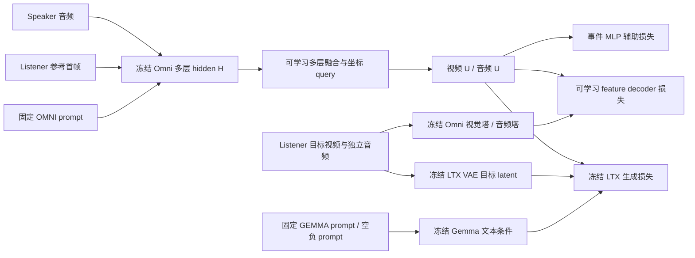

# P2 特征抽取代码与缓存交接

更新：2026-10-25。范围：当前 **audio-driven-v5 listen-only P2**，包含离线冻结特征、训练时可学习融合、真实样本缓存和接手命令。入口：[总索引](../README.md)。

最先看 [src/p2_listen/features.py](../src/p2_listen/features.py)，运行入口是 [scripts/p2_listen.py](../scripts/p2_listen.py) 的 `cache` 子命令。当前代码仍通过 `reuse_root=../audio-driven-v4` 复用底层模块，交接时必须保留 v4、v5 两个目录和现有 Python 环境，不能只复制 v5 的一个文件。

## 1. 哪些代码负责什么

下表路径从本文所在的 `related/` 目录解析；项目根目录为 `/private/liqi_workspace/project_code/audio-driven-v5`。

| 工作 | 文件与函数 | 重点 |
|---|---|---|
| 命令入口、split 与分片 | [scripts/p2_listen.py](../scripts/p2_listen.py)：`parser()`、`main()` 的 `cache` 分支 | `--part input/teacher/vae/text/events/all`；`--shards`、`--shard-index` |
| 离线抽取总调度 | [src/p2_listen/features.py](../src/p2_listen/features.py)：`cache_parts()` | 分阶段加载/释放冻结模型、校验和写缓存 |
| speaker 条件 hidden states H | 同文件：`extract_input()`、`image_grid()` | 读取 speaker 音频＋listener 参考图＋固定 prompt，返回 Omni 多层 H 与独立时间网格 |
| Omni 多模态前缀 | [src/p3_listen/features.py](../src/p3_listen/features.py)：**仅当前 P2 调用的 `prefix()`** | 编码输入音频/参考图、替换占位 embedding、构造位置及有效 mask；该文件其他 P3 缓存入口不是本次入口 |
| Omni 加载及选层 | [v4/src/omni_av_p2/data.py](../../audio-driven-v4/src/omni_av_p2/data.py)：`load_omni()`、`select_hidden_layers()` | 冻结 Thinker，选取内部 block 输出 |
| listener 目标特征 | [src/p2_listen/features.py](../src/p2_listen/features.py)：`extract_teacher()`、`sample_frames()` | listener 目标视频经视觉塔，独立 listener 音频经音频塔；仅用于训练监督 |
| 时间网格与音频聚合 | [src/p2_listen/layout.py](../src/p2_listen/layout.py)：`make_layout()`、`aggregate_audio()`、`geometry()` | 4 Hz 视觉时间组、8 Hz 音频 bin、有效支持及 LTX 帧数对齐 |
| LTX 视频/音频 VAE | [src/p2_listen/runtime.py](../src/p2_listen/runtime.py)：`encode_vae()`、`support_masks()`、`align_audio_latents()` | 512×512 目标编码、独立首帧条件、padding mask 和音频端点对齐 |
| 固定文本条件 | [v4/src/omni_av/ltx_runtime.py](../../audio-driven-v4/src/omni_av/ltx_runtime.py)：`NativeTextConditioner`、`load_text_modules()` | Gemma＋LTX embeddings processor；固定正 prompt 和空负 prompt 各一份 |
| 两份固定 prompt | [src/p3_listen/prompts.py](../src/p3_listen/prompts.py)：`OMNI`、`GEMMA`、`contract()` | 当前没有按样本生成文本事件计划 |
| 事件标签转时间监督 | [src/p2_listen/annotations.py](../src/p2_listen/annotations.py)：`rasterize()` | 事件 1、可用背景弱 0、不确定/padding mask；它不是预训练模型特征抽取 |
| 缓存写入/校验/读取 | [src/p2_listen/cache.py](../src/p2_listen/cache.py)：`save_part()`、`load_part()`；[features.py](../src/p2_listen/features.py)：`identity()`、`load_input()`、`load_training_sample()`、`load_text()` | 每部分独立身份，原子写入，SHA256 验证，拒绝混用陈旧缓存 |
| 清单和媒体检查 | [src/p2_listen/dataset.py](../src/p2_listen/dataset.py)、[contracts.py](../src/p2_listen/contracts.py) | 路径、媒体哈希、时长、角色字段、预裁剪尺寸和 split 分组 |
| 可学习 H→U 融合 | [v4/src/omni_av_p2/connector.py](../../audio-driven-v4/src/omni_av_p2/connector.py)：`LayerMemory`、`FusionConnector` | 每层归一化/投影、层 embedding、坐标 query 与 attention 融合，输出视听 U |
| 训练集成 | [src/p2_listen/model.py](../src/p2_listen/model.py)：`ListeningExtractor.forward()`；[training.py](../src/p2_listen/training.py) | 实时计算 U、feature decoder 损失与事件头，不能把 U 固定成离线训练缓存 |
| 推理集成 | [src/p2_listen/generation.py](../src/p2_listen/generation.py)：`generate()` | 读取 input/text；input 缺失时重新抽取；不读取 teacher/目标 VAE/events |

## 2. 数据流和角色约定



- **条件输入**：`speaker_audio` 是对方说话音轨；`listener_image` 是 listener 的参考首帧。整段 listener 目标音视频不能送进 H 抽取路径。
- **监督目标**：`target_video` 和 `target_audio` 都属于 listener。目标 Omni 特征与目标 VAE latent 只能进入训练损失。
- **不缓存 U**：H 固定缓存；融合模块、feature decoder、事件头在训练中更新，U 必须逐步重算。E0 的事件分支 detach U；E1 事件梯度进入 U。
- 当前读取整个样本窗口的 speaker 音频，输入 Transformer 保持原生因果 attention；这不等于已经实现逐时刻的在线流式可见性限制。

## 3. 使用的模型、环境与形状

当前训练特征基座是 **Qwen2.5-Omni-3B**，不是事件打标阶段使用的 Qwen3-Omni、Joy 或 MiniCPM。模型路径默认来自 [v4 Config](../../audio-driven-v4/src/omni_av_p2/config.py)，可在 v5 配置的 `extractor` 中显式覆盖。

| 资产 | 当前路径 |
|---|---|
| Python | `/private/liqi_workspace/project_code/Omni-LTX-stage2/.venv/bin/python` |
| Omni | `/public/2_CKPT/3_PreTRAINED/Qwen2.5-Omni-3B` |
| LTX | `/public/2_CKPT/2_AVATAR/LTX23/LTX_23/ltx-2.3-22b-dev.safetensors` |
| Gemma | `/public/2_CKPT/0_WM/LTX2.0_TEXT_ENCODER` |
| 当前弱背景配置模板 | [configs/p2_listen_weak_background_v1.json](../configs/p2_listen_weak_background_v1.json) |

已验证环境为 Python 3.13.12、Torch 2.9.1+cu128、Transformers 4.57.6、PyAV 16.1.0，见 [environment.json](../experiments/p2_listen_gpu_debug50_20261025/environment.json)。模型加载使用本地权重；无需在线下载。不要直接照搬 v4 默认采样率：当前 v5 配置明确覆盖为 `vision_fps=8`、`audio_hz=8`、`vision_max_pixels=50176`。

### 3.1 Omni 条件 H

选层 `[8,18,28,35]`，输出形状 `[B,4,N,2048]`，BF16；当前逐样本抽取，B=1，N 随音频和文本 token 数变化。HF `hidden_states[0]` 为 embedding，所选索引是内部 block 输出；末层归一化输出不能按当前约定混入。

H 保留整个多模态前缀 token 序列，不是先按 8 Hz 抽出四条时序向量。`hidden_valid` 的形状为 `[B,N]`；后续 query 从多层 memory 提取生成条件。默认融合宽度 512、深度 2、8 个 attention heads；输出 `U.video=[B,Nv,4096]`、`U.audio=[B,Na,2048]`。

### 3.2 listener teacher 与时间网格

视觉目标按 8 FPS 取帧，Omni 两帧一组，因此视觉时间组是 **4 Hz**，每组还保留空间 token。音频塔原生 token 按 40 ms 支持区间，与目标 125 ms bin 求重叠加权，得到 **8 Hz** 音频 teacher。两种 teacher 通道维均为 2048。

媒体应事先完成 listener 区域裁剪并 resize 为 **512×512**，目标视频 25 FPS。该抽取入口不接原画面＋裁框坐标，也不会自动辨认 listener。Omni 感知分支另外按 `vision_max_pixels` 和 patch 网格缩放；当前 512 方图对应约 224×224、8×8 合并空间网格。LTX VAE 分支仍使用 512×512。不要混淆训练媒体尺寸和 Omni 编码器内部尺寸。

`make_layout()` 只依赖时长、参考图几何和固定采样率，不依赖 listener 的动作、VAD 或标签。`*_valid` 表示 query 存在，`*_target_valid` 表示完整有效目标支持；两者不能互换。跨越真实尾部的 bin 不应当成背景负例。

### 3.3 本次实际抽检的张量

样本 `naturalistic_V02_S3394_I00000303_local_f0a7c70ff4da`，真实时长 2.001 秒；通过现有 `load_training_sample()` / `load_text()` 在 CPU 读取并核对缓存身份、payload 哈希，未初始化 CUDA。

| 内容 | 实测形状 |
|---|---|
| input hidden H | `[1,4,220,2048]` |
| video/audio coordinates | `[1,576,3]` / `[1,17,3]` |
| video/audio teacher | `[1,576,2048]` / `[1,17,2048]` |
| video/audio 时间区间 | `[1,9,2]` / `[1,17,2]` |
| 视频 VAE latent | `[1,128,8,16,16]` |
| 音频 VAE latent | `[1,8,57,16]` |
| 固定文本 video/audio | `[1,1024,4096]` / `[1,1024,2048]`，正/负各一组，并保留有效 mask |
| head_nod 的 y/known | 各 `[1,9]` |

LTX 将该样本补齐到 57 帧、2.28 秒，真实支持仍为 2.001 秒。视频尾部取最近帧、音频补零；损失由 support mask 排除无效尾部。首帧 latent 从参考图独立编码，不借用目标尾帧；音频 VAE 只允许移除有明确几何依据的额外端点 token，其他形状差异直接报错。

## 4. 现有数据、特征和验证结果在哪里

以下目录均相对项目根目录。**当前完整检查优先使用最新修复轮的配置**，它复用了历史冻结特征并配套新的弱背景事件缓存。

| 用途 | 路径 |
|---|---|
| 50 条真实样本媒体 | [experiments/listen_debug50_fullraw_20261025/media/](../experiments/listen_debug50_fullraw_20261025/media/) |
| 原始 observation / target 清单 | [observations.json](../experiments/listen_debug50_fullraw_20261025/observations.json)、[targets.debug.json](../experiments/listen_debug50_fullraw_20261025/targets.debug.json) |
| 弱背景派生可导入标签 | [derived/labels.admitted.json](../experiments/p2_listen_weak_background_validation_20261025/derived/labels.admitted.json)；仍带 debug 身份 |
| 原始冻结特征实体 | [experiments/p2_listen_gpu_debug50_20261025/cache/](../experiments/p2_listen_gpu_debug50_20261025/cache/) 下 `input/teacher/vae/text` |
| 当前组合配置 | [experiments/p2_listen_ddp_fix_v2_20261025/config.json](../experiments/p2_listen_ddp_fix_v2_20261025/config.json) |
| 当前组合缓存 | [experiments/p2_listen_ddp_fix_v2_20261025/cache/](../experiments/p2_listen_ddp_fix_v2_20261025/cache/)：四类冻结特征为符号链接，`events` 为本轮独立缓存 |
| 当前清单和标签 | 同轮 `manifests/observations.json`、`manifests/targets.json`、`labels/canonical/<sample_id>.json` |
| 首轮完整缓存检查 | [cache_validation.json](../experiments/p2_listen_gpu_debug50_20261025/cache_validation.json)，其中事件统计为旧正例-only 阶段 |
| 当前代码与 GPU 验收 | [最新 summary.json](../experiments/p2_listen_ddp_fix_v2_20261025/summary.json)、[修复报告](P2_单卡双卡数值一致性修复与验证.md) |

本次核对：input/teacher/vae/events 各 **50** 个 payload，text **1** 个。四类冻结 payload 合计约 **515.1 MiB**，当前事件 payload 合计约 **0.25 MiB**；不含媒体、元数据和训练检查点。不要把符号链接指向的公共实体误认为可随新实验一起清理的副本。

缓存目录结构：

```text
<config.output>/
  manifests/{observations,targets,admission}.json
  labels/canonical/<sample_id>.json
  cache/input/<sample_id>/{payload.pt,complete.json}
  cache/teacher/<sample_id>/{payload.pt,complete.json}
  cache/vae/<sample_id>/{payload.pt,complete.json}
  cache/events/<sample_id>/{payload.pt,complete.json}
  cache/text/{payload.pt,complete.json}
```

`complete.json` 包含完整 `contract`、其摘要 `identity` 和 `payload_sha256`。没有 complete 标记的部分视为未完成；身份不同或 payload 损坏会报错，不会偷偷覆盖为另一种特征。

## 5. 接手后怎么检查和运行

### 5.1 先检查现有结果，不占 GPU

```bash
cd /private/liqi_workspace/project_code/audio-driven-v5
P2_PY=/private/liqi_workspace/project_code/Omni-LTX-stage2/.venv/bin/python
P2_CFG=experiments/p2_listen_ddp_fix_v2_20261025/config.json

"$P2_PY" scripts/p2_listen.py audit --config "$P2_CFG" --suite config
"$P2_PY" scripts/p2_listen.py audit --config "$P2_CFG" --suite data

"$P2_PY" - <<'PY'
import sys
sys.path.insert(0, 'src')
from p2_listen.config import load, activate
from p2_listen.dataset import load_observations, load_targets
from p2_listen.features import load_training_sample, load_text
import torch
c = load('experiments/p2_listen_ddp_fix_v2_20261025/config.json')
activate(c)
o = load_observations(c)[0]
t = load_targets(c, [o])[o['sample_id']]
x, layout, teacher, av, events = load_training_sample(c, o, t, device='cpu')
text = load_text(c, device='cpu')
print(o['sample_id'], x.hidden.shape)
print('teacher:', teacher['video'].shape, teacher['audio'].shape)
print('VAE:', av['av']['latents']['latents'].shape,
      av['av']['audio_latents']['latents'].shape)
print('text:', text['positive']['video'].shape)
print('CUDA initialized:', torch.cuda.is_initialized())
PY
```

`audit --suite data` 检查媒体与清单，不替代特征 payload 检查；上面的读取脚本会走真实身份和校验和验证。50 条全部属于 train，没有可冒充独立 dev/test 的数据。

### 5.2 独立重建这批 50 条缓存

以下为交接运行示例，本次编写文档没有重新占 GPU 抽取。新配置和输出目录必须尚不存在；不要对现有验收目录重写清单或标签。

```bash
# 接续上节 cwd 和 P2_PY。
"$P2_PY" - <<'PY'
import json
from pathlib import Path
p = Path('configs/p2_listen_feature_rebuild50.json')
c = json.loads(Path('configs/p2_listen_weak_background_v1.json').read_text())
c['output'] = 'experiments/p2_listen_feature_rebuild50'
if Path(c['output']).exists():
    raise FileExistsError(c['output'])
with p.open('x') as f:
    json.dump(c, f, indent=2)
    f.write('\n')
PY
P2_CFG=configs/p2_listen_feature_rebuild50.json
"$P2_PY" scripts/p2_listen.py prepare --config "$P2_CFG" \
  --observations experiments/listen_debug50_fullraw_20261025/observations.json \
  --targets experiments/listen_debug50_fullraw_20261025/targets.debug.json
"$P2_PY" scripts/p2_listen.py import-labels --config "$P2_CFG" \
  --labels experiments/p2_listen_weak_background_validation_20261025/derived/labels.admitted.json

# 在实际分配且显存足够的 GPU 上执行。4 是物理卡示例，不表示它当前空闲。
CUDA_VISIBLE_DEVICES=4 "$P2_PY" scripts/p2_listen.py cache \
  --config "$P2_CFG" --part all --split train --device cuda:0
```

正式新数据替换上述 observation/target/label 文件，并使用新的配置和输出目录。数据契约与样例见 [examples/p2_listen/README.md](../examples/p2_listen/README.md)。`prepare` 要求已裁剪的 512×512、25 FPS 媒体，完整独立音轨、明确分组与准入状态；当前范围为真实时长至少 2 秒、LTX 对齐后最多 201 帧。超范围报错，不会自动截断。

只抽特定部分时，可把 `--part all` 换成对应值：

- `input`：只需 observation，不需要目标和事件标签。
- `teacher`：依赖目标；如果 input 缺失，会先抽 input。
- `text`：固定共享文本，不依赖样本清单。
- `vae`：依赖 observation 和目标，不依赖 Omni input 缓存。
- `events`：依赖已导入标签和 input/layout；不加载预训练模型，可指定 `--device cpu`。

`all` 的执行顺序是 input/teacher → text → vae → events。正式数据如有 dev/test，需对相应 split 显式运行；空 split 会报错。

### 5.3 分卡抽取和中断恢复

```bash
# 在两个终端或任务中同时执行；接续上节的新 P2_CFG。
CUDA_VISIBLE_DEVICES=4 "$P2_PY" scripts/p2_listen.py cache \
  --config "$P2_CFG" --part all --split train --device cuda:0 \
  --shards 2 --shard-index 0

CUDA_VISIBLE_DEVICES=5 "$P2_PY" scripts/p2_listen.py cache \
  --config "$P2_CFG" --part all --split train --device cuda:0 \
  --shards 2 --shard-index 1
```

分片规则为 `observations[shard_index::shards]`。每个样本只安排一个 writer，固定 text 只由 shard 0 写入；这不是带动态领取、跨进程锁和自动重试的全量任务队列。所有 shard 完成后再启动训练。

中断后以相同配置/清单重跑相同命令，已完成且身份一致的部分会跳过。注意 input/teacher 阶段即使已有缓存仍会先加载 Omni，再逐样本检查；`encode_vae()` 当前逐样本加载并释放视频/音频编码器。这些是现有实现的吞吐限制，文档没有将其描述为已优化的全量抽取服务。也没有从训练约 50 GiB 的显存占用推算各抽取阶段的最低显存。

## 6. 修改与复用时的注意点

1. **仅事件标签变化**：新建标签/事件缓存版本，核验后复用 input/teacher/vae/text。旧 canonical 标签不可原地改写。当前最新验收目录就是这一复用方式的实例。
2. **speaker 音轨、参考图、时长或几何变化**：按当前身份规则重建相关缓存，不通过改 marker 绕过检查。input identity 不包含 target/标签，但其他部分也绑定 observation 输入身份，失效策略有意保守。
3. **层、模型、prompt 或抽取代码变化**：使用新缓存版本。identity 记录抽取配置、prompt、相关代码哈希和模型资产信息。大型权重主要记录大小/mtime，JSON 配置另有 SHA256；不是逐样本重新哈希全部大权重。训练 checkpoint 还绑定更完整的源码与资产身份。
4. **缓存损坏或身份不一致**：先定位原因，在独立版本重建；不要直接改 `complete.json` 的摘要或删掉失败保护。
5. **推理隔离**：使用当前 `generation.py`，只允许 source-only 条件和固定文本。input 缺失可现场抽取；身份不一致不会作为普通缺失静默重抽。不要通过加载整份 `load_training_sample()` 来简化推理代码。
6. **数值修复与缓存的关系**：最新确定性反向、FP64 梯度累加改动属于训练数值路径，没有改变这些冻结特征，所以已核验复用。105 项 CPU 回归和真实 E0/E1 单/双卡验收通过；这不等于重新抽过一轮全量特征或完成了生成质量评测。

交接阅读顺序：本文 → `features.py` → `prefix()` / v4 `load_omni()` → `layout.py` → v4 `connector.py`。训练与标签背景继续看 [实现与运行](P2_倾听事件监督实现与运行.md)、[弱背景派生说明](P2_弱背景标签派生实现与验证.md)、[最新数值验收](P2_单卡双卡数值一致性修复与验证.md)。
