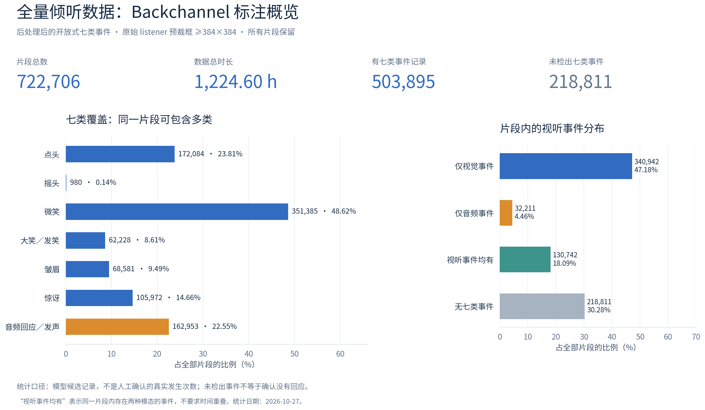
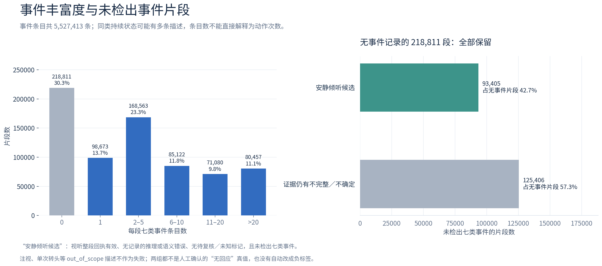
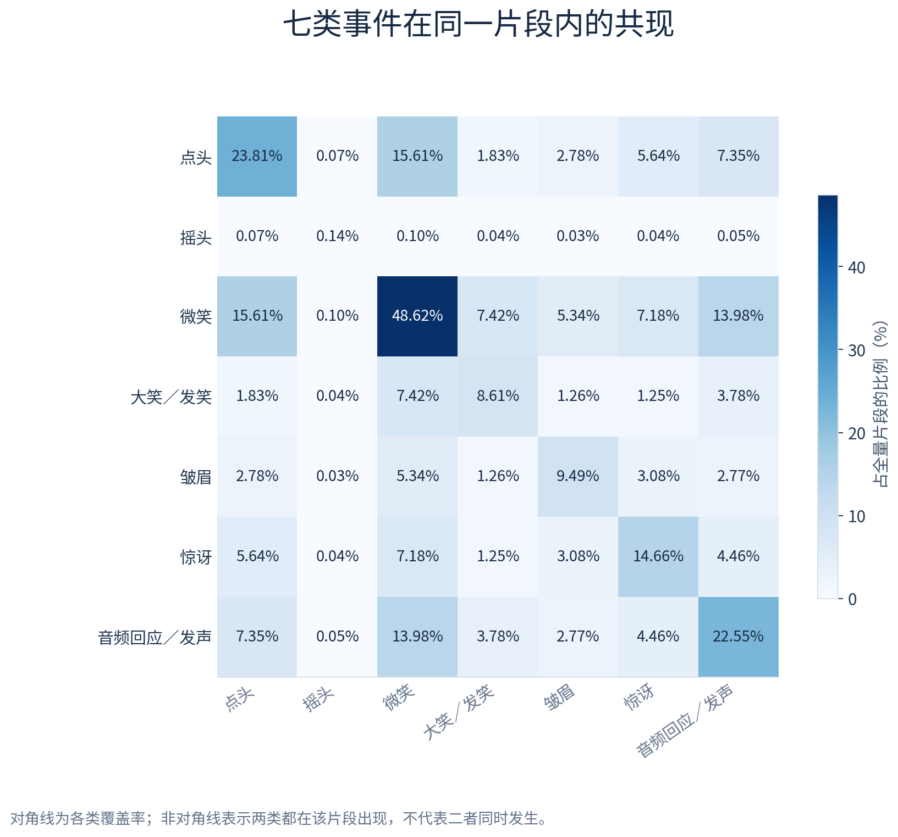

# 全量后处理数据 Backchannel 统计（2026-10-27）

## 可直接用于汇报的摘要

本轮在原始 listener 预裁框不小于 384×384 的数据上，完成 **722,706 段、1,224.60 小时**倾听数据的多模型标注、信息整合及音频后处理。后处理后的开放式七类记录共包含 **5,527,413 条候选事件**，覆盖 **503,895 段（69.72%）**；另外 **218,811 段（30.28%）未检出七类事件，全部保留**。数据覆盖六类视觉反应及一类音频回应，微笑最常见，摇头最稀有。所有结果均为模型弱标注，不作为人工真值或模型准确率结论。



## 一、范围与口径

- 只统计全量后处理目录中的 722,706 个唯一 train ID；不混入 50h 子集、独立 test 24 条或其他重复小样本。
- 这是用户后续确认的 crop≥384 范围，不是最初全部 1,419,124 段。时长是片段时长相加，不是源会话时间去重后的小时数。
- 平均片段长度 6.100 秒，中位数 5.683 秒。
- 本报告正文采用**后处理后的开放式七类事件记录**。canonical 是经过训练监督规则筛选的另一层标签，单列对照，避免混用。
- “事件数”是整合后的模型候选条目数；持续微笑等可被描述为多条，不能宣称真实发生了同样多次动作。未重新修改合并规则或描述原文。
- 音频只计算过滤后保留的区间；同一事件被静音切成多个支持区间时只计一次。重叠区间在时长统计中取并集。
- 没有删除任何片段，也没有修改训练准入或把未知改成负标签。全量 ID 在 [sample_ids_all.txt](sample_ids_all.txt)，无事件 ID 在 [no_open_event_ids.txt](no_open_event_ids.txt)。

| 来源 | 片段数 | 时长 | 有事件的片段数 |
|---|---:|---:|---:|
| naturalistic | 606,643 | 1,033.36 h | 415,631 |
| improvised | 116,063 | 191.24 h | 88,264 |

## 二、七类覆盖

| 类别 | 含该类的片段数 | 全量占比 | 候选事件条目数 |
|---|---:|---:|---:|
| 点头 | 172,084 | 23.81% | 439,958 |
| 摇头 | 980 | 0.14% | 1,287 |
| 微笑 | 351,385 | 48.62% | 4,054,357 |
| 大笑／发笑 | 62,228 | 8.61% | 231,610 |
| 皱眉 | 68,581 | 9.49% | 165,469 |
| 惊讶 | 105,972 | 14.66% | 346,307 |
| 音频回应／发声 | 162,953 | 22.55% | 288,425 |

一段可以含多类，所以各类片段数不能相加当作总片段数。大笑／发笑属于视觉类；音轨中的笑声计入音频回应／发声。

## 三、模态与丰富度

| 模态情况 | 片段数 | 全量占比 |
|---|---:|---:|
| 仅视觉事件 | 340,942 | 47.18% |
| 仅音频事件 | 32,211 | 4.46% |
| 同片段视听事件均有 | 130,742 | 18.09% |
| 无七类事件记录 | 218,811 | 30.28% |

上述视听共现只要求同片段两种模态都有事件。进一步按实际时间区间求交，有 101,705 段存在视听事件时间重叠，累计重叠支持时长 15.35 小时。

每段候选事件数：均值 7.65，中位数 2，p90=22，p95=36。条目多不等同于回应质量高，不能单凭该值评价模型效果。



最常见的互斥类别组合：

| 类别组合（恰好这些类别） | 片段数 | 全量占比 |
|---|---:|---:|
| 未检出七类事件 | 218,811 | 30.28% |
| 微笑 | 126,404 | 17.49% |
| 点头＋微笑 | 50,338 | 6.97% |
| 微笑＋音频回应／发声 | 35,252 | 4.88% |
| 音频回应／发声 | 32,211 | 4.46% |
| 点头 | 29,820 | 4.13% |
| 惊讶 | 24,118 | 3.34% |
| 点头＋微笑＋音频回应／发声 | 20,900 | 2.89% |
| 微笑＋大笑／发笑 | 17,936 | 2.48% |
| 微笑＋大笑／发笑＋音频回应／发声 | 13,859 | 1.92% |



## 四、无事件片段全部保留

共有 **218,811 段、335.31 小时**未检出七类事件。其中：

- **93,405 段、111.64 小时**：视听整段回执均有效，没有记录的推理／语义错误、待复核观察或未知区间，可作为“安静倾听候选”。仍然不是人工确认的无回应真值。
- **125,406 段、223.67 小时**：存在回执、待复核或未知状态等证据限制，继续保留，不能直接当作确认负例。

`unresolved_observations` 是上游容器名，其中 `out_of_scope` 只表示注视、单次转头等描述不属于当前七类，**本报告没有把它当成标注失败**。真正的 `needs_review` 或其他未决原因则保留为不确定性。

960 段未获原训练标签准入的样本也全部保留在统计中，见 [unadmitted_ids.txt](unadmitted_ids.txt)。其中 **837 段仍有开放式事件，123 段没有七类事件记录**，与“没有回应”的集合不是同一概念。当前训练读取仍遵守原标记，本次没有更改训练损失或数据读取准入逻辑。

## 五、音频后处理与 canonical 对照

- 693,997 段更新音频，28,709 段原样复用；没有生成新的静音版 WAV。
- 494,861 段按官方区间规则得到全静音支持。这个数与“没有音频事件标签”不同：有保留的官方发声区间，也可能没有模型事件标签。
- 开放式保留音频事件 288,425 条，覆盖 162,953 段；canonical 保留 262,642 个音频源事件，覆盖 147,596 段。
- canonical 共 5,309,009 个源事件；序列化时间段条目为 5,314,554 条。两者差 5,545 条来自同一音频事件的分段支持，不计为新增发声。

| 类别 | 开放式记录：片段数 | canonical：片段数 | canonical：事件数 |
|---|---:|---:|---:|
| 点头 | 172,084 | 165,589 | 424,678 |
| 摇头 | 980 | 955 | 1,255 |
| 微笑 | 351,385 | 339,648 | 3,901,524 |
| 大笑／发笑 | 62,228 | 60,404 | 225,382 |
| 皱眉 | 68,581 | 66,132 | 159,913 |
| 惊讶 | 105,972 | 102,129 | 333,615 |
| 音频回应／发声 | 162,953 | 147,596 | 262,642 |

## 六、汇报文件与复现

- [概览 PNG](figures/01_overview.png)／[SVG](figures/01_overview.svg)／[PDF](figures/01_overview.pdf)：可直接插入幻灯片。
- [分布 PNG](figures/02_event_distribution_and_no_event.png)／[SVG](figures/02_event_distribution_and_no_event.svg)；[共现 PNG](figures/03_class_cooccurrence.png)／[SVG](figures/03_class_cooccurrence.svg)。
- [七类汇总 CSV](class_statistics.csv)、[逐片段 CSV](samples.csv)、[完整统计 JSON](summary.json)、[完成与校验](COMPLETE.json)。
- [统计代码](../../scripts/report_postprocessed_backchannels.py)、[图表与本文生成代码](../../scripts/render_backchannel_corpus_report.py)。

读取并核验 20,666 个源任务，逐条校验开放记录和 canonical 身份，最终 ID 与 scope 完全一致；canonical 七类覆盖、音频数量和准入数量与原全量验收精确对齐。报告没有改写上游数据。源验收 SHA：`def7b99c7b2187e72d214c25398a6f5b18c440455b259a68bdf86cf23fe6d75c`。

```bash
python scripts/report_postprocessed_backchannels.py \
  --run experiments/p2_full_audio_postprocess_crop384_20261026 \
  --output experiments/p2_full_backchannel_report_20261027 --workers 16
python scripts/render_backchannel_corpus_report.py experiments/p2_full_backchannel_report_20261027
```
