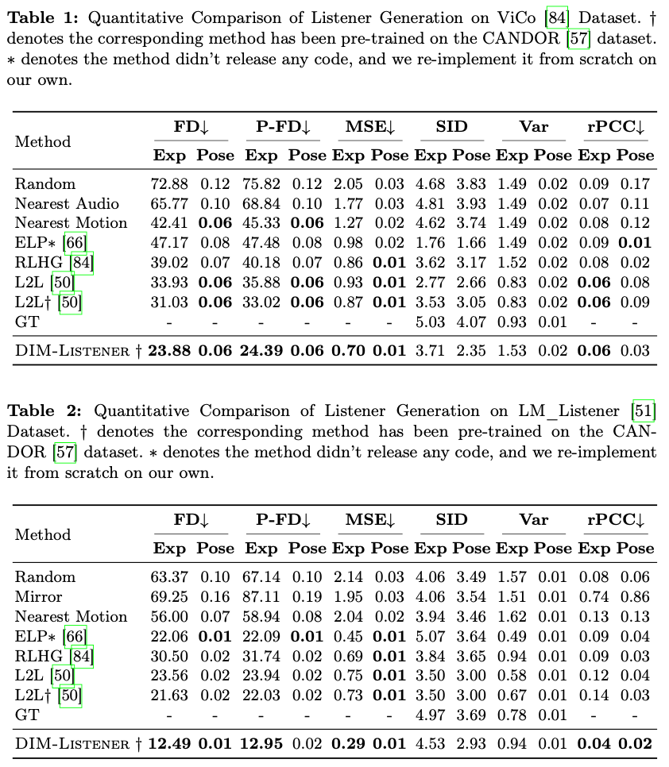

# Writing 

# 1、OmniHuman\-1\.5: Instilling an Active Mind in Avatars via Cognitive Simulation

OmniHuman\-1\.5 的对比实验与作者解释，可以概括为：

**作者的主要论点：提升重点在“动作更符合语义、看起来更自然”，而非所有画质或口型指标都更高。**

# 2、OmniCharacter: Towards Immersive Role\-Playing Agents with Seamless Speech\-Language Personality Interaction

**音频信息消融**：比较完整音频与仅转写文本，检验语调、节奏等非文本信息是否帮助生成恰当反馈。

**主观评测的拆分方式**：把自然度、情绪适切性、声音清晰度分别评分，避免一个总体偏好分数掩盖问题。

意思是：**保持说话内容相同，只改变模型能否听到声音，比较生成的倾听反馈。**

例如，说话人说：“我终于做完了。”转写文字相同，但声音可能是兴奋的，也可能是疲惫的；合适的听者反应可能不同。

对我们的任务，可以设置：

两组使用相同测试样本，比较**反馈的情绪适切性、行为选择和触发时机**。若完整音频组更好，说明声音中超出文字内容的信息对任务有帮助。

但要注意两点：

- **时机比较需要控制时间信息。** 普通转写没有时间戳，若直接比较，就混合了“失去语调”和“失去时间定位”两个因素。可给文本组提供词级时间戳，尽量控制这一差异。

- **不能把差异直接归因于语调。** 音频还包含停顿、笑声、呼吸等信息。这项消融检验的是“额外声学信息整体是否有用”；要单独研究语调，需要进一步控制。

另外，我上一条说的是**可以借鉴并改造成我们实验的思路**。OmniCharacter 的有无音频对比评估角色对话质量，并没有直接验证“生成的倾听反馈是否更恰当”。

# 3、OmniAvatar: Efficient Audio\-Driven Avatar Video Generation with Adaptive Body Animation

# 4、Avatar Forcing: Real\-Time Interactive Head Avatar Generation for Natural Conversation

Table 4 测的是纯倾听头部画面，比 Table 1 更靠近你的任务，但这组指标仍然盖不住「speaker audio \+ listener 首帧 → 听众 backchannel 音视频」。

四项都用 SPECTRE 抽出的 3DMM：表情 50 维，头部姿态 6 维。Exp 是表情，Pose 是姿态。RLHG、L2L、DIM 的数字是从 DIM 论文转引的，不是 Avatar Forcing 自己重跑的。

**FD（越低越好）**  

生成听众和真人听众的系数分布有多远。分别对表情、姿态算均值和协方差，再算 Fréchet 距离。它不看某一帧有没有对准对方的重音，只看整段系数的分布像不像真人。

**rPCC（越低越好）**  

和 Table 1 相同：生成听众与对方的相关，减去真人听众与对方的相关，取绝对值。这里的「对方」是说话人的脸部表情和姿态。

**SID（越高越好）**  

动作种类的香农指数。表情聚类 $K=15$，姿态 $K=9$。

**Var（越高越好）**  

系数沿时间的方差，再对维度取平均。这张表里姿态方差大家都很低，RLHG、L2L、DIM 是 0\.02，INFP 和 Avatar Forcing 是 0\.03，几乎分不开。

对你这个输入输出，只有 FD 勉强能留作画面分布的旁证。测试集里只要有真人听众视频就能算，不要求模型看见对方的脸。它仍然不看反应类型、起止，也不看生成的「嗯、啊」。

rPCC 不合适。它把说话人的表情和姿态当成对照，而这些不在你的输入里。对方只是无声地笑一下，模型无法跟随，分数仍会变差。

SID 和 Var 仍然只表示动得多不多、种类散不散。Var\-Pose 在这张表上没有区分度。乱晃头会显得更好。

ViCo 上的倾听任务本身也比你的窄：输入通常还有说话人的脸，输出只有听众的头，没有听众自己的反馈声音，也不要求用一张首帧保住身份。

# 5、ARIG: Autoregressive Interactive Head Generation for Real\-time Conversations

身份不重合的 listen 测试片段作为主测试集；FID/FVD＋CSIM 评价生成质量，FD＋RPCC 辅助评价视觉行为，事件评价＋主观评价验证反馈是否恰当。ViCo 用作视觉补充，HDTF 可不做。

# 6、OmniResponse: Online Multimodal Conversational Response Generation in Dyadic Interactions

# 7、Diffusion\-based Realistic Listening Head Generation via Hybrid Motion Modeling

# 8、DIM: Dyadic Interaction Modeling for Social Behavior Generation

# 9、CustomListener: Text\-guided Responsive Interaction for User\-friendly Listening Head Generation

**是 ViCo 官方原本就有的划分，CustomListener 沿用了它，并非作者重新划分。**

ViCo 官方项目页面的元数据字段 `data_split` 明确列出了 `train、test、ood` 三种取值。[Mohan's Projects](https://project.mhzhou.com/vico/?utm_source=chatgpt.com)

**CustomListener 自己增加的是文本信息**：在已有 ViCo 划分上补充说话内容转录、听者反应的文本描述，构建支持文本条件的扩展版本。因此，“扩展数据集”指增加标注，不是新建这套 train/test/ood 划分。[openaccess\.thecvf\.com](https://openaccess.thecvf.com/content/CVPR2024/papers/Liu_CustomListener_Text-guided_Responsive_Interaction_for_User-friendly_Listening_Head_Generation_CVPR_2024_paper.pdf?utm_source=chatgpt.com)

# 10、Learning and Evaluating Human Preferences for Conversational Head Generation

研究的是“如何评价生成结果更符合人的偏好”

# 11、Emotional Listener Portrait: Realistic Listener Motion Simulation in Conversation

# 12、Multiple Appropriate Facial Reaction Generation in Dyadic Interaction Settings: What, Why and How?

**3．它提出哪些评价指标？**

