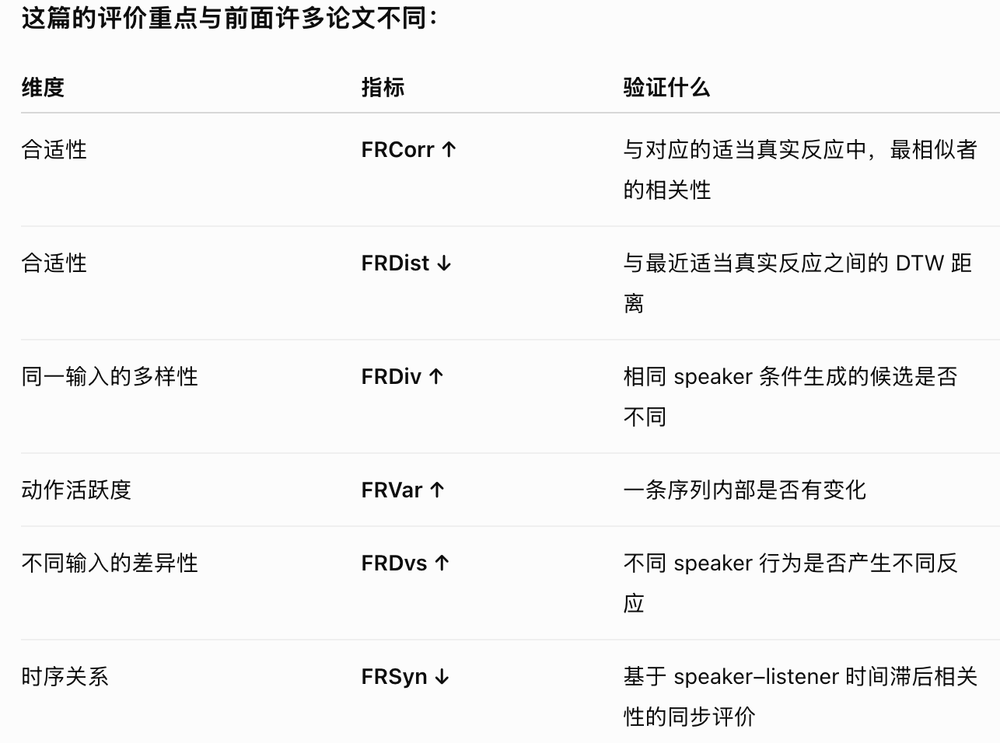

# 评测v2

Responsenet 交接说明在：

`/private/liqi_workspace/project_code/audio-driven-v5/evaluation/responsenet_speaker_j/HANDOFF.md`

|||||||GLARE: Generating Listening Heads with  Appropriate REactions||||||ANYTALKER ||||||
|---|---|---|---|---|---|---|---|---|---|---|---|---|---|---|---|---|---|
||||||CPBD ↑ |**PSNR ↑** |**SSIM ↑** |**FID ↓**|**FVD ↓** |**LPIPS ↓**|**UTMOS\_v2 ↑** |**Emo\-Acc ↑：表情类别一致率** |**Emo\-Div：表情类别多样性**|**ΔResp ↓：倾听动作幅度与 GT 的差距** |**MLLM reaction detection rate：互动动作检出率**|**人工反应标注／自然度偏好**|待定|
|GLARE: Generating Listening Heads with  Appropriate REactions |GLARE: Generating Listening Heads with  Appropriate REactions比较的5个方法|已经开源权重和推理代码，可以直接推理测试|**L2L / Learning to Listen @boxian**|**Learning to Listen: Modeling Non\-Deterministic Dyadic Facial Motion**||||||||||||||
||||**ListenFormer** @boxian|**ListenFormer: Responsive Listening Head Generation with Non\-autoregressive Transformers**||||||||||||||
||||**DyStream** @boxian|**DyStream: Streaming Dyadic Talking Heads Generation via Flow Matching\-based Autoregressive Model**||||||||||||||
|||||||||||||||||||
|||没有权重，但是有开源代码，可以重新训练之后推理测试（暂缓） |**ViCo baseline**|**Responsive Listening Head Generation: A Benchmark Dataset and Baseline**||||||||||||||
||||**DIM**|**Dyadic Interaction Modeling for Social Behavior Generation**||||||||||||||
|||||||||||||||||||
||很相近的工作，必须比较|有训练代码，用我们的数据重新训练|**GLARE **@林莉淇|**GLARE: Generating Listening Heads with Appropriate REactions**||||||||||||||
|||||||||||||||||||
||开源了，比较看看|已经开源权重和推理代码，可以直接推理测试|Avatar\-Forcing @boxian|||||||||||||||
||||DualTalk@boxian|||||||||||||||
|||||||||||||||||||
|||||||||||||||||||
|||||||||||||||||||
|||||||||||||||||||
||||**DiTaiListener** |**DiTaiListener: Controllable High Fidelity Listener Video Generation with Diffusion**||||||||||||||
||||DiffListener|Diffusion\-based Realistic Listening Head Generation via Hybrid Motion Modeling||||||||||||||
||||ELP|Emotional Listener Portrait: Realistic Listener Motion Simulation in Conversation（ELP，ICCV 2023）||||||||||||||
||||RLHG（vico）|Responsive listening head generation: a benchmark dataset and baseline\. ||||||||||||||
||||PCH |Percep\-tual conversational head generation with regularized driver and enhanced renderer\. ||||||||||||||
||||MFR\-Net  |Mfr\-net: Multi\-faceted responsive listening head generation via denoising diffusion model\.||||||||||||||
||||CustomListener |Customlistener: Text\-guided responsive inter\-action for user\-friendly listening head generation\.||||||||||||||
||||ReactFace|\[TVCG 2024\] ReactFace: Online Multiple Appropriate Facial Reaction Generation in Dyadic Interactions||||||||||||||
||||ARIG|||||||||||||||
||||ECHO|ECHO: Towards Emotionally Appropriate and Contextually Aware Interactive Head Generation||||||||||||||
|||||||||||||||||||
|||||||||||||||||||
|OMNIPERSONA: PERSONA\-EMBODIED AGENTS FOR MULTIMODAL CONVERSATIONAL INTERACTION |||**SpeakerVid\-5M**|**SpeakerVid\-5M: A Large\-Scale High\-Quality Dataset for Audio\-Visual Dyadic Interactive Human Generation**||||||||||||||
||||**OmniResponse**|**OmniResponse: Online Multimodal Conversational Response Generation in Dyadic Interactions**||||||||||||||
|||||||||||||||||||
|||||||||||||||||||
|||||||||||||||||||
||||ViCo test/ood|L2L\-trevor （LLM\-driven Multimodal and Multi\-Identity Listening Head Generation） https://github\.com/sanjayss34/lm\-listener\#data\-preparation||||||||||||||
||||Latent Behavior Diffusion for Sequential Reaction Generation in Dyadic Setting| ||||||||||||||

|||||||||||||||||
|---|---|---|---|---|---|---|---|---|---|---|---|---|---|---|---|
|||||GLARE: Generating Listening Heads with  Appropriate REactions||||||ANYTALKER ||||||
||||CPBD ↑ |**PSNR ↑** |**SSIM ↑** |**FID ↓**|**FVD ↓** |**LPIPS ↓**|**UTMOS\_v2 ↑** |**Emo\-Acc ↑：表情类别一致率** |**Emo\-Div：表情类别多样性**|**ΔResp ↓：倾听动作幅度与 GT 的差距** |**MLLM reaction detection rate：互动动作检出率**|**人工反应标注／自然度偏好**|待定|
|GLARE: Generating Listening Heads with  Appropriate REactions |**L2L / Learning to Listen**|**Learning to Listen: Modeling Non\-Deterministic Dyadic Facial Motion**||||||||||||||
||**DIM**|**Dyadic Interaction Modeling for Social Behavior Generation**||||||||||||||
||**ViCo baseline**|**Responsive Listening Head Generation: A Benchmark Dataset and Baseline**||||||||||||||
||**ListenFormer**|**ListenFormer: Responsive Listening Head Generation with Non\-autoregressive Transformers**||||||||||||||
||**DyStream** |**DyStream: Streaming Dyadic Talking Heads Generation via Flow Matching\-based Autoregressive Model**||||||||||||||
||**GLARE**|**GLARE: Generating Listening Heads with Appropriate REactions**||||||||||||||
||**DiTaiListener** |**DiTaiListener: Controllable High Fidelity Listener Video Generation with Diffusion**||||||||||||||
||DiffListener|Diffusion\-based Realistic Listening Head Generation via Hybrid Motion Modeling||||||||||||||
||ELP|Emotional Listener Portrait: Realistic Listener Motion Simulation in Conversation（ELP，ICCV 2023）||||||||||||||
||RLHG（vico）|Responsive listening head generation: a benchmark dataset and baseline\. ||||||||||||||
||PCH |Percep\-tual conversational head generation with regularized driver and enhanced renderer\. ||||||||||||||
||MFR\-Net  |Mfr\-net: Multi\-faceted responsive listening head generation via denoising diffusion model\.||||||||||||||
||CustomListener |Customlistener: Text\-guided responsive inter\-action for user\-friendly listening head generation\.||||||||||||||
||ReactFace|\[TVCG 2024\] ReactFace: Online Multiple Appropriate Facial Reaction Generation in Dyadic Interactions||||||||||||||
||ARIG|||||||||||||||
||ECHO|ECHO: Towards Emotionally Appropriate and Contextually Aware Interactive Head Generation||||||||||||||
|||||||||||||||||
|||||||||||||||||
|OMNIPERSONA: PERSONA\-EMBODIED AGENTS FOR MULTIMODAL CONVERSATIONAL INTERACTION |**SpeakerVid\-5M**|**SpeakerVid\-5M: A Large\-Scale High\-Quality Dataset for Audio\-Visual Dyadic Interactive Human Generation**||||||||||||||
||**OmniResponse**|**OmniResponse: Online Multimodal Conversational Response Generation in Dyadic Interactions**||||||||||||||
|||||||||||||||||
|||||||||||||||||
|||||||||||||||||
||ViCo test/ood|L2L\-trevor （LLM\-driven Multimodal and Multi\-Identity Listening Head Generation） https://github\.com/sanjayss34/lm\-listener\#data\-preparation||||||||||||||
||Latent Behavior Diffusion for Sequential Reaction Generation in Dyadic Setting| ||||||||||||||

