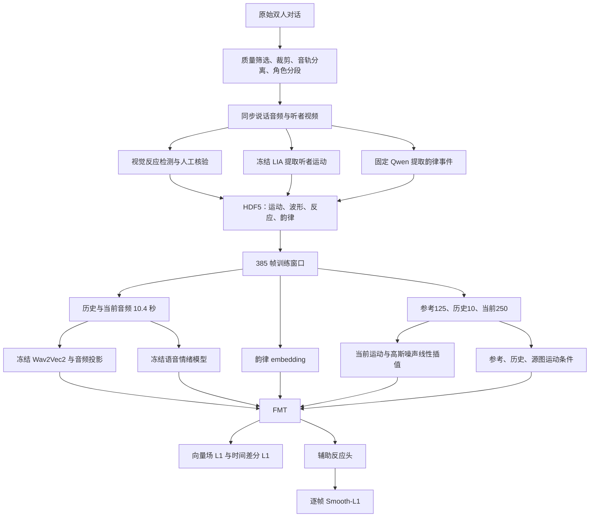
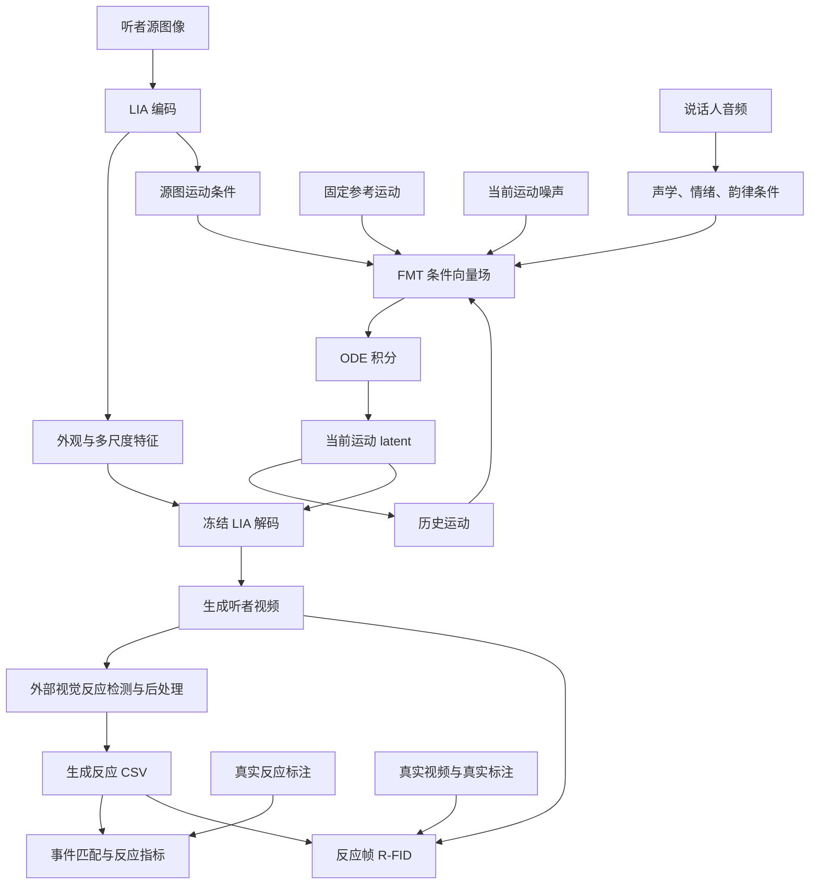

# GLARE：论文与发布代码详细分析

记录日期：2026-10-21。

本文用于记录 GLARE 的任务定义、数据处理、模型结构、训练目标、推理数据流、评测协议，以及论文与当前发布代码之间的差异，供后续研究、实现和复现参考。

## 1. 分析依据与结论边界

### 1.1 核对材料

- 论文：[00_GLARE_local.pdf](00_GLARE_local.pdf)，共 30 页，技术内容主要在正文第 1–9 页和附录第 13–22 页。
- 代码：[glare](glare)。
- 核对的 Git commit：`26f621e1620066885828d01739437beb71ed5204`，简写 `26f621e`。
- 重点阅读文件：数据集、参数定义、`FLOAT.py`、`FMT.py`、LIA 编解码、Qwen 韵律提取、训练入口、推理入口以及 `eval/`。

本文区分三类结论：

1. **论文描述**：作者在论文中声明的方法或实验设置。
2. **代码事实**：当前 commit 中可以直接追踪到的实现行为。
3. **分析判断**：根据实现推导出的影响，不等于已完成大规模实验验证。

已经进行的验证包括：提取实际音频编码接口检查梯度；使用实际反应头定义检查输出约束；使用合成 HDF5 调用实际数据读取方法；调用实际事件评测函数核对阈值和聚合行为。

**没有执行完整 GLARE 训练、带预训练权重的视频生成或论文数据集上的指标复现。** 当前本地仓库不包含对应训练 HDF5、完整模型权重和固定参考运动文件。第 1–16 节的初次分析未审查 README 链接的独立视觉反应标注仓库；后续已补充审查，其代码事实和复用建议记录在第 17 节。

当前发布代码与论文存在实质差异，并有影响复现的实现问题。因此，不能把当前 commit 的所有实现细节直接视为论文实验实际使用的配置，也不能根据发布代码的问题反推作者私有实验代码必然具有相同问题。

### 1.2 核心理解

GLARE 是一个**在听者运动 latent 空间内进行条件 Flow Matching 的视频生成系统**。

输入包括说话人的音频、听者源图像、参考运动片段和历史运动。模型生成当前片段的听者运动 latent，再使用冻结的 LIA 解码器恢复视频。音频提供声学特征、情绪和韵律条件；训练时的逐帧反应标签通过辅助预测头约束 FMT 隐藏表示。

它没有显式实现“语言理解 → 决定反应类别 → 调用某类动作生成器”的离散决策流程。反应类型和时机主要由条件运动模型隐式学习。

论文贡献分为三部分：

| 贡献 | 内容 |
|---|---|
| 数据 | 双人对话配对、听者反应的逐帧分数和事件级标注 |
| 模型 | 在 FLOAT 风格生成框架上增加运动参考上下文、韵律条件及反应监督 |
| 评测 | 联合衡量反应匹配、时序偏差与反应区域视觉质量 |

## 2. 任务定义与输入输出

### 2.1 任务

给定说话人的音频，生成另一位参与者正在倾听时的面部视频，使其在合适的时刻表现出点头、摇头、微笑、大笑、皱眉或惊讶等非语言反馈。

与说话人视频生成相比，听者运动和输入音频之间的关系更弱，也有多种合理解。相同音频可能对应不同反应类型、强度和延迟。

### 2.2 必须区分的输入

| 输入 | 实际含义 | 用途 |
|---|---|---|
| 听者源图像 `S` | 一张人物图像 | 提供外观、多尺度图像特征和源图像运动条件 |
| 源图像运动条件 `wr` | 单个 512 维运动向量 | 重复到时间轴，进入条件拼接 |
| 参考运动 `ref_x` / `ref_r_s` | 默认 125 帧运动序列 | 作为额外运动 token 前缀 |
| 历史运动 `prev_x` | 默认前 10 帧运动 | 支持片段间连续性 |
| 说话人音频 | 16 kHz 波形 | 提供声学、情绪、韵律条件 |

`wr` 和 `ref_x` 不是同一输入。单张身份参考图像也不等于论文附录中的参考视频片段。

标准推理输出为 25 FPS、512×512 的听者视频，代码还支持保存生成的运动 latent。合成视频可附带说话人的音轨，但这不意味着生成的是说话人动作。

## 3. 原始数据构建：论文描述

依据：正文 §3，附录 A/B，PDF 第 3–4、13–16 页。

### 3.1 数据来源与规模

| 数据来源 | 原始规模 | 原始分辨率 |
|---|---:|---|
| RealTalk | 694 个视频 | 1080P |
| Seamless Interaction | 65k+ 个视频 | 4K |

论文报告的最终数据包含 107,149 对说话音频／听者视频片段、约 147 小时、64,557 个反应事件。

| 反应 | 事件数 |
|---|---:|
| 点头 nodding | 10,230 |
| 摇头 head shaking | 12,790 |
| 微笑 smiling | 15,767 |
| 大笑 laughing | 8,320 |
| 皱眉 frowning | 9,986 |
| 惊讶 surprised | 7,464 |
| 合计 | 64,557 |

片段数不等于反应事件数。当前代码目录没有训练 HDF5，以上数量只能作为论文报告值，不能视为已独立核验。

### 3.2 视频筛选和裁剪

1. 每隔 2.5 秒抽帧，制作缩略图检查。
2. 剔除频繁切镜、黑屏、无关画面、严重遮挡、多人重叠等视频。
3. 进行第二轮质量检查。
4. 对每名参与者，在第一个有效人脸帧上使用 Face-Alignment 获取人脸区域。
5. 将 bounding box 放大 1.5 倍，固定该区域裁剪整段视频。
6. 对裁剪结果重新检测人脸和关键点，剔除缺脸、半脸、严重侧脸和异常比例等样本。

论文描述的是固定区域裁剪，没有给出完整的逐帧动态裁剪方案。

注意：推理入口 `generate.py` 的单张图像裁剪使用约 1.6 的放大系数。这是推理图像预处理，不应与论文数据集制作时的 1.5 倍裁剪混为一谈。

### 3.3 音频处理和说话／倾听配对

RealTalk：Asteroid 音源分离 → 降噪 → 人工检查严重分离失败 → PyAnnote 估计每个参与者的语音活动时间。

Seamless：优先使用已有音轨和 diarization，边界不准确时进行修正。

根据说话主导区间构建同步配对：

```text
A 说话的音频时间段 ↔ 同一时间 B 的听者视频
B 说话的音频时间段 ↔ 同一时间 A 的听者视频
```

这里保留原始对话时间同步。论文没有描述先人为平移听者视频，再让动作与音频线索机械对齐。

对无效音频、有效语音过短、视频缺帧、听者人脸不清晰等片段进一步过滤。统一视频 25 FPS、音频 16 kHz、图像 512×512、图像值域 `[-1,1]`。

### 3.4 六类视觉反应标注

检测器对每个听者视频产生 `r ∈ [0,1]^(T×6)`。它组合关键点运动、头部姿态、面部 AU 和表情分析，而不是论文中完整给出结构的单一端到端六分类网络。

| 类别 | 主要视觉线索 |
|---|---|
| 点头 | 归一化垂直头部轨迹、上下极值、速度零交叉、速度和加速度 |
| 摇头 | 水平头部轨迹、左右交替极值、yaw 相关变化 |
| 微笑 | happy 表情置信度、微笑相关 AU、嘴角运动 |
| 大笑 | 微笑信号、张嘴、高强度 happy、更强面部运动 |
| 皱眉 | 负面表情、AU04 眉毛下压、嘴角下垂 |
| 惊讶 | 惊讶表情、抬眉、睁眼、张嘴 |

点头检测使用稳定关键点估计垂直头部中心，按脸部尺度归一化，填补缺失轨迹，使用约 0.1 秒窗口的 Savitzky–Golay 滤波，寻找峰谷和运动周期。事件强度由幅度、速度、加速度、平滑性和接近约 0.5 秒名义周期等因素决定，再转成中心较高的逐帧分数。

之后进行阈值处理、连续段提取、短事件过滤和短间隔合并。六类阈值均为 0.5，具体边界实现应以所用检测器版本为准。

最终事件为单标签，跨类别重叠通过保留优势反应、裁剪或删除较低置信度候选解决。模糊情况由人工核验删除。

因此，真实的“边点头边微笑”会被简化。人工核验主要减少已检测候选的误报；论文没有明确说明是否全面补标检测器遗漏的事件。

### 3.5 当前仓库覆盖范围

本地 GLARE 仓库主要从已经预处理好的 HDF5 开始训练。README 将视觉反应标注流程链接到独立仓库：<https://github.com/lzk901372/visual_reaction_annotation>。

当前目录没有提供原始双人视频筛选、分离、完整标注、HDF5 制作到全部论文指标的一键流水线。`float/utils.py` 包含 LIA latent 提取辅助函数，但不等于完整数据集构建脚本。

## 4. 训练数据格式与实际采样

依据：[VideoDataset.py](glare/float/data/VideoDataset.py)、[base.py](glare/float/data/base.py)、[dataset.py](glare/float/data/dataset.py)、[train_multigpu.py](glare/train_multigpu.py)。

### 4.1 HDF5 结构

```text
dataset.h5
├── r_s/video_id/chunk_000
├── audio/video_id/chunk_000
├── reaction/video_id/chunk_000
└── intensity/video_id/chunk_000
```

默认存储 chunk 为 60 帧，即 2.4 秒：

| 字段 | 内容 | 默认预期形状 |
|---|---|---|
| `r_s` | 预提取的听者 LIA 运动 latent | `[60,512]` |
| `audio` | 说话人音频波形 | `[38400]`，或读取后可 squeeze 成该形状 |
| `reaction` | 六类逐帧置信度 | `[60,6]` |
| `intensity` | 逐帧韵律强度 | `[60]` |

`reaction` 的代码注释有 `[T,1]` 的残留，但模型断言要求与 `[B,Tcur,6]` 的预测形状一致，应以实际消费者为准。

**音频字段是波形，不是 `[T,512]` 的预提取音频特征。** loader 按采样点切片，并在模型前向中再次调用 Wav2Vec2。README 关于预处理音频特征的文字不能覆盖这一代码事实。

训练 loader 不执行 Wav2Vec2 输入标准化；实际 HDF5 波形是否已经标准化，必须核对制备过程。推理入口会调用 `Wav2Vec2FeatureExtractor`。

### 4.2 三个时间尺度

| 时间尺度 | 默认设置 | 含义 |
|---|---:|---|
| HDF5 存储 chunk | 60 帧 | 数据存储和索引单元 |
| 模型当前片段 `Tcur` | 250 帧 | 每次生成 10 秒运动 |
| 完整训练窗口 | 385 帧 | 历史＋当前＋参考 |

以 README 的 `wav2vec_sec=10`、`num_prev_frames=10`、`num_ref_frames=125` 为准：

```text
Tprev = 10       = 0.4 秒
Tcur  = 10×25    = 250 帧 = 10 秒
Tref  = 125      = 5 秒
Tfull = 385      = 15.4 秒
```

单个样本／batch 形状：

```text
单样本：
r_s       [385,512]
audio     [246400]
reaction  [385,6]
intensity [385,1]

batch：
r_s       [B,385,512]
audio     [B,246400]
reaction  [B,385,6]
intensity [B,385,1]
```

loader 至少读取 `ceil(385/60)=7` 个连续 chunk，再截取 385 帧。索引阶段要求至少有相应数量的 chunk；不能把“生成 10 秒”理解为只需一个 10 秒训练视频。

### 4.3 数据划分

`VideoDataset.index_dataset()` 将 HDF5 中的 `video_id` 排序，使用种子 42 打乱，按 9:1 划分训练和验证。同一 video_id 的所有 chunk 进入同一个集合。

这保证 video_id 层面分离，但不自动保证人物独立、原始长视频独立或原始对话独立。若同一个人物／对话对应多个 video_id，代码没有额外分组约束。

RealTalk 和 Seamless 分别构建后由 `CombinedDataset` 直接拼接。主路径没有类别平衡或按来源平衡的采样器。

### 4.4 实际采样缺陷

`index_dataset()` 在遍历每个视频时只执行一次 `video_chunk_num[video_id] += 1`，而不是记录该视频的 chunk 数，因此该字典中的值实际上为 1。

随后 `__getitem__()` 根据这个值判断是否能读取额外 chunk 并随机选择起点。对正常非负 chunk_id，当前逻辑总走“从索引 chunk 起点开始”的分支。

结果：相邻索引样本仍然可以不同，但预期的 **chunk 内随机裁窗分支不会执行**。对同一索引重复读取，起点固定。合成 HDF5 检查验证了这一行为。

位置：`VideoDataset.py` L138–141、L178 附近。另一个目前被遮蔽的分支里还存在 `if f'scores/{chunk_path}':` 这种始终为真的字符串判断；修复采样索引时也应一起检查该分支。

### 4.5 路径与必需字段

RealTalk 和 Seamless 主训练类把 HDF5 路径写死在作者的 `/data/zikai/...` 目录中。单独修改 `--root_dir` 不会改变这两个路径。

当前主路径实际依赖完整的 `reaction` 和 `intensity` 数据：缺失强度时 loader 最终对列表调用 `unsqueeze` 会出问题；缺失反应时也不能满足模型六类形状断言。不能把这两个字段简单视为可选项。

## 5. LIA 运动表示与图像生成

依据：[encoder.py](glare/float/models/encoder.py)、[styledecoder.py](glare/float/models/styledecoder.py)、[FLOAT.py](glare/float/models/FLOAT.py)。

### 5.1 从图像得到运动 latent

默认 LIA 路径为：

```text
人脸图像
  → 外观编码器 net_app
  → 512 维外观表示 + 多尺度图像特征
  → motion fc
  → 20 维运动系数 α
  → Direction
  → 512 维运动 latent m
```

Direction 对一个 `512×20` 的可学习矩阵做 QR 分解，取得正交方向 Q，将运动系数映射为：

`m = α Qᵀ`，其中 `α ∈ R^20`、`Q ∈ R^(512×20)`。

**FMT 的生成空间是 512 维运动 latent。** `dim_m=20` 是 LIA 的运动系数维度，不是 FMT 输出维度。

### 5.2 解码生成视频

推理时，源图像编码得到外观 `s_r`、多尺度图像特征 `s_r_feats`，以及源图像运动条件。

对每个生成运动 `m_t`，执行：

`I_hat[t] = LIA.Dec(s_r + m_t, s_r_feats)`。

解码器通过源图像特征和学习到的形变恢复图像。代码并非只用一个身份向量直接生成所有像素，多尺度源图像特征也参与生成。

### 5.3 在训练中的角色

LIA 使用预训练参数并冻结。GLARE 训练时直接读取预计算运动 latent，不在每个 iteration 中编码真实视频或解码当前预测视频。

当前训练主路径没有像素重建、LPIPS 或 GAN 损失。论文中的 PSNR、LPIPS 等是评测指标，不是这里的训练目标。

## 6. 条件编码与 FMT 结构

### 6.1 声学条件

波形进入冻结的 Wav2Vec2。定制 `Wav2VecModel` 先将卷积特征线性插值到视频帧数，再送入后续编码。

默认拼接 12 层隐藏状态：

```text
waveform
  → Wav2Vec2 12 层隐藏状态
  → [B,T,12×768] = [B,T,9216]
  → Linear(9216,512) + LayerNorm + SiLU
  → wa: [B,T,512]
```

开启 `--only_last_features` 时才仅使用最后一层 768 维。

Wav2Vec2 主干参数被设为 `requires_grad=False`。音频投影虽然被列入优化器，但当前训练调用路径没有梯度，详见第 8 节。

### 6.2 情绪条件

语音情绪模型输出七类概率：angry、disgust、fear、happy、neutral、sad、surprise。

实际形状为 `[B,1,7]`，随后重复到历史＋当前的时间轴。

这不是逐帧独立提取的情绪变化序列。训练时从所选历史＋当前音频提取一个向量；推理时从 `sample()` 收到的整段音频提取一个向量。指定 `--emo` 时可以改用相应 one-hot 条件。

### 6.3 韵律条件

训练：HDF5 中预先保存的 `intensity` → embedding。模型构造函数中的 Qwen 初始化被注释，不在训练主路径加载 Qwen。

推理：`generate.DataProcessor` 加载 Qwen2-Audio-7B-Instruct，分析音频并输出韵律事件。

提示词要求关注音高、响度、重音、语速、节奏、犹豫、兴奋、惊讶等声音变化，明确要求不以词义为依据。输出格式：

```text
2.34, 3.29, 0.78
5.69, 7.29, 0.92
```

含义为开始秒数、结束秒数、强度。生成采用 `do_sample=False`，默认 `max_new_tokens=256`。

后处理会忽略不匹配格式、越界、结束早于开始和低于 0.5 的事件，并将强度裁到 `[0,1]`。时间展开相当于：

```python
scores[floor(start * fps):ceil(end * fps)] = intensity
```

未覆盖帧为零。虽然提示词要求无重叠，解析代码没有实现完整重叠事件合并；重叠帧由后写入的事件覆盖。

实际 embedding：

```text
[B,T,1] → Linear(1,4) → LayerNorm(4) → SiLU → [B,T,4]
```

**论文写的是 MLP＋Sigmoid，发布代码是 Linear＋LayerNorm＋SiLU。** 只有输入强度标量被限制在 `[0,1]`，输出四维 embedding 没有这个范围约束。

Qwen 没有直接输出应当点头还是微笑，也没有把其大规模隐藏特征送入 FMT；该分支只提供低维时间强度信号。

### 6.4 源图像运动条件

训练时从历史＋当前真实运动中随机选取一个运动 latent，得到 `[B,512]` 的 `wr`。这里没有实际加载源图像。

推理时 `wr` 由用户提供的源图像经过 LIA 得到。随后在时间轴重复，成为每帧条件的一部分。

### 6.5 输入 token 和条件的形状

默认无额外运动统计 token：

```text
运动输入：
[ref_x:125 | prev_x:10 | x_t:250]
  → [B,385,512]
  → Linear(512,1024) + 固定正弦位置编码
  → [B,385,1024]

历史＋当前条件：
wr 512 + wa 512 + we 7 + intensity 4
  → [B,260,1035]
  → Linear(1035,1024)
  → 加 flow 时间步 embedding
  → 前方补 125 帧全零条件
  → [B,385,1024]
```

参考段的零条件是在条件投影和 flow 时间 embedding 相加之后添加。因此参考 token 的条件不含对应音频，也不含该时间 embedding。

这是论文中 `Tprev+Tcur` 与 `Tfull` 条件长度不一致问题在代码中的具体处理方式。

### 6.6 FMT 主干

| 项目 | 默认配置 |
|---|---|
| 层数 | 8 |
| 隐藏维度 | 1024 |
| attention heads | 8 |
| MLP ratio | 4 |
| 位置编码 | 固定正弦编码 |
| 条件注入 | 逐帧 AdaLN，含 shift、scale 和 gate |
| 输出维度 | 512 |

每层为 DiT 风格的条件 self-attention 和条件 MLP。这里没有独立的音频 cross-attention 模块，音频等条件通过 AdaLN 调制运动 token。

默认 fused attention 路径的 mask：

- 普通帧可关注前后各 2 帧。
- 所有帧可关注全部参考 token。
- 参考 token 可关注整个序列。

该 mask 不是因果 mask。参考 token 可以跨层传递更远时序信息，不能把整个模型的有效感受野理解为固定五帧。非 fused attention 分支没有应用 mask，若切换执行后端，应额外核对其行为。

### 6.7 可选运动统计控制

代码保留 alpha 均值／标准差、速度均值／标准差、加速度均值／标准差等附加 token，以及可学习 null token。

这些不是 README 主要 GLARE 训练命令默认启用的分支。分析默认结构时不能把这些全部计入主要方法；开启后也应单独检查对应推理分支。

## 7. 一次训练前向的完整数据流

核心位置：`FLOAT.py` L133–295。

### 7.1 切分与重排

在标准 385 帧输入下，先按原始时间切分：

```text
[历史 10 帧 | 当前 250 帧 | 参考 125 帧]
```

送入 FMT 时重排：

```text
[参考 125 帧 | 历史 10 帧 | 当前带噪运动 250 帧]
```

训练参考来自当前目标片段之后的真实运动。推理参考可以是独立片段，发布的评测脚本使用固定外部参考。因此参考信息的分布和关联性在训练、推理间存在差异，但不能仅凭这一点认定测试泄漏。

音频与韵律仅保留历史＋当前部分，即 260 帧／10.4 秒。参考段的音频不作为参考 token 的驱动条件。

### 7.2 构造 flow matching 状态

设当前真实运动为 `x1 ∈ R^(B×250×512)`：

```text
x0 ~ N(0,I)
t  ~ Uniform(0,1)，每个样本一个 t
x_t = (1-t) * x0 + t * x1
u_target = x1 - x0
```

FMT 在参考运动、历史运动、源图运动条件、声学、情绪和韵律条件下预测向量场 `u_pred`。

当前噪声插值只作用于生成片段，参考与历史作为上下文输入。最终生成损失只计算当前 250 帧。

### 7.3 条件 dropout

代码为了支持 classifier-free guidance，对条件进行随机置零：

- 当前声学、源图运动条件、情绪、韵律等通常使用各自默认 0.1 的丢弃概率。
- 历史运动、历史音频特征、历史韵律 embedding 各有 0.5 的丢弃概率。
- 外层还存在约 0.1 的参考运动整段置零。
- 外层约 0.1 的分支同时使用空的当前音频／情绪／韵律条件。

这些分支叠加，不能把训练过程理解为所有条件始终完整可见。

### 7.4 Flow matching 损失

代码名为 `loss_ot`，实际为：

`L_fm = mean(abs(u_target - u_pred_current))`。

它使用 L1，不是 MSE。代码没有显式 OT 样本配对或最优传输求解，不能从 `loss_ot` 变量名推断用了额外 OT 算法。

### 7.5 速度损失

对向量场沿视频帧轴求相邻差分：

`L_vel = L1(Δ_video u_target, Δ_video u_pred_current)`。

这是预测向量场的时间差分约束。训练时没有先求解 ODE、解码最终视频，再对视频计算运动速度损失。

### 7.6 反应辅助头

论文：隐藏表示 → 192 维 → 六组各 32 维 → 每组独立 Linear＋Sigmoid。

发布代码：

```text
FMT hidden [B,385,1024]
  → 去掉参考及可选额外 token
  → Linear(1024,192)
  → LayerNorm(192)
  → Linear(192,6)
  → LayerNorm(6)
  → Softmax(dim=-1)
  → 选择当前 250 帧
  → [B,250,6]
```

与真实逐帧置信度计算默认 `SmoothL1Loss()`，其默认 reduction 是对 batch、帧和类别元素取平均。

**实际没有独立的六组 32 维分类子空间，也没有六个独立 Sigmoid。** Softmax 每帧之和固定为 1，不能同时输出六类全零或独立多标签强度。

若某帧标签为全零，在当前 Smooth-L1 默认 beta=1 下，六类平均损失最小值是 `1/72 ≈ 0.0138889`。这是输出约束与全零目标不一致的数学结果，不是端到端视频行为的直接结论。

辅助头不在主生成路径上直接选择反应类别，也没有把预测反应再次输入解码器。它通过训练梯度影响隐藏表示。

### 7.7 总损失

```text
L = L_fm + λ_vel * L_vel + λ_react * L_react
```

论文／README 推荐 `λ_vel=1.0`、`λ_react=0.05`，但 `TrainOptions` 默认 `λ_react=0.2`，发布多卡 shell 脚本没有覆盖这一值。

## 8. 优化、初始化、验证与训练配置

### 8.1 实际训练入口

主要入口为 [train_multigpu.py](glare/train_multigpu.py)，单卡也可以通过该入口运行。

旧 `train.py` 没有完整接入当前参考帧长度和反应训练路径，不应把它视为与多卡脚本等价的 GLARE 实现。

### 8.2 初始化与冻结

`setup_model()` 从预训练文件中提取并加载 `motion_autoencoder.*`，冻结 LIA；FMT 随后重新初始化。

因此从头训练时，不能描述为“加载完整 FLOAT Transformer 后进行微调”。这里主要复用 FLOAT 的架构与 LIA 预训练表示。

| 模块 | 参数更新情况 |
|---|---|
| LIA | 冻结 |
| Wav2Vec2 主干 | 冻结 |
| 语音情绪模型 | 冻结 |
| Qwen | 训练主模型不加载；推理中作为固定提取器 |
| FMT | 更新 |
| 韵律 embedding | 更新 |
| 反应头 | 更新 |
| 音频投影 | 被列入优化器，但当前前向无梯度 |

### 8.3 已验证的音频投影梯度问题

训练 `FLOAT.forward()` 调用：

```python
wa = self.audio_encoder.inference(audio, seq_len=T)
```

而实际接口是：

```python
@torch.no_grad()
def inference(self, a, seq_len):
    a = self.get_wav2vec2_feature(a, seq_len=seq_len)
    return self.audio_projection(a)
```

因此 `audio_projection` 也处于 `no_grad` 内。将参数加入 optimizer 并不能恢复计算图。

提取实际方法、用轻量特征替身和下游线性层执行反向传播，得到：

```text
output.requires_grad = False
projection.weight.grad = None
```

从头训练时，`setup_model()` 没有加载已有 FLOAT 音频投影权重，所以该投影会保持初始化状态；若恢复已有 GLARE checkpoint，则保留所恢复的状态。此处不能按论文文字宣称投影层在当前代码路径中被正常学习。

### 8.4 超参数对照

| 项目 | README 的主要命令 | 发布 scripts/train_multigpu.sh |
|---|---|---|
| Epochs | 650 | 600 |
| GPUs | 4 | 4 |
| 每卡 batch | 64 | 64 |
| 梯度累积 | 1 | 1 |
| 有效 batch | 256 | 256 |
| 学习率 | 5e-4 | 5e-4 |
| λ_vel | 1.0 | 1.0 |
| λ_react | 显式 0.05 | 未传，默认 0.2 |
| 当前／历史／参考帧数 | 250／10／125 | 相同 |

共同设置：AdamW；默认 weight decay=1e-5；FP16；Accelerate；梯度裁剪 1.0；warmup 占总 steps 的 10%；cosine 衰减到初始学习率的 10%。

论文正文及附录文字为 650 epochs，表 7 为 850。代码又出现 600 与 650，因此实际论文训练轮数仍不能唯一确定。

### 8.5 验证循环

每轮训练后，验证集合调用同一个 `FLOAT.forward()`，统计总损失和三个子损失。它不是生成视频后执行 R-F1、R-tIoU、R-ATD、R-FID 的评测。

虽然外部调用 `model.eval()`，`FLOAT.forward()` 仍显式向 FMT 传递 `train=True`，所以自定义条件 dropout 不会因此关闭。此外仍随机采样 flow 时间、噪声和源图运动条件。

因此当前验证 loss 是带随机性的训练式目标估计；不能当作无条件扰动的确定性生成质量分数。

### 8.6 检查点

周期检查点包含模型状态、优化器、epoch、global step、部分调度器状态和选项。训练结束的 `e2e.pth` 导出保留 FMT、LIA、音频投影、韵律 embedding 和反应头等参数，但仍需要外部 Wav2Vec2／情绪／Qwen 组件。

主路径没有按最终视频反应指标自动选择最优 checkpoint。仅凭发布代码不能确认论文选择的是哪一次训练、哪一轮 checkpoint。

## 9. 推理流程与实际行为

依据：[generate.py](glare/generate.py)、`FLOAT.sample()`、`FMT.forward_with_cfv()`、[generate_videos.py](glare/tools/generate_videos.py)。

### 9.1 预处理

1. 读取听者源图像。
2. 若没有 `--no_crop`，检测人脸并裁剪。
3. resize 到 512×512，归一化到 `[-1,1]`。
4. librosa 读取并重采样说话人音频到 16 kHz。
5. Qwen 从音频提取韵律事件，转换为逐帧强度。
6. Wav2Vec2FeatureExtractor 对波形做输入预处理。
7. 可选加载参考运动 `.pth`，取前 `num_ref_frames=125` 帧。
8. 可选加载历史运动和历史音频信息。

标准 `DataProcessor` 总会初始化 Qwen。底层 `FLOAT.sample()` 可接收已提供的强度；若没有，则用零强度，但这不等于标准 CLI 提供了完整的跳过 Qwen 选项。

### 9.2 整段音频编码

`sample()` 首先对整段输入音频提取 Wav2Vec2 特征和一个情绪向量，再处理逐帧韵律 embedding。

之后才把音频条件切成每块 250 帧。因此“运动分块生成”不等于“整条链路严格流式”。标准代码可以使用整段音频的未来信息，且没有实现音频逐包输入、严格固定延迟的端到端接口。

### 9.3 参考运动

`--ref_r_s_path` 载入运动 latent 文件，使用前 125 帧。若未提供，底层创建 `[B,125,512]` 的全零参考并警告。

发布的批量生成脚本为所有样本指定同一个 `altman_v2.pth` 文件。该文件路径位于作者机器目录，文件本身未包含在本地仓库中。

因此，只运行 README 中没有 `--ref_r_s_path` 的简化示例，会使用零参考路径；它不等价于论文的固定参考片段评测设置。

### 9.4 分块生成

```text
第 1 块：
  没有历史时，历史运动／音频特征／韵律 embedding 置零
  当前 250 帧由高斯噪声初始化
  使用参考运动和当前条件积分生成运动

第 n 块：
  上一块末尾 10 帧运动作为历史
  加入对应 10 帧历史音频特征及韵律
  当前 250 帧重新采样噪声
  生成后追加到已有序列
```

最后一块条件不足 250 帧时，使用末尾值复制补齐。最终运动输出裁回实际音频对应帧数。

没有看到跨块 RGB overlap blending 或独立接缝平滑，连续性主要依靠历史上下文和训练目标。

### 9.5 ODE 积分

默认 `torchdiffeq.odeint`，方法为 Euler。代码构造：

```python
time = torch.linspace(0, 1, self.opt.nfe)
```

默认 `nfe=10` 在此是 10 个时间点，对默认 Euler 对应 9 个积分区间。由于每次向量场调用可能打包多个 guidance 条件分支，不能直接描述为“10 次单条件 FMT 前向”。此判断来自代码和标准 Euler 网格语义，本次没有运行完整 torchdiffeq 视频采样。

### 9.6 Classifier-free guidance

默认主要配置为：音频 scale=2，情绪 scale=1，韵律 scale=1，其他 scale=1。

无运动统计控制时，代码沿 batch 轴拼接四个条件分支，再按增量公式组合向量场。实际分支为：

| 分支名 | 当前音频 | 情绪 | 当前韵律 | 历史韵律 |
|---|---|---|---|---|
| `all_cond` | 有 | 有 | 有 | 有 |
| `uncond` | 零 | 零 | 零 | 零 |
| `audio_only` | 有 | 零 | 零 | 零 |
| `audio_emotion_no_intensity` | 有 | 有 | **仍然有** | 零 |

这些分支保留相同的源图运动、参考运动、历史运动和历史音频，所以 `uncond` 也不是所有条件全空。

组合公式为：

```text
v = v_uncond
    + a_scale * (v_audio_only - v_uncond)
    + e_scale * (v_audio_emotion_no_intensity - v_audio_only)
    + i_scale * (v_all - v_audio_emotion_no_intensity)
```

问题在于第三个名字带 `no_intensity` 的分支实际包含当前韵律，使情绪与当前韵律的影响没有按名称独立分离。`i_scale` 对应的差分主要是在该条件配置下增加历史韵律，而不是独立增加当前韵律。

`r_cfg_scale` 和 `ref_cfg_scale` 在这个主分支的最终公式中没有分别生效。参数存在不意味着相应控制已完整实现。

### 9.7 推理中的其他问题

- 所有 guidance scale 都为 1 时，`forward_with_cfv()` 直接返回 `self.forward()` 的二元组；下游却使用张量切片 `out[:, num_prev_frames:]`，会发生返回类型不匹配。
- 开启运动统计条件的另一 guidance 分支，将部分输入复制为 5 份、部分历史输入复制为 4 份，存在 batch 维不一致；该分支不是默认 GLARE 配置。
- `--seed` 只有在 `--fix_noise_seed` 路径中才用于显式创建有种子的生成器。发布脚本仅传 seed，不足以保证完整可重复采样。
- 指定固定噪声种子时，代码在每块重新初始化同一个种子的生成器，即可能在不同块重复使用同一噪声模式。
- 外部历史续接路径存在帧数与音频采样点数混用等可疑处理，需要在实际使用前单独修复和验证，不能因为主路径能生成就认为续接路径也可靠。

### 9.8 逐帧解码与保存

全部运动生成后，逐帧计算 `s_r + motion_t`，结合源图多尺度特征通过 LIA 解码。随后保存视频，可用 ffmpeg 合入说话音频，或保存运动 latent。

辅助反应头不参与这个阶段的动作选择，标准采样也不需要真实反应标签。

## 10. 完整数据流总图





## 11. 评测协议与实现

依据：[eval/README.md](glare/eval/README.md)、[common.py](glare/eval/common.py)、[r_f1.py](glare/eval/r_f1.py)、[r_tiou.py](glare/eval/r_tiou.py)、[r_atd.py](glare/eval/r_atd.py)、[r_fid.py](glare/eval/r_fid.py)。

### 11.1 三种“反应／强度模块”不能混用

| 模块 | 输入 | 作用 |
|---|---|---|
| 视觉反应检测器 | RGB 听者视频 | 构建真实标注或提取生成视频的实际反应 |
| 模型辅助反应头 | FMT 隐藏表示 | 提供训练梯度 |
| Qwen 韵律提取器 | 说话人音频 | 提供说话侧驱动条件 |

最终评测必须基于生成视频重新检测出的反应，不能直接用模型辅助头的输出替代，否则无法保证视频里真的出现相应动作。

当前 `eval/` 不包含完整 RGB 反应检测器，而是读取已经后处理好的 CSV。前三项指标只需 CSV，R-FID 还需要视频。

### 11.2 输入目录与 CSV

```text
gt_videos/clip_001.mp4
gen_videos/clip_001.mp4
gt_csv/clip_001.csv
gen_csv/clip_001.csv
```

按相对路径去掉扩展名进行严格配对，不静默取样本交集。缺少配对、多余文件或长度不一致会报错。

CSV 包含恰好以下列，解析按列名识别：

```csv
frame_index,smiling,laughing,frowning,surprised,nodding,head_shaking
0,0,0,0,0,0,0
1,0.65,0,0,0,0,0
2,0.75,0,0,0,0,0
3,0,0,0,0,0,0
```

要求零起始、连续帧号、所有值有限且在 `[0,1]`、每帧最多一个非零类别。这个约束在阈值化之前检查，不能提交未经类别冲突压制的原始多类分数。

训练 HDF5 只存数值列，不带类别名，因此制作数据时必须保证六类列顺序一致；不能仅依据论文列举类别的顺序决定训练数组布局。

### 11.3 从 CSV 提取事件

CSV 应已完成检测器平滑、短事件过滤和短间隔合并；评测脚本不重复处理。

- 分数必须 **严格大于 0.5** 才保留。
- 分数恰好 0.5 视为中性。
- 连续同类帧合并成半开区间 `[first_frame,last_frame+1)`。
- 一个中性帧就会中断事件。

上面的 CSV 产生 `smiling [1,3)`。

### 11.4 一对一事件匹配

在每个视频、每个类别内部：

1. 计算预测事件和真实事件的 temporal IoU。
2. 只保留同类且 `tIoU >= 0.5` 的候选对。
3. 按 tIoU 降序排列；相同时按实现中的索引／时间顺序处理。
4. 贪心接受两端均未使用的候选对。

不会跨视频匹配，不允许一对多。

对半开区间 `[s,e)`，代码计算：

```text
intersection = max(0, min(e_pred,e_gt) - max(s_pred,s_gt))
tiou = intersection / (max(e_pred,e_gt) - min(s_pred,s_gt))
```

### 11.5 R-F1

先在整个评测集内分别累计每类 TP、FP、FN：

```text
F1_k = 2TP_k / (2TP_k + FP_k + FN_k)
R-F1 = (F1_1 + ... + F1_6) / 6
```

分母为零的类别记 0，仍参与六类平均。

这是 dataset-level class-wise counts 后的 macro-F1，不是逐视频 F1 平均，也不是 micro-F1，更没有再除以样本数 Nk。

论文附录 D.3 文字存在歧义；当前代码选定了上述明确规则，不能将其表述为论文所有聚合表述都毫无歧义。

实际后果：若评测集只有微笑一个类别，并且它完全匹配，当前总 R-F1 仍为 `1/6`，因为另外五类记零。

### 11.6 R-tIoU

对整个评测集的全部匹配事件求 tIoU 平均：

`R-tIoU = sum(matched_tiou) / number_of_matches`。

无匹配返回 0。它只评价已经匹配成功的事件，因此要与 R-F1 联合解释；漏检多但仅保留少数精准匹配时，仍可能得到较高 R-tIoU。

### 11.7 R-ATD

真实事件 `[s,e)`，预测事件 `[s_hat,e_hat)`，令 `d=e-s`：

```text
δ_start    = (s_hat-s)/d
δ_end      = (e_hat-e)/d
δ_duration = ((e_hat-s_hat)-d)/d

φ(δ) = 2.0*abs(δ),  δ<0
       0.5*abs(δ),  δ>=0

pair_penalty = φ(δ_start)+φ(δ_end)+φ(δ_duration)
R-ATD = 100 * mean(pair_penalty over all matched events)
```

三项相加，不除以 3。无匹配返回 `null`。

提前开始、提前结束、持续过短都受到更重处罚。它表达的是作者选择的一种时间偏好，不是已由代码证明的普适人类感知规律。

**关于乘以 100：** `r_atd.py` 注释明确说这是当前实现约定，并非恢复出了论文未写明的隐藏细节。因此只能确认当前脚本如此输出，不能单靠该实现认定论文表格就是按相同尺度产生。

### 11.8 R-FID

真实视频按真实事件区间取帧，生成视频按生成事件区间取帧。各自汇总整个评测集所有反应帧，包含未匹配事件。

特征使用 `pytorch-fid` 的 FID 专用 Inception-v3，2048 维 pool3：

```text
OpenCV BGR → RGB → float [0,1]
  → Inception 内部 resize 到 299×299、归一化
  → 2048 维特征
  → 全数据集均值与样本协方差
  → Fréchet distance
```

代码使用 float64 累积均值和协方差，协方差为样本协方差。每侧各自累积，不需要反应帧数相同。

没有进行逐事件匹配、等量采样、类别平衡、额外人脸裁剪或逐视频 FID 平均。R-FID 衡量反应帧的视觉分布，不直接衡量运动时序。

任一反应帧池少于两帧时返回 `null`。视频会解码到结束并检查帧数与 CSV 一致，默认要求恒定 25 FPS。

论文还报告 per-class R-FID；当前 CLI 主要输出一个总体 R-FID，不能认为它已经提供了论文每个分类表格的完整导出流程。

### 11.9 运行方式

```bash
bash eval/run_eval.sh \
  --gt-video-dir /path/to/gt_videos \
  --gen-video-dir /path/to/gen_videos \
  --gt-csv-dir /path/to/gt_csv \
  --gen-csv-dir /path/to/gen_csv \
  --device cuda:0 \
  --output /path/to/results.json
```

四项指标并行计算，全部成功后才写合并结果。上面是接口示例，并不表示本次已运行完整视频评测。

### 11.10 论文常规指标与限制

论文还使用 PSNR、SSIM、FID、16 帧 FVD、LPIPS、Var、rPCC、DI-Sync，比较 L2L、DIM、ViCo、ListenFormer、DyStream。

当前仓库没有包含这些方法重训、全套常规指标和全部表格的一键复现流程。

反应评测依然与单个真实参考比较。某种合理但不同于 GT 的反应会被处罚；R-F1 等不能穷尽“对话适宜性”。真实标签和生成评测共用视觉检测体系，也可能共享检测偏差。论文没有通过当前仓库提供独立人工适宜性评测来排除这一限制。

## 12. 论文实验结果应如何解读

以下数值来自 PDF，未由本次代码运行复现。

### 12.1 与 DyStream 比较

| 数据集／方法 | R-F1 ↑ | R-tIoU ↑ | R-ATD ↓ | R-FID ↓ |
|---|---:|---:|---:|---:|
| RealTalk／DyStream | 0.535 | 0.694 | 63.171 | 15.337 |
| RealTalk／GLARE | 0.594 | 0.704 | 57.388 | 15.192 |
| Seamless／DyStream | 0.414 | 0.553 | 110.808 | 30.774 |
| Seamless／GLARE | 0.460 | 0.582 | 102.113 | 28.857 |

论文结果支持其在这些参考匹配指标上的改善，但不代表所有指标、所有反应类别都最佳，也不等价于所有生成反应在人类判断下更合适。

### 12.2 主要消融

RealTalk 模块消融：

| 配置 | R-F1 ↑ | R-tIoU ↑ | R-ATD ↓ | R-FID ↓ |
|---|---:|---:|---:|---:|
| 基础模型 | 0.404 | 0.599 | 89.984 | 23.706 |
| 仅韵律条件 | 0.481 | 0.574 | 100.342 | 20.603 |
| 仅反应损失 | 0.579 | 0.695 | 55.657 | 17.885 |
| 两者同时使用 | 0.594 | 0.704 | 57.386 | 15.192 |

主要观察：

- 反应损失是论文报告中更主要的反应指标增益来源。
- 韵律条件单独加入并未改善所有时间指标。
- 组合模型的 R-ATD 比仅反应损失略差，不能笼统称所有指标最佳。
- 音频长度消融以 10 秒为较好的综合选择；代码证实该主要配置下 `Tcur=250`。
- 四维韵律投影作为默认选择，但不是所有指标都在四维达到最佳。
- BCE 的部分反应检测指标略好，Smooth-L1 的部分视频质量和时间偏差指标更好。
- λ_react=0.05 是综合折中，不是逐项最佳；例如论文 λ=0.1 的部分检测指标更高。

论文没有报告多次运行方差或统计显著性检验，因此不能根据小幅数值差异推导未经验证的稳健优势。

## 13. 论文与代码差异及复现问题汇总

| 项目 | 论文／文字描述 | 当前代码事实 | 影响 |
|---|---|---|---|
| 韵律投影 | MLP＋Sigmoid | Linear＋LayerNorm＋SiLU | embedding 不限制在 [0,1] |
| 反应头 | 6×32 子空间、独立 Sigmoid | 1024→192→6，全局 Softmax | 概率归一化约束不同；无法表示全零 |
| 情绪时间维 | 记号容易理解为逐帧 | 整段一个七维向量并重复 | 没有显式逐帧情绪变化 |
| 音频训练输入 | README 提到预处理特征 | loader 消费波形 | HDF5 不能直接替换为 512 维特征 |
| 音频投影学习 | 文字称优化投影层 | `inference()` 的 no_grad 截断梯度 | 优化器中存在但不更新 |
| FLOAT 初始化 | 基于 FLOAT 架构 | 仅加载 LIA，FMT 重初始化 | 不应描述为完整 FLOAT 权重微调 |
| 时间长度 | 正文未给全 | 当前250、历史10、参考125 | 可明确数据形状和分块长度 |
| 参考条件长度 | 论文记号不完整 | 前置125帧全零条件 | 补齐 token／条件对齐机制 |
| train/test 粒度 | 只写 9:1 | 按 HDF5 video_id 划分 | 不保证人物／原对话独立 |
| 数据路径 | 可配置 root_dir | 两个主类路径写死 | 不能直接移植运行 |
| 随机裁窗 | 有随机起点分支 | chunk 数统计为1，分支失效 | 样本起点多样性与预期不同 |
| λ_react | 默认推荐0.05 | 参数默认0.2，shell未覆盖 | 直接跑脚本不等于论文配置 |
| Epochs | 650与850冲突 | README650、shell600 | 无法确定论文实际配置 |
| 验证模式 | 常规理解为 eval | 显式 train=True 保留条件 dropout | 验证 loss 随机且非最终视频评测 |
| NFE | 写10 | 10个时间点，默认Euler9个区间 | 实际调用量不能照字面解释 |
| CFG | 参数名暗示独立控制 | 韵律分支错配，部分scale未作用 | 控制结果不能按名称解释 |
| 无 CFG 路径 | 应直接条件生成 | 返回元组，下游按张量处理 | 全scale=1会出错 |
| 随机种子 | shell传seed | 显式固定噪声还需另一个flag | 可重复性不完整 |
| R-F1 | 附录聚合描述歧义 | 数据集每类计数后六类平均 | 当前实现规则明确，但需区分论文文字 |
| R-ATD | d及表格尺度不清 | d为GT时长，最终乘100 | 缩放是当前代码约定 |
| 评测反应提取 | 从视频检测 | eval接收已有后处理CSV | 还需外部检测流程 |
| 完整复现 | 方法、数据、指标均描述 | 缺数据、参考latent、完整上游和全指标脚本 | 不是当前目录一键可复现 |

这些差异中，有些属于版本演化或实现选择，有些是明确代码缺陷；不能统一归为“论文错误”。修复后得到的是一个明确记录的修订实现，也不能无条件认为它与原论文模型等价。

## 14. 本次最小验证记录

### 14.1 音频投影梯度

从实际 `AudioEncoder.inference()` 提取方法，保留 `@torch.no_grad()`，用轻量特征替身避免加载大模型，并连接一个可训练下游层执行反向传播。

结果：输出 `requires_grad=False`，投影权重梯度为 `None`。验证的是调用路径的梯度行为，不是音频编码质量。

### 14.2 反应头约束

执行源码中的 `channel_projection` 与 `reaction_classifier` 定义。输入 `[1,3,1024]`，输出 `[1,3,6]`，每帧六类和均为 1。

同时核对均匀六类概率对全零标签的 Smooth-L1 为约 `0.013888889`，与推导一致。

### 14.3 Loader 数据形状与起点

构造临时 HDF5，含 8 个 60 帧 chunk，使用源码中实际 `__getitem__()` 方法，设置与索引代码一致的 `video_chunk_num=1`。

得到：

```text
r_s       (385,512)
audio     (246400,)
reaction  (385,6)
intensity (385,1)

chunk_000 对应窗口起点：0
chunk_001 对应窗口起点：60
重复读取 chunk_000：起点仍为0
```

这验证了主读取形状及当前固定 chunk 起点行为，没有验证真实数据的波形归一化、标签质量或 ID 语义。

### 14.4 事件指标

使用实际评测函数，设仅有一个微笑事件：

```text
GT:   [20,40)
Pred: [22,42)
```

结果：

```text
R-F1   = 1/6 ≈ 0.1666667
R-tIoU = 18/22 ≈ 0.8181818
R-ATD  = 10.0
```

含 0.5 和 0.8 分数的 CSV 检查确认只有严格大于 0.5 的帧进入事件。

本次未加载 Inception 运行 R-FID，也没有将这些小例子当作论文结果验证。

## 15. 后续复现前应明确的事项

以下是后续工作建议，本次仅完成分析记录，没有修改发布代码。

### 15.1 首先固定目标版本

必须决定要复现哪一种对象：论文文字结构、当前发布代码的历史行为，还是修复缺陷后的工程版本。它们不完全相同，应保存独立配置和变更记录。

### 15.2 数据与表示

1. 获取真实 HDF5 schema 和制作脚本，确认音频为波形、是否标准化。
2. 确认六类 reaction 列顺序、标签取值、中性帧编码、是否已压制重叠。
3. 确认 intensity 与视频帧严格对齐，以及训练与推理的 Qwen 切段方式。
4. 确认 video_id 与原始对话、人物的关系，并保存固定 split 清单。
5. 确认训练和推理的 LIA 权重、运动 latent 尺度一致。
6. 获取固定参考运动文件并记录来源、身份、长度和选取规则。

### 15.3 模型与训练

1. 修复数据路径和 chunk 数统计，再检查被启用的随机采样分支。
2. 将冻结 Wav2Vec2 与可训练投影的梯度边界正确分开。
3. 决定采用论文的独立 Sigmoid 头，还是保留发布版 Softmax；不要静默替换后宣称完全相同。
4. 固定韵律 embedding 形式、epochs、λ_react、窗口长度及所有随机种子。
5. 明确验证时条件 dropout 的策略。
6. 先做真实小 batch 的完整前向、反向和参数更新检查，再做大规模训练。

### 15.4 推理与评测

1. 修复无 CFG 返回类型和 guidance 条件组合；验证各 scale 实际控制对象。
2. 核对 ODE 网格、实际函数调用次数和计算成本。
3. 单独验证首次生成、末尾不足一块、跨块接缝及外部历史续接。
4. 固定生成视频后的视觉检测器、阈值和后处理版本。
5. 固定 R-F1 聚合、R-ATD 缩放和 R-FID 特征提取约定。
6. 保存逐样本事件、匹配结果及每类指标，避免只有一个总分而无法定位误差。
7. 区分“与单一参考一致”与“人类认为适宜”，如需后者，应增加独立评价。

## 16. 主要源码定位表

行号对应本次核对 commit，后续版本可能变化。

| 文件 | 关键位置 | 内容 |
|---|---|---|
| [README.md](glare/README.md) | Data Preparation / Training / Inference | 数据约定和推荐命令 |
| [base_options.py](glare/float/options/base_options.py) | L22、L42、L70 | 音频、维度、FMT、时序和ODE默认参数 |
| [train_options.py](glare/float/options/train_options.py) | L24 | 反应权重默认0.2 |
| [VideoDataset.py](glare/float/data/VideoDataset.py) | L93、L138、L150、L173 | 索引、chunk计数、划分、读取 |
| [VideoDataset.py](glare/float/data/VideoDataset.py) | L497、L662附近 | 两个主训练数据集硬编码路径 |
| [train_multigpu.py](glare/train_multigpu.py) | L33、L104、L134 | 窗口、初始化、优化器 |
| [train_multigpu.py](glare/train_multigpu.py) | L301、L349 | 验证和训练循环 |
| [FLOAT.py](glare/float/models/FLOAT.py) | L50 | 韵律embedding与反应头 |
| [FLOAT.py](glare/float/models/FLOAT.py) | L133、L231、L272 | 前向、flow路径、三项损失 |
| [FLOAT.py](glare/float/models/FLOAT.py) | L299、L409、L489 | 采样、分块、推理解码 |
| [FLOAT.py](glare/float/models/FLOAT.py) | L604、L662、L670 | 声学、无梯度接口、情绪模型 |
| [FMT.py](glare/float/models/FMT.py) | L13、L149、L198 | mask、block、主干结构 |
| [FMT.py](glare/float/models/FMT.py) | L355、L480、L516 | 前向、参考条件补零、guidance |
| [intensity_encoder.py](glare/float/models/intensity_encoder.py) | L62、L130、L167、L206 | 提示词、解析、帧对齐、Qwen生成 |
| [generate.py](glare/generate.py) | L35、L85、L127 | 推理预处理和参考输入 |
| [generate_videos.sh](glare/scripts/generate_videos.sh) | 全文件 | 评测集生成与固定参考路径 |
| [common.py](glare/eval/common.py) | L74、L119、L155 | CSV验证、事件提取、匹配 |
| [r_f1.py](glare/eval/r_f1.py) | L6 | 六类macro-F1 |
| [r_tiou.py](glare/eval/r_tiou.py) | L6 | 匹配事件tIoU平均 |
| [r_atd.py](glare/eval/r_atd.py) | L8、L17、L28 | 惩罚、归一化及×100约定 |
| [r_fid.py](glare/eval/r_fid.py) | L93、L165 | 反应帧收集与Inception特征 |

本文后续如需更新，应同时记录代码 commit、修复内容和重新验证的范围，避免把当前代码事实、论文原始结果和修订实现混在一起。

## 17. 补充：数据处理代码的可复用范围

补充日期：2026-10-21。目标任务为脸部倾听阶段的 listener 音视频生成。本节只审查代码，没有读取本地 Seamless 数据，也没有执行数据集处理或模型推理。

### 17.1 独立标注仓库与入口边界

除了主仓库，作者还发布了 [visual_reaction_annotation](https://github.com/lzk901372/visual_reaction_annotation)。本次核对 commit：`8e7cd4b8ea1d54a55e127f530476b7033b327f78`。以下脚本路径均相对该仓库；对应版本的 [README](https://github.com/lzk901372/visual_reaction_annotation/blob/8e7cd4b8ea1d54a55e127f530476b7033b327f78/README.md) 明确写道：

> The raw-video filtering, portrait cropping, source separation, diarization, and speaker–listener pairing described in the paper must be completed upstream.

因此，它提供的是**已经裁好、分段并配对的数据上的自动标注流程**，不是从原始 Seamless 到训练 HDF5 的完整制作流程。

```text
原始 Seamless
  → 上游自行准备：人物/角色对应、倾听区间、稳定人像裁剪、同步音轨
      ├─ listener 人像视频
      │    ├─ FER → 情绪 CSV
      │    └─ MediaPipe → 人脸特征 PKL
      │           → 完整性检查 → usable 清单
      │           → 六类视觉反应 CSV → 合并 CSV
      ├─ speaker 音频 → Qwen2-Audio → 韵律事件 TXT → 帧级 intensity
      └─ listener 音频 → 新任务需保留并补充质量/事件标注

现有基础 HDF5 + 反应 CSV → 注入 /reaction 并裁减副本
现有 HDF5 + 韵律 TXT/CSV → 注入 /intensity
```

这里的 speaker 音频是条件，listener 音频是新任务的生成目标，不能混为一条音轨。

### 17.2 可以复用的模块

| 模块与脚本 | 输入 → 输出 | 复用判断 |
|---|---|---|
| `nod_headshake/face_detection/detect_face_multithread.py` | 已准备的人像视频 → 逐帧 PKL，含检测状态、landmarks、bbox、blendshapes、pitch/yaw/roll | 最适合先复用；CPU 多线程，仓库自带 MediaPipe `.task`。它提取特征，不负责生成稳定裁脸视频 |
| `fer_emotion/detect_multi_gpu.py` | 人像视频 → 情绪分数 CSV | 可复用，但需验证 FER/TensorFlow 版本与 CSV schema；提供多 GPU worker |
| 两个特征目录内的 `examine_output.py` | 视频及 CSV/PKL → 帧数/检测完整性报告 | 可作为质量检查基础，仍需补同步和索引检查 |
| `generate_usable.py` | 人脸检查报告 + FER 不完整名单 → 视频、CSV、PKL 三路径清单 | 筛选思路可用，路径构造必须修改 |
| `reaction_detector/` 下六类 `run_*_intensity_mt.py` | 情绪 CSV 和/或人脸 PKL → 逐帧反应强度 CSV | 可复用规则与批处理；点头另有 `run_nodding_intensity_mt_v2.py`，需固定具体版本 |
| `reaction_detector/combine_reactions.py` | 六类 CSV → 六通道 CSV | 可用于 GLARE 风格标签；原实现每帧只保留分数最大的一类 |
| `reaction_detector/sample_reaction_videos.py` | 视频及反应结果 → 抽样可视化视频、抽样清单 | 可用于人工抽检；不等于完整人工复核标注系统 |
| `prosody_extract/batch_emotion_fluctuation_multi_gpu.py` | 已对齐 speaker 音频 → 每段起止时间与强度 TXT | 可选复用，依赖 Qwen2-Audio；不标注 listener 的声音 |
| `build_reaction_pruned_h5.py` | 已有基础 HDF5 + CSV → 含 `/reaction` 且裁减后的 HDF5 副本 | 仅适合兼容 GLARE schema 的情况，不负责建立基础视频/音频数据 |
| `prosody_extract/build_qwen_intensity_h5.py` | 已有 HDF5 + Qwen 输出 → 帧级 CSV 与 `/intensity` | 同上；不是通用音视频数据打包工具 |

### 17.3 视觉标签具体如何产生

六通道顺序为 `smiling, laughing, frowning, surprised, nodding, head_shaking`。这些分数是预训练特征加人工规则产生的自动标签，不应直接解释为经过校准的事件概率。

- 微笑：核心原始分数为 `0.65 × FER happy + 0.35 × smile blendshape`，再乘检测有效掩码，随后平滑和事件门控。
- 大笑：结合 happy、smile、jawOpen 及嘴部动态；**完全是视觉线索，不使用 listener 音频**。因此有视觉 laughing 不代表有可听见的笑声，反之也不能直接否定。
- 皱眉/惊讶：使用相应情绪及人脸特征的规则组合。MediaPipe 的 `au04_proxy` 是两侧 browDown 均值，不应当作经过标定的真实 AU04 测量。
- 点头 v2：对 pitch/yaw 去趋势，以 pitch 振幅、一阶差分、二阶差分构造分数，并惩罚 yaw 变化；再检查事件内转折、周期、角度范围与峰值变化量。
- 摇头：主要根据 yaw 的动态信号并约束其他方向运动。

这些规则包含平滑窗、进入/退出双阈值和最短事件帧数；不能概括为统一的“分数大于 0.5”。例如点头 v2 默认平滑 9 帧、进入阈值 0.58、退出阈值 0.42、最短事件 10 帧。运动差分按帧计算，没有自动换算成每秒角速度；因此 FPS 改动会影响检测结果。

`combine_reactions.py` 的真实行为是：对每帧六类分数取最大值，只保留该通道，其余置零；全部为零时保留零，并列按通道顺序优先。它不是论文文字中“按事件平均置信度解决冲突”的严格实现。新任务建议保留原始六路结果，另导出互斥版用于兼容评测，以免丢掉同时微笑和点头等情况。

### 17.4 直接运行前必须处理的工程约束

1. **路径并未完全参数化。** `generate_usable.py::build_output_paths` 仍把 `Original` 替换成作者目录，且人脸路径含 `output_realtalk`；FER 实际输出含 `emo_scores` 子目录。Qwen 的 Seamless 路径使用 `Seamless → Seamless_audio`、`.mp4 → _speak.wav` 字符串替换。这些应改为显式样本清单里的字段。
2. **帧对齐不能只靠“检测成功率 100%”。** usable 生成器只要求 `detection_rate == 1.0` 并排除 FER 失败名单，没有强制使用人脸报告中的 `frame_count_match`。还需检查视频、PKL、情绪 CSV 和反应 CSV 的帧数及索引一致。
3. **反应 HDF5 写入器不修复缺帧。** 它按 `frame_index` 排序后丢掉索引、直接拼成矩阵。如果 CSV 有缺号或重复号，会造成错误时间位置。因此必须先要求逐帧索引连续、唯一、起点一致。
4. **FER 环境需要小样本验证。** 仓库没有完整锁定并验证的依赖环境；脚本直接调用 `fer.Video` 并导出 `to_pandas`，需确认安装版本兼容调用参数和下游所需的 `frame_index`、情绪列。多层目录下，它只取直接父目录名组织输出，需避免同名覆盖。
5. **固定 FPS 和统一时间原点。** MediaPipe 脚本读取原视频 FPS，不替你做 25 FPS 重采样。转换、裁切和音频处理需使用同一时间轴，不能分别删除各音轨的静音段。
6. **保留中性和失败的区别。** 六类全零可代表未检出视觉事件，不能据此删掉正常倾听；同时缺文件、未检测到人脸或推理失败也不能直接视作有效中性标签。

### 17.5 Qwen 韵律与 HDF5 的特殊约定

Qwen 批处理使用 speaker 音频，默认按 2.4 秒分块，取完整块并丢弃不足一块的尾部；音频读取为 16 kHz 单声道。输出时间相对当前块，解析器仅保留时间有效且强度不低于 0.5 的条目，没有有效条目时写 `NULL`。其物理含义是模型提示词定义的情绪/韵律波动，不能替代 listener 的 VAD、笑声或 backchannel 标注。

反应写入器默认每块 60 帧，写入 float16 `[60,6]`，按已有 `/audio` 的块数限制可写块数，并按 `/reaction` 已存在的 clip/chunk 键裁减副本中的其他顶层组。这是按标注可用性取交集，**不是只留下存在正反应的块**。直接套到新增的 listener 音轨或不同层级 metadata 上并不安全，需要调整 schema 和裁减逻辑。

韵律写入器默认 25 FPS、60 帧，写入 float16 `[60]`；时间段按起点 floor、终点 ceil 映射到帧，重叠段由后写入的分数覆盖。它会检查锚点 clip/chunk 是否存在，但不统一裁减其他模态以保证每块都有 intensity，后续仍需全模态完整性检查。

60 帧与 2.4 秒是这里的存储/提取约定，不能误认为新任务必须使用的训练窗口长度。

### 17.6 当前新任务还需要自行建设的部分

- 原始素材筛选、人物跟踪和稳定脸部裁剪；仅输出 bbox 的 MediaPipe 脚本不能替代完整裁剪流程。裁剪应保留点头、摇头等运动信息。
- speaker/listener 的人物对应与角色区间，尤其是倾听阶段结束、正式接管话轮的边界。
- 同步的 speaker 条件音频与 listener 目标音频；若素材无干净独立音轨，还需要评估分离和串音处理。
- listener 声音的活动区间及类型，例如短反馈、笑声；需要覆盖非词汇发声，不能只依赖 ASR 文本。
- 原始会话/身份、时间起止、音轨映射、质量状态和固定 split 的样本清单，防止同一原始会话的相邻片段泄漏到训练和测试两侧。
- 适配所用音视频生成器的数据与 latent 缓存，而不是强制采用 GLARE 的 LIA 运动表示。

对本任务，建议将“倾听”定义为对方保持主话轮的区间，允许 listener 的短反馈、笑声及重叠发声，同时排除正式回应阶段；不能简单使用 `listener VAD == 0` 来选数据。应保留这些区间中的静音时间，才能学习何时发声以及何时保持安静。该定义是对新任务的数据建议，不声称为发布脚本已经实现的筛选规则。

主仓库的 `float/utils.py::extract_latents` 与 `tools/concatenate_latents.py` 只有在选择 LIA 表示时值得复用；`VideoDataset.py` 是读取器，`generate.py::DataProcessor.process_img` 是推理参考图预处理，均不能补足原始 Seamless 制作链路。

**建议的复用优先级：先建立共同时间轴上的脸部视频、speaker 音频、listener 音频与样本清单，再接 MediaPipe、FER、视觉反应和抽样质检；Qwen 韵律按模型需求添加；GLARE 专用 HDF5 与 LIA 缓存最后按实际表示决定是否采用。**
