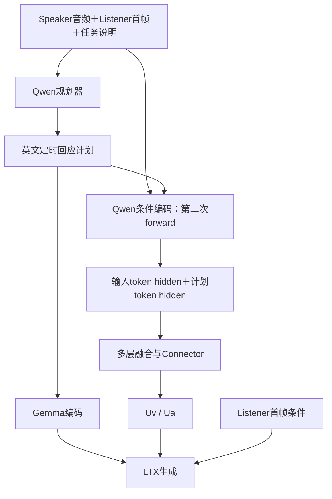

# P2 显式回应规划与双通路生成：实验方案草案

实现进度：[条件缓存实现与运行](P2_显式规划条件缓存实现与运行.md)已提供Gemma/A2缓存及读取API；新训练入口、自主规划推理和全量GPU提取仍未实施。

记录日期：2026-10-27。状态：**用户已确认基本方案，并明确首版数据、冻结Qwen及文本格式；尚未实现新pipeline或启动新训练。** 文件名保留以维持索引链接。

本文记录用户提出的方案及后续确认。以下“首版确认约束”优先于早期建议；训练预算、验证数据和正式评价协议仍未冻结，不把未回复项视为已确认。

相关入口：[总索引](../README.md)、[原事件监督实验计划](P2_倾听事件监督实验计划.md)、[四组实际训练代码与备份核验](P2_四组训练代码备份与恢复索引.md)、[全英文指导推理与双口径评测](../experiments/p2_guided_en_full_eval_20261027/README.md)。

## 首版确认约束（用户最新回复）

1. **唯一训练数据入口**：`experiments/p2_train50h_postprocessed_reselected_20261027/config.json`，29,975段、180,000.532312494秒，全部train。使用静音后保留标注重新筛选的名单；不使用旧30,415段视图。配置及`COMPLETE.json`已核对。
2. **图像几何**：listener目标视频和LTX首帧条件沿用现有512×512处理。配置`data.size=512`；抽查既有VAE缓存合同`height=width=512`。在图像进入VAE/首帧编码前完成resize，兼容缓存直接读取，不对latent再resize或每步重复编码。Qwen自身processor内部视觉预算保持原配置，避免借此改变另一项对照变量。
3. **音频/标签**：保留现有overlay读取，组合原视频latent、后处理音频latent（或显式复用原音频）及更新事件标签。计划从本子集`integrated_labels.jsonl`中静音后保留的事件与有效区间构造；不能从旧原始标注重新引入被删除事件。需要波形时走配方，不直接读取原listener WAV作为清洗目标。
4. **Qwen全部冻结**：首版不训练Qwen，也不创建规划LoRA。推理先由同一固定Qwen生成计划，再将实际计划拼回原输入进行第二次forward。用户判断其已有规划能力；效果仍通过实验验证。生成训练用标注计划，训练多层融合/Connector与LTX text-attention LoRA；保留A0/A1/A2的AV-only首轮对照，Feature关闭，Event生成监督后置。
5. **文本格式与此前英文指导评测一致**：复用`src/p2_guided_prompt_en/formatting.py`的`render`格式及其引用的固定`GEMMA`前言，保持INTRO、时间表示、排序、空行、`Visual response:`、`Audio response:`及`vocal content:`规则。上次讨论中的“Visual:/Audio:分节”仅为示例，**不采用**。
6. **同一文本双通路**：标注或预测计划均整理成同一规范文本P；Qwen第二次forward追加完整P，Gemma编码同一完整P，保存一致的文本哈希。Qwen生成任务指令属于独立的规划提示，不混入Gemma文本。第一遍可输出事件日程，最终经同一渲染规则补齐固定前言并校验；不能改写计划语义或静默修正越界时间。
7. **英文与验证数据**：用户确认新清洗数据已解决非英文发声问题；首版不增加翻译或改写发声词的步骤。实施时检查实际prompt，若仍有异常则显式报告，不自动套用旧诊断的翻译表。验证数据由用户后续提供，不自行从train划分或将旧test面板当作本轮正式验证集。

本段记录用户确认时的方案约束；当前条件缓存实现进度见顶部链接。配置中的`global_batch=8/steps=1000`是现有数据入口携带的旧默认，不能据此认定新训练预算；新训练需派生独立运行配置和输出目录，不修改已验收数据配置、共享缓存或旧实验。

## 1. 用户提出的方向与核心问题

将训练时固定的 Gemma prompt 改为逐样本的具体回应标注。推理时，Qwen-Omni 接收 speaker 音频、listener 首帧及任务说明，先产生 listener 回应计划；将该计划拼接到输入后再次 forward，提取包含输入和规划信息的 hidden，经多层融合和 Connector 形成 LTX 条件。同一计划也经 Gemma 编码，两路共同指导 listener 音视频生成。

目标仍是：回应随 speaker 的语义和节奏合理变化，而不是单纯更多微笑、点头或发声。应分别检验：

- H-P：仅凭允许的输入，规划器能产生合适的回应计划。
- H-T：明确的回应计划经 Gemma 文本通路能改善生成及时间控制。
- H-H：在相同计划与训练预算下，计划进入 Qwen hidden 比只进入 Gemma 有额外价值。
- H-S：使用自主预测计划的完整系统能改善对 speaker 的实际回应适当性。

真实标注计划属于额外目标信息条件，能检验执行能力，不能单独证明 H-P 或 H-S，也不自动构成严格效果上界。

## 2. 已核对的工程事实

旧 v4 P2 已有类似骨架：[inference.py](../../audio-driven-v4/src/omni_av_p2/inference.py) 执行自主计划→再次提取条件→Connector，同时将计划交给 Gemma；[paired_validation.py](../../audio-driven-v4/src/omni_av_p2/paired_validation.py) 已对 GT/自主计划分别重新 forward。旧 `TextPlan` 的 Reply/Delivery/Behavior/Vocal 格式不等于当前定时 backchannel 计划，不能不加适配直接复用。

当前 v5 固定文本 P2 使用 speaker 完整窗口音频、listener 首帧及固定任务文本，提取 Thinker 8/18/28/35 层 hidden。当前标注指导推理只替换 Gemma 正向文本，**没有把计划回填 Qwen hidden**。

Qwen 使用因果注意力。把计划追加到序列后，原输入 token hidden 不会看到后面的计划；后面的计划 token hidden 才整合输入和此前的计划。Connector 必须实际读取计划 token，并正确处理 token mask、层索引、位置编码与长度。不能只读取原输入 token 后声称已获得计划条件。

当前 P2 的共享 U 同时供 LTX、事件头及可选 Feature decoder 使用；旧 P3 的多 connector 结构不能与其混淆。当前提取链路含 no_grad 和 detach，开启一个 LoRA 开关不足以使 AV 梯度穿回 Qwen。即使第二遍 forward 可微，第一次离散计划解码仍不会自动得到 AV 梯度。

## 3. 候选方案与推荐顺序

| 方案 | 内容 | 价值与代价 |
|---|---|---|
| A1：计划只给 Gemma | Qwen 保持输入 hidden；Gemma 接收计划 | 改动较少，先确认文本计划是否可执行；不能验证计划 hidden 的价值 |
| A2：计划进入两路 | 输入＋计划重新提取 hidden；同一计划交给 Gemma | 对应用户方案，可检验额外表示是否有用；增加缓存与分布一致性要求 |
| 完整自主联合方案 | 自主规划及生成条件一起优化 | 变量更多，离散计划梯度与信用分配另需设计，不建议作为第一轮默认 |

沿用已基本认可的 A0→A1→A2 首轮对照，统一改用用户指定的新50h数据；具体启动顺序与预算在实施配置中明确。不把“工程可运行”或两次 forward 的连接结构本身当成新的研究效果。

两路必须消费同一份实际计划，不能一侧使用 GT、另一侧使用预测文本而未标明。首轮建议保持现有离线完整窗口任务；此系统不能据此宣称实时、流式或无未来信息的因果回应。

## 4. 规划文本和数据边界

- 实际 Gemma/Qwen 计划文本统一英文；保留清洗后原英文描述、具体发声词与有效时间支持。新数据已解决非英文发声问题，本轮不新增翻译分支；异常显式报告。
- 计划表达包括视觉行为、音频行为、起止时间和可选具体发声词；不由视觉笑推断一定有笑声，不由缺少标注推断应该静音。
- 原开放描述、来源、不确定性和精确时间保持原样，派生规划格式另存。复用已有英文formatter：按起止时间及源事件顺序排序，时间用JSON数值精确表示，不额外去重，不四舍五入，不静默截断；延用1024/2048/4096分档与超限显式失败规则，实际长度分布需在缓存准备时检查。
- listener 目标视频、音轨和标签仅用于训练监督及明确标记的标注计划诊断。正式自主规划推理只用允许的 speaker/首帧输入。
- 当前英文诊断中9条样本、10个事件的中文转写经用户授权翻译；这不是ASR修正，不能不经质量核对就视为可靠的规划训练目标。
- 新训练已确定使用重新筛选的29,975段50h及对应新事件标签，并统一重训基线。旧30,415段训练集与同名单换音轨的30,415段视图不属于本轮训练集。

已确认的新50h入口：[重新筛选数据说明](../experiments/p2_train50h_postprocessed_reselected_20261027/README.md)。读取原视频 latent、新音频 latent 或明确复用的原音频，并读取新事件标签；不直接绕回过滤前标签或把原WAV当成后处理目标。

## 5. 训练阶段与梯度边界建议

首版Qwen规划与条件编码全部冻结，不训练规划器，不构建规划LoRA。生成器学习`(X,P)→AV`，使用标注计划与listener真实音视频目标。首轮AV-only：关闭Feature decoder及teacher读取，训练多层融合/Connector与现有LTX text-attention LoRA；Event loss后续单独对照。AV梯度不更新Qwen/Gemma，也不穿过离散计划解码。

已讨论但首版不实施的候选包括“单独训练规划LoRA＋冻结条件编码器”及“两次共用训练后冻结的Qwen”。它们作为后续备选保留，不属于当前待准备代码的必需项。

冻结模型与规划格式后，计划、第二遍 hidden、Gemma embedding 都可缓存。身份应包含 Qwen/LoRA checkpoint、规划prompt、解码设置、实际计划、token mask/位置构造与代码版本。固定-prefix hidden 不能冒充含计划 hidden；Qwen权重更新后，相关 hidden 缓存须失效。原媒体latent可按已有合同复用。

训练只给标注计划、推理换成预测计划，会出现格式、时间、事件和措辞分布差异。不能简单把错误预测计划配上原GT音视频训练，否则可能同时要求“服从错误计划”与“生成原GT”，促使模型忽略计划。是否混入预测计划、如何筛选或修正，必须另设验证。

## 6. 最小训练与推理矩阵

| 训练组 | Gemma输入 | Connector读取的hidden | 核心比较 |
|---|---|---|---|
| A0 | 固定prompt | 输入信息 | 同数据、同预算基线 |
| A1 | 标注回应计划 | 输入信息 | A1−A0：文本计划收益 |
| A2 | 同一标注计划 | 输入＋计划信息 | A2−A1：计划hidden额外收益 |

匹配数据版本、样本顺序、共享模块初始化、训练seed、有效batch、数据暴露量、优化步数、LoRA范围、学习率规则和采样参数。新增预算和缓存计算单列，不用旧四组不同数据条件的分数替代新A0。

首版对A1/A2分别测试标注计划与冻结Qwen自主计划；不包含监督训练规划器分支。固定计划来源进行A1/A2对照；规划生成seed与LTX生成seed分开记录。真实标注条件和自主条件分表报告。

执行建议：先做8–16条真实数据工程检查与小集拟合；再在同一50h视图做一个训练seed的A0/A1/A2 pilot；有稳定信号后复验更多训练seed。具体步数、学习率、开发样本量及正式测试规模待预算确认，不自动继承旧1,268步。

## 7. 三层评测与必要干预

| 层面 | 主要检查 | 不能被什么替代 |
|---|---|---|
| 规划质量 | 格式/时间合法、事件与发声频率、语义适当性、视觉/音频冲突 | 单一GT文本相似度 |
| 计划执行 | 计划动作是否发生、时机/时长、指定词是否说出、额外误触发 | 仅规划文本正确 |
| 最终回应 | 对speaker的语义、时机、频率与自然度是否合适 | 单纯更像GT或更频繁回应 |

建议把随机顺序、隐藏模型身份的配对人工适当性评价作为主要效果证据，自动指标作分解证据；用户已确认训练数据并表示稍后提供验证数据，人工评价协议及正式主指标仍需在收到验证数据后确定。执行一致性评价可展示计划；最终适当性评价不向评审暴露模型身份或计划来源，避免提示偏差。真实listener回应只是多种合理回应之一。

自动指标：GLARE六类视觉事件及其时间一致性（严格/去门槛两版和检测覆盖分开）；音频发声起止、持续时间、漏发声及误发声；指定词转写一致性和抽样试听；FVD-32、UTMOSv2、LSE-D/C分别作视觉质量、音质及嘴音同步诊断。静音不适用项保留；不能把静音上的ASR幻觉或较高音质分数当成有效回应。

| 干预 | 要推翻或支持的假设 |
|---|---|
| 同一输入，改变合法计划 | 生成是否真正受计划控制 |
| 保持描述，移动计划时间 | 是否使用时间指导 |
| 保留Gemma计划，移除hidden中的计划token | 第二遍计划hidden是否提供额外价值；同时参考训练匹配的A1/A2 |
| 更换speaker并重新规划、提取hidden | 完整系统是否根据speaker调整；输出不同不等于更合适 |
| 通用回应计划对照 | 收益是否只是更多微笑、点头和发声 |

人为干预需保留合法长度、时间轴和来源，单列诊断，不混入正常测试均值。

## 8. 开发、最终测试与统计

train24来自旧训练集。test24虽仍与train身份/会话隔离，但已用于多轮可视化、检测器修复和prompt修改，已承担开发反馈作用。test48包含全部test24，且仍是相同六个连通组；不能只剔除旧24条就称为新的身份独立最终盲测。两套面板还偏向大脸、回应丰富片段，不能代表自然分布。

建议现有面板继续作开发诊断；在规划格式、训练规则和评价协议确定后，从未参与反馈的连通组冻结最终测试。先在开发集估计配对差异与方差，再按预设最小有意义效果确定测试量；类别支持数和独立组数必须单列，不能只按总片段数估计有效样本量。

报告配对差异、置信区间、训练seed波动及评审一致性；重采样以会话/参与者连通组为单位，避免同源片段被当作独立证据。相同条件用相同评测样本与生成seed；检测失败、静音不适用和任务失败均保留分母及原因。正式test不用于调prompt、阈值或挑选最优检查点。

## 9. 继续、停止与结果解释

| 观察结果 | 合理结论与下一步 |
|---|---|
| A1优于A0，A2无进一步提升 | 文本计划有用，计划hidden额外价值未证实；不默认扩大双通路规模 |
| 标注计划有效，自主计划无效 | 优先定位规划质量或训练/推理分布差异 |
| 自主计划合理，生成不执行 | 优先定位生成接口、条件利用与时间控制 |
| 自动指标提升，人工适当性不变 | 尚不能支持回应更合理 |
| 自主系统盲评提升且speaker干预成立 | 才较有力支持规划改善对speaker的回应 |
| 两种计划执行路径均无信号 | 先检查文本/音频监督、条件通路和数据质量，不直接增加复杂度 |

停止或进入下一阶段的效果阈值、容许退化、资源预算须在正式测试前确定，目前未给出未经数据支持的数值承诺。

## 10. 最终结果表模板与当前证据

| 训练组 | 计划来源 | 数据/模型版本 | 规划质量 | 执行时机/事件 | 指定词执行 | 发声漏检/误触发 | 人工适当性配对差异及CI | AV质量 | 检测覆盖 | 成本 |
|---|---|---|---|---|---|---|---|---|---|---|
| A0/A1/A2 | 固定/标注/冻结预测/SFT预测 | 待冻结 | 待实验 | 待实验 | 待实验 | 待实验 | 待实验 | 待实验 | 待实验 | 待实验 |

**当前没有本新方案的训练结果或最终效果结论。** 已完成的是旧四组权重的固定/全英文标注指导推理诊断：384个新英文指导输出＋384个固定输出，全部评测和浏览器验收通过；GLARE去门槛版train/test均24/24，严格版分别2/24、7/24。它只改变Gemma输入，不代表A1/A2训练或自主规划已经验证。

## 11. 已确认项与后续细化

已确认：新29,975段后处理50h、512×512、首版Qwen全冻结、清洗后的英文发声、复用旧全英文指导prompt格式、验证数据稍后提供。基本方案继续采用标注计划训练生成器、自主计划推理及A0/A1/A2对照。

尚需细化：新训练步数/有效batch/资源预算、冻结Qwen规划指令与解码参数、预测计划格式失败策略、用户提供验证集后的评价协议及停止阈值。原配置中的旧训练默认不是新预算确认，冻结Qwen也不等于已证明其规划效果。

无需再次询问已确认的数据版本、是否训练Qwen、是否更换文本格式。收到验证数据前，可以准备工程接口和训练方案；目前已提供独立条件缓存与读取API，尚未进行全量GPU提取、新训练入口集成或启动训练。
