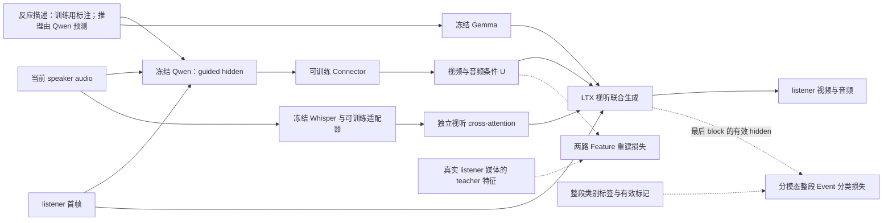

# 中文论文初稿 引言与任务数据

更新日期：2026-11-07。返回 [论文写作总索引](README.md)。

本轮新增：[第二部分：相关工作初稿](#related-work)，并附[任务比较与引用核对](相关工作比较与引用依据_20261107.md)。已有：[第七部分：实验与五组消融](#experiments)；[第八部分：配图、表格与图注填空](#figures)。图表参考来源见[21篇论文图表阅读记录](参考论文图表与实验设计分析_20261107.md)。

当前优先完成论文大致内容：引言、相关工作定位、任务定义、数据、方法与评测概述。**数据章节、方法三组件逻辑、评测三组框架，以及引言末尾的工作概述与三条贡献工作稿均已获作者确认。方法按作者指定的 LTX hidden 整段 Event 版本撰写，数据与标签按当前转正／筛选／冲突屏蔽版本核对；实验协议及效果结论待完善。** 数据、模型 pipeline、benchmark 仍是论文的三项贡献方向。

引言已更新为作者逐段填写、讨论修改后合并的版本；本轮按作者确认补入已有生成任务与本文的区别、倾听视听生成的建模困难，并将具体监督位置留在方法章节。引言末尾的工作概述与贡献列表已于2026-11-07获作者认可并写入；benchmark 已补充当前确认的评价框架。其他章节保留为参考草稿。正文中的文献链接用于定位原文，投稿时再转换为正式参考文献编号。

**一 引言初稿**

在自然对话中，说话者与倾听者共同参与交流。倾听者通过点头、表情变化和简短附和等视觉与声音反馈，表达对当前话语的关注和参与。因此，数字人需要具备在倾听阶段产生自然视听反馈的能力。本文聚焦于倾听阶段的视听 backchannel 生成，根据当前说话者语音和倾听者参考图像生成相应的音视频反馈，旨在增强对话的自然度与参与感。

现有数字人生成研究已在语音驱动的说话头像合成方面取得进展，这类方法通常根据目标人物的给定语音生成相应画面，强调口型同步与自然的面部运动，例如 [OmniHuman-1.5](OmniHuman-1.5.pdf)。倾听反应生成则关注对说话者的反馈，已有方法能够生成点头、表情变化等视觉行为，但其中许多方法并不生成倾听者自身的声音，例如 [ViCo](01_RLHG_ViCo_ECCV2022.pdf)、[Learning to Listen](02_Learning_to_Listen_CVPR2022.pdf)与 [GLARE](00_GLARE_local.pdf)。近期的视听回应研究进一步探索了有声与无声反馈，为多模态交互提供了基础，例如 [OmniResponse](50_OmniResponse_NeurIPS2025.pdf)与 [OmniPersona](OmniPerson.pdf)。本文聚焦于仅根据当前说话者语音与倾听者参考图像，生成说话者持有话轮期间的视听 backchannel，不依赖对话历史或预先提供的倾听者声音。

这一任务要求模型从当前语音中获取与反馈有关的语义和声学信息，并将其转化为倾听者的声音与视觉行为。通用多模态表征可以提供理解基础，但其到视听生成条件的映射仍需适配倾听任务。同时，媒体重建目标并不直接约束点头、附和等反馈类别是否出现。因此，我们关注如何有效利用当前语音、学习适合视听生成的条件表征，并为具体反馈行为提供显式监督。

已有研究在倾听反应生成方面取得了进展，并提供了相应的数据资源。然而，本文关注的视听 backchannel 生成需要同时获得说话者输入、倾听者视频及其自身音频，并明确这些片段中的倾听角色和反馈行为。现有资源对这些要求的支持并不一致：部分资源尚未提供可直接用于生成训练的独立倾听者音轨，另一些包含双方视听信息的对话资源，则仍需围绕倾听阶段组织样本并补充 backchannel 标注。这些不足使得原始对话素材难以直接转化为任务所需的训练样本，因此需要开展面向倾听阶段视听反馈的数据整理与标注工作。

除训练数据外，研究视听 backchannel 生成还需要相应的评价协议。常用的视频质量指标能够反映生成画面的保真度与真实感，但高质量的画面仍可能缺少有意义的倾听反应，或呈现与当前话语不相适应的反馈。因此，对该任务的评价需要同时考察音视频质量、反馈行为，以及反馈的自然度和互动参与感。

围绕上述需求，我们从数据、生成方法和评测协议三个方面展开研究。在数据方面，我们基于 Seamless 对话数据，综合语音停顿、ASR 标点与语义线索进行话轮切分，组织说话者讲话期间的 speaker–listener 配对视听样本。针对直接基于音视频生成描述时观察到的动作遗漏，我们提取点头、摇头、眉部变化及发声等反应线索，并将其类别与起止时间作为补充提示输入 Qwen3-Omni，引导其生成按反馈发生顺序组织的自然语言描述。由此获得的配对样本与反应描述，为学习倾听阶段的视听回应提供数据基础。

在生成方法方面，我们通过 speaker audio cross-attention 为生成过程补充当前语音的直接声学信息，通过目标视听特征监督促进条件表征适配倾听者音视频生成，并通过整段事件监督显式鼓励相应 backchannel 类别出现。这三个设计分别针对输入信息利用、条件表征适配和反馈行为表达。【对应效果证据待补。】

〔方法逻辑已于2026-11-07获作者确认：语音信息补充 → 条件表征适配 → 反馈事件表达。已有框架的具体不足与最终实验结论仍需证据支撑，见第五部分和[组件动机与消融证据](组件动机与消融证据_20261107.md)。〕

〔写作借鉴：OmniPersona 引言第 1—2 页先承认相邻方法的能力，再提出具体设计挑战并引出方法。这里借鉴其论证方式；新增的任务差异与建模困难段说明方法设计的动机，后续数据与评价段分别说明资源和协议需求。保留当前短语音输入设定，不借用历史记忆或多轮漂移作为本方法动机。上述困难是设计依据，不代表已通过实验验证现有模型必然失败或本文组件有效。〕

在评测方面，我们从整段事件类别一致性、语境适当性与参与感、视听事件协调性三个方面组织评价。整段类别比较允许反馈发生时刻变化，语境评价考虑不同但合理的回应，视听协调评价则关注生成声音与动作之间的配合。【测试集组织、具体评价工具及细则待补。】

本文的主要贡献包括：

1. **面向倾听阶段的数据构建。** 我们基于 Seamless 对话素材构建面向倾听阶段视听 backchannel 生成的配对数据，通过角色与片段组织、媒体质量处理，以及反应线索辅助的视听标注，关联说话者语音、倾听者音视频及有序反应描述，为该任务提供数据基础。
2. **面向视听反馈的生成方法。** 我们提出面向当前说话者语音与倾听者参考首帧的视听反馈生成方法，通过直接语音条件补充声学信息，通过目标特征监督促进条件表征适配视听生成，并通过整段事件监督显式鼓励 backchannel 类别出现。
3. **面向倾听互动行为的评价。** 我们围绕整段事件类别一致性、语境适当性与参与感、视听事件协调性组织评价，在媒体质量评价之外考察生成反馈的行为表现，并允许合理回应在具体发生时刻上有所变化。

〔作者确认（2026-11-07）：以上工作概述与三条贡献作为当前认可的写作工作稿。三条分别回应“原始素材难以直接用于任务”“条件输入不保证有效反馈”“画质不能充分反映回应质量”。最终数据规模、方法配置与效果证据后续补充；第三条目前为评测贡献的目标表述，正式 benchmark 声明须与实际完成的测试集、标注、协议及基线对应，不表示整套评测已执行或发布。〕

〔编辑备注：数据需求段的资源差异后续补充代表数据集与引用；数据方案段依据作者说明整理，切分及辅助标注的具体实现、遗漏改善情况仍需对应记录与质量证据。反应起止时间用于辅助 prompt，最终自然语言描述只保留发生顺序，不含具体时间戳；最新生产检测中的眉部降低、抬眉属于物理表情线索，不能直接等同于皱眉或惊讶情绪。LTX最后block的hidden、有效位置聚合及Feature监督的具体位置在第五部分展开，引言只保留设计与目的。〕

**二 相关工作初稿**

**2.1 倾听反应生成。** 倾听反应生成根据说话者的交流信号，合成倾听者的表情与头部动作。[ViCo](01_RLHG_ViCo_ECCV2022.pdf)建立了响应式倾听头像生成任务及配对数据，通过说话者视听信号和预设态度生成倾听动作。[Learning to Listen](02_Learning_to_Listen_CVPR2022.pdf)将倾听动作建模为非确定性分布，允许同一输入对应多种合理反应。后续研究分别探索了扩散式多样化生成、情绪控制与文本定制，例如 [MFR-Net](06_MFR_Net_ACMMM2023.pdf)、[ELP](08_Emotional_Listener_Portrait_ICCV2023.pdf) 和 [CustomListener](15_CustomListener_CVPR2024.pdf)；[DiffListener](34_DiffListener_CVPR2025.pdf)与 [DiTaiListener](41_DiTaiListener_ICCV2025.pdf)进一步改善倾听视频的表现力与生成质量。这些研究逐步从动作合成扩展到可控、细致的倾听行为表达。

除了生成质量，反应是否适合交流情境也受到关注。[ReactFace](26_ReactFace_TVCG2025.pdf)研究在线生成多种适当的面部反应，强调适当性、多样性与同步性；[GLARE](00_GLARE_local.pdf)进一步将反应表示为具有类别和时间区间的事件，结合韵律条件、时序反应监督与事件评价。上述视觉倾听方法为反馈行为建模提供了基础，但其生成目标不包含倾听者自身的音频。本文在视觉倾听的基础上，同时生成简短附和、笑声等声音反馈及相应画面，使有声回应与安静倾听都成为输出的一部分。

**2.2 视听对话与回应生成。** 对话数字人的研究还需区分“根据给定声音生成画面”与“生成回应声音及画面”。[INFP](35_INFP_CVPR2025.pdf)和 [DyStream](DyStream.pdf)利用双方音轨生成包含说话与倾听行为的头像视频；[ARIG](40_ARIG_ICCV2025.pdf)进一步结合双方视听信号与对话状态建模交互动作。这类方法将角色切换与倾听行为纳入统一生成过程，但目标人物音频仍作为条件提供。本文则仅接收对方当前语音与倾听者首帧，需要同时生成倾听者的声音和视觉反馈。

更接近本文的是能够生成多模态回应的工作。[OmniResponse](50_OmniResponse_NeurIPS2025.pdf)结合说话者面部信息、转写及对话历史，生成对齐的文本与面部反应，并通过 TempoVoice 合成声音，覆盖有声与无声回应。[OmniPersona](OmniPerson.pdf)将多模态对话历史编码为语言与非语言条件，联合生成音视频，同时考虑倾听 backchannel 和跨轮身份一致性。因此，视听回应与倾听期间的有声反馈已有研究基础。本文聚焦于一个更明确的任务设定：不提供历史对话、说话者视频、目标倾听者音轨或参考声音，仅依据当前短语音与倾听者首帧，生成对方持有话轮期间的视听反馈。围绕这一设定，我们结合直接语音条件、目标特征监督与整段事件监督学习反馈生成；重点是短语音条件下的倾听行为，而非多轮对话记忆或接续话轮的完整回答。

**2.3 对话数据与反馈评价。** 现有数据覆盖了不同层面的双人交互：[ViCo](01_RLHG_ViCo_ECCV2022.pdf)提供倾听生成样本，[RealTalk](https://realtalk.cs.columbia.edu/)收集自然双人对话并提供转写与活跃说话者标注，[Seamless Interaction](https://ai.meta.com/research/publications/seamless-interaction-dyadic-audiovisual-motion-modeling-and-large-scale-dataset)提供大规模面对面交流资源。[SpeakerVid-5M](38_SpeakerVid_5M_2025.pdf)同时组织对话、倾听和多轮数据分支，其倾听分支将说话者音频与无声倾听者视频配对；[ResponseNet](50_OmniResponse_NeurIPS2025.pdf)提供同步的双方视频、多通道音频、转写和面部行为标注；[GLARE](00_GLARE_local.pdf)则补充了视觉反应类别及起止时间。可见，现有资源已包含配对媒体与多种行为标注，其对本文任务的支持仍需结合片段组织、角色定义和声音反馈覆盖情况具体考察。本文基于 Seamless 进一步切分说话者持有话轮的片段，整理同期倾听者音视频，并利用带时间区间的动作与发声线索辅助生成有序反应描述，为视听 backchannel 生成组织训练样本。

反馈评价也已从画面质量扩展到互动行为。[REACT2023](https://www.repository.cam.ac.uk/items/208fff1a-e416-4cd2-aa16-55eb01633574)与 [ReactFace](26_ReactFace_TVCG2025.pdf)关注多种适当反应；GLARE 的事件评价要求类别匹配与时间区间重叠；OmniResponse 与 SpeakerVid-5M 考察多模态回应质量及视听同步，OmniPersona 还评估倾听表情适当性。本文借鉴这些维度，将评价组织为整段事件类别一致性、语境适当性与参与感，以及生成内容内部的视听协调性。整段类别比较不要求反馈与单一参考在具体发生时刻上重合，但也不能单独证明回应符合语境；因此，需要将其与语境评价及视听协调评价结合。这一设计旨在支持短促、间歇且具有多种合理实现方式的倾听反馈。

〔编辑说明，不进入投稿正文：本节为2026-11-07相关工作初稿，尚未标记为作者确认稿。引用链接定位本地原文或原作者资源；逐项条件与页码见[任务比较与引用核对](相关工作比较与引用依据_20261107.md)。GLARE和OmniPersona按提供的匿名稿版本讨论，不虚构作者或录用信息。评价段描述已确认的协议设计，不表示benchmark已执行、发布或取得效果。〕

**〔本人说明，后续根据实际篇幅修改。合并成：2.1 视听对话与回应生成。 2.2 MLLM级连生成（omnipersona展示了这类相关工作） 2.3 对话数据与反馈评价。〕**

**三 任务定义**

**输入与输出。** 给定当前说话者的一段语音及倾听者参考首帧，模型生成对应时段内的倾听者视频和音频。参考图像提供人物外观条件，当前语音提供可用于产生反馈的信息。应用场景关注一两句简短话语；训练与测试中实际片段长度及句数分布将单独报告。

**倾听阶段的反馈范围。** 本文将倾听者在对方持有话轮时提供的简短反馈作为建模重点。反馈可以仅表现为视觉动作，也可以包含简短附和或笑声。输出还需覆盖安静倾听的状态，避免要求每个片段都必须产生声音或明显动作。倾听角色与是否发声分别定义：倾听者可以发声，但短发声本身不足以确定其属于 backchannel。数据中的具体角色划分与筛选规则将在数据构建部分说明。

**条件与监督的区别。** 推理时不提供历史对话、倾听者未来画面、目标声音或真实反应标签。训练阶段可以利用与输入配对的倾听者媒体及其标注学习生成目标，但推理时不读取这些真实目标。当前 guided 训练使用标注描述构造条件，推理则以 Qwen 自行生成的描述替代；两者的具体流程见第五部分。

**输出的不确定性。** 当前语音通常不能唯一决定倾听者的全部行为。不同的面部反应、声音形式和时间实现可能同样贴切。因此，本文将观察到的真实倾听行为作为学习样本，同时保留同一输入可以产生多种合理输出的任务属性。这一属性不自动意味着当前模型已经实现了可控多样性，其具体建模能力仍需后续方法与实验说明。

**四 数据构建基础正文**

**作者确认（2026-11-06）：D1—D5 暂定为当前数据章节初稿。** 后续在此基础上补充引用、统计与质量证据；2026-11-07 按作者要求补齐当前 AV 选集、整段标签派生及方法版本。此处确认的是写作版本，不代表自动标注已完成人工验收。

以下按“来源与目标 → 切分与角色 → 媒体处理 → 辅助标注 → 样本与规模”回答五个问题。2026-11-07 沿项目总索引核对：采用固定 J v1 切分、反应与发声辅助标注、转正标签池和冻结 v3 行为统计。D5按最新全量筛选通过集报告训练与测试样本数；AV生成训练所用选集在第五部分说明。

**D1 数据来源与构建目标：原始素材来自哪里，为什么需要重新整理？**

我们基于 Seamless 对话数据构建面向倾听阶段视听 backchannel 生成的配对数据。原始对话素材包含双方交替发言的过程，而本文需要明确当前说话者、对应倾听者及其在同一时间段内的反馈。因此，我们围绕说话者持有话轮的区间组织样本，关联当前说话者语音、倾听者参考首帧及对应的倾听者音视频，并补充描述其视觉动作与声音反馈的自然语言标注，为学习当前话语条件下的倾听反应提供数据基础。

依据：[固定 J 切分与来源入口](../releases/listen_pair_segmentation_j_v1_20261029/README.md)、[最新样本读取协议](../related/交接_最后处理完的数据_20261106.md)。原始 Seamless 资源的正式引用、来源构成与使用许可在投稿前单独补齐；这里不将对已有资源的整理写成自行采集原始会话。

**D2 片段切分与角色组织：怎样获得 speaker 说话、listener 倾听的配对片段？**

我们结合转写文本、词级时间、语音活动及声学停顿信息，判断局部发言角色并确定候选片段边界。切分优先保留完整句末，避免将下一句的零碎开头并入当前片段；对于较长内容，在合法边界处继续划分。当前固定规则将片段时长限制为 2–11.95 秒，并以超过 5 秒的相邻词间停顿作为长停顿分界。倾听者的简短反馈允许与说话者语音重叠，局部 backchannel 不直接视为话轮交接。流程先形成完整候选，再进行音质筛选与必要的局部恢复；无法确认恢复子段完整性的候选保留原记录供复核。

依据：[J v1 规则、参数与输出口径](../releases/listen_pair_segmentation_j_v1_20261029/README.md)。这里的“语义线索”主要体现为转写与句末完整性规则，不能据此写成使用大模型完成语义切分，也不宣称每个样本覆盖一整个长话轮。角色判定的具体阈值可在后续方法细节或附录中补充。

**D3 媒体与边界处理：怎样处理画面、音轨和裁剪边界？**

视觉侧对倾听者画面进行质量筛查和人物裁剪，并修正部分素材的画面方向；反应检测与视听标注使用同一人物、裁框和时间范围。音频侧从独立的倾听者长音轨读取对应区间，利用官方词、句及语音活动时间区间的并集确定保留范围，在前后扩展 100 毫秒并施加 10 毫秒淡入淡出，以减少边界突变及非目标声音干扰。范围外的音频置零，而不删除相应时间，使处理后的音轨保持原有长度及音画对应关系。样本保留原媒体、裁框与处理配方的来源信息，支持后续读取与核验。

依据：[最新全量打标输入契约](../related/P2_四机32卡检测打标重叠运行_20261103.md)、[转正与重打标记录](../experiments/listen_j_labels_upright_20261105/README.md)。100 毫秒和 10 毫秒是音频保留区间的处理参数，不能写成所有视频切口统一使用的余量。512×512 是处理后的输入尺寸，不代表原始素材全部达到这一有效分辨率；音轨净化效果仍需质量抽检支持。

**D4 反应线索辅助标注：为什么需要辅助线索，最终标注是什么？**

针对直接根据音视频生成描述时观察到的动作和短促发声遗漏，我们采用反应线索辅助的视听标注流程。在倾听者视频中提取点头、摇头、眉部降低和抬眉等反应候选，并在官方时间区间支持的发声范围内结合 ASR、官方转写和音频事件形成声音线索。各候选的类别、起止时间及可用的发声内容作为补充提示，与同一最终裁框的 8 fps 倾听者视频和净化音轨共同输入 Qwen3-Omni，引导其关注短暂反应并按发生顺序描述视觉动作与声音反馈。最终输出为整段英文自然语言描述，按要求保留反应顺序而不输出数值时间戳。流程还检查反应线索覆盖及静音状态的一致性，对疑似遗漏进行重试，并保留仍需复核的记录。

依据：[最新生产配置](../experiments/listen_j_reaction_vocal_omni_20261103/config.json)、[全量反应与发声标注实现](../src/listen_benchmark/j_omni_reaction_vocal.py)、[实际 prompt 与覆盖检查](../scripts/run_glare_reaction_omni_pilot.py)、[发声线索规范化说明](../experiments/listen_native_caption_nod_vocal24_20261103/README.md)。最新生产版已包含多类反应，不能仅按较早“点头＋发声 v4”说明概括。皱眉／惊讶样候选是可观察表情线索，不直接等同于真实心理情绪；提示时间窗不是人工精确时序真值。“完整性和顺序准确性提升”仍需独立抽检支持，不能仅由流程设计断言。

**从自然语言描述到整段训练标签。** 在完整描述之外，我们使用冻结 v3 行为统计流程提取视觉／音频行为名称及其原文依据，再派生整段类别存在性标签。该文本统计由 Qwen3-30B-A3B-Instruct-2507 完成，与上游 Qwen3-Omni 视听打标分开。采用项提供正向证据；不确定、矛盾及不能支持整段判断的项保持未知。只有描述完整性检查通过且真正未提及的类别，才以较低权重作为弱负例。最新规则还屏蔽已提及的基线状态、补充反应线索与弱负例之间的冲突；存在发声证据但无法确定子类时，不将全部音频类别判为不存在。此过程不新增事件时间监督，不将自动标签称为人工真值。

依据：[冻结 v3 统计说明](../experiments/listen_j_upright_av500h_v3_20261105/README.md)（复用其全量统计，当前成员以 train＋dev 选集为准）、[最新整段标签与冲突屏蔽](../related/P2_整段Event数值缓存_20261106.md)。规则修复保留已采用正例；当前配置使用修正后的稀疏标签及数值缓存。

**D5 最终样本与数据概况**

每条样本包含当前说话者音频、倾听者参考首帧、同一时段的倾听者音视频及自然语言反应描述，并记录来源与时间范围。经过筛选，最终保留 **704,368 条训练样本和 7,087 条测试样本**。

依据：[最新数据说明](../related/交接_最后处理完的数据_20261106.md)、[最终筛选统计](../experiments/listen_j_upright_response_sft_20261105/final/summary.json)。

**五 方法正文：LTX hidden 整段 Event 版本**

〔版本依据：2026-11-07 作者指定采用[当前实现说明](../related/P2_LTX主干整段与时序事件监督_20261106.md)及[默认配置](../configs/p2_ltx_hidden_clip_events_current500h_20261106.json)。本节以该模型、当前284,218段选集及修正标签为准；不混入旧U-Event或历史时序Event分支。以下为依据实现整理的中文正文初稿。〕

**M1 总体框架与条件构建。** 给定当前说话者语音 \(a_s\) 和倾听者参考首帧 \(I_l\)，我们的目标是联合生成对应时段的倾听者视频 \(V_l\) 与音频 \(a_l\)。框架由冻结的 Qwen2.5-Omni-3B、可训练 Connector、Gemma 文本编码器、speaker Whisper 分支及 LTX 音视频生成主干组成。Qwen 提供输入与反应描述的多层 hidden 表征，经 Connector 映射为视觉和音频条件 \(U_v,U_a\)；反应描述也经 Gemma 编码形成文本条件。LTX 在参考首帧、两路条件及直接说话者音频的共同引导下，进行视听潜变量的联合去噪与解码。

记反应描述为 \(d\)。当前训练使用真实 listener 的标注描述 \(d^*\)：将完整指导文本追加到 Qwen 的原生多模态前缀的 assistant 位置，提取 guided hidden，并对同一文本进行 Gemma 编码。推理时，Qwen 仅依据当前 speaker audio、listener 首帧和任务指令预测描述 \(\hat d\)，再以该预测描述重新构建 guided hidden 与 Gemma 条件。描述是内部生成的中间条件，不是额外要求用户提供的输入。（训练使用真实描述、推理使用预测描述的差异需要明确披露；不能把当前训练写成全程使用模型自主预测描述。）

（当前 Qwen 为原始未做规划 SFT 的冻结版本，读取第8、18、28、35层表征。数据打标使用的 Qwen3-Omni 与此处用于模型条件的 Qwen2.5-Omni 是不同角色，不共用训练含义。）

**M2 直接说话者语音条件。** 高层表征和文本条件可能不足以让生成器充分利用当前语音的局部声学信息。为此，我们将同一片段的 speaker audio 输入冻结的 Whisper-large-v3，保留其时序特征，经 LayerNorm 与线性适配器后注入 LTX 每个 block 的独立视频和音频 cross-attention 残差分支。该分支使用共同的片段时间原点及时间位置编码，保留语音中的静音间隔，输出投影以零初始化，在原有条件路径之外学习利用直接音频信息。Whisper 是额外的条件分支，不引入一个独立的“Whisper loss”，也不替代 Qwen 和 Gemma 条件。

**M3 面向目标视听内容的特征监督。** Qwen 提供通用条件表征，但其到生成器条件的映射仍需适配当前倾听任务。我们利用冻结 Qwen2.5-Omni 的视觉塔和音频塔，从真实 listener 视频与净化音轨提取目标特征 \(F_v,F_a\)。两路辅助 EmbeddingDecoder 分别以 Connector 输出 \(U_v,U_a\) 为条件，采用 flow-matching 特征重建目标，得到 \(\mathcal L_{\mathrm{Feature}}^v\) 与 \(\mathcal L_{\mathrm{Feature}}^a\)。仅在 teacher 与条件均有效的位置计算该目标；静音本身仍是有效声音状态，不因无发声而去掉监督。

该损失训练辅助解码器与共享 Connector，使条件表征包含有利于目标媒体拟合与生成的信息。它不是直接计算 Qwen hidden 与 teacher 的逐点 MSE，也不更新冻结的 Qwen 基座。辅助特征解码器与真实 listener teacher 仅用于训练，推理时不执行特征重建。

**M4 LTX 生成表征上的整段事件监督。** 连续媒体生成目标不显式要求反馈类别出现，因此我们直接在 LTX 的视听生成表征上施加整段多标签监督。在每次训练前向中，读取最后一个 Transformer block、输出归一化及投影之前的视频与音频 hidden \(Z_v,Z_a\)。视觉分支先在各有效时间位置聚合空间 token，再对有效时间位置取平均；音频分支按自身时间网格聚合。固定参考帧及超出真实时长、无效或补齐的位置不参与事件聚合。随后分别通过视觉／音频分类头，预测各类行为是否在整段中出现。

该监督作用于随机 flow 噪声步的去噪 hidden，并不在每个训练步骤额外完整采样和解码视频。当前配置只创建整段分类头，时序分支权重为0，不读取历史事件区间标签，也不构造逐时刻事件目标。辅助打标提示中曾使用的起止时间不能据此被写成模型的时序监督。

整段目标来自第四部分的描述统计与冲突处理。每个样本、类别具有目标 \(y_{ic}\)、有效标记 \(m_{ic}\) 和权重 \(w_{ic}\)。正向采用项的样本权重为1；通过完整性检查且真正未提及的类别以0.1作为弱负例；未知、矛盾及补充证据冲突项的有效标记为0。每类采用带正例权重的二元交叉熵，并按该类有效样本数归一化，最后平均当前有效类别：

\[
\mathcal L_{\mathrm{Event}}=
\frac{1}{|\mathcal C_{\mathrm{eff}}|}
\sum_{c\in\mathcal C_{\mathrm{eff}}}
\frac{\sum_i m_{ic}w_{ic}\,\mathrm{BCE}_{\alpha_c}(s_{ic},y_{ic})}
{\sum_i m_{ic}}.
\]

其中 \(s_{ic}\) 为分类 logit，\(\alpha_c\) 为依据训练标签统计得到的正例权重；\(\mathcal C_{\mathrm{eff}}\) 只包含已启用且本次有有效目标的类别。当前配置有16个视觉和3个音频输出位置，其中18类满足有效性及至少5,000个正例的准入要求；mouth closing 保留输出位置但不参与损失。训练类别包含一般视觉行为，不直接等同于最终评测中的交际性 backchannel 类别。该目标鼓励有依据的反馈类别出现，同时保留合理安静倾听与未知状态。

**M5 总体训练目标与参数更新。** 视听生成损失 \(\mathcal L_{\mathrm{AV}}\) 为原生视频、音频 flow-matching 目标之和，分别在有效生成支持范围计算，固定参考帧与补齐位置遵循原生训练掩码。总体目标为：

\[
\mathcal L=
\mathcal L_{\mathrm{AV}}
+0.05\mathcal L_{\mathrm{Event}}
+0.025\mathcal L_{\mathrm{Feature}}^v
+0.025\mathcal L_{\mathrm{Feature}}^a.
\]

训练更新 Connector、Feature 解码器、Event 分类头、LTX 文本条件 LoRA，以及 Whisper 适配器和独立视听 attention 分支；冻结 Qwen、Gemma、Whisper encoder、teacher 编码器及 LTX 主体参数。Feature 梯度约束条件映射，Event 梯度则从生成 hidden 经过 LTX 可训练分支回传至 Connector。读取 hidden 时不截断梯度，但这不意味着 LTX 全部基座参数被解冻。

当前生成训练采用独立整理的[284,218段、约500小时AV选集](../experiments/listen_j_upright_av500h_train_dev_v3_20261105/README.md)，五项缓存覆盖同一成员及媒体版本。训练读取预先编译的整段标签目标、有效标记和权重，不在线解析标签文本。

**M6 推理流程与训练信息边界。** 推理仅接收当前 speaker audio 与 listener 首帧，先由冻结 Qwen 预测反应描述，再构造 Qwen guided 条件、Gemma 文本条件及 speaker Whisper 条件。Connector 将 Qwen 表征映射为两路生成条件，LTX 从噪声潜变量出发，在首帧约束下进行视听联合采样，最后分别解码为 listener 视频和音频。推理不读取真实 listener 后续音视频、真实描述、teacher 特征或事件标签，也不执行 Feature 和 Event 辅助损失。当前共享推理函数采用30步采样、视频／音频CFG分别为3／7；这些属于可在实验设置中统一调整的采样参数，不作为方法贡献。

| 信息或模块 | 当前训练 | 推理 |
|---|---|---|
| speaker audio、listener 首帧 | 输入条件 | 输入条件 |
| 反应描述 | 真实标注描述，构造guided条件 | Qwen根据输入预测的描述 |
| Qwen guided hidden、Gemma条件 | 由真实描述构造并缓存 | 由预测描述构造 |
| speaker Whisper | 同片段说话者音频条件 | 同片段说话者音频条件 |
| listener 目标音视频 | AV目标及teacher来源 | 不提供 |
| Feature decoder及teacher特征 | 辅助特征重建 | 不执行 |
| Event分类头及整段标签 | 生成hidden上的辅助监督 | 不执行 |

**流程示意（论文图的内容草稿）。** 实线表示条件与生成流程，虚线表示仅用于训练的辅助监督。描述节点的来源随训练／推理切换。

**实现依据与当前证据边界。** [模型与损失连接](../src/p2_ltx_events/model.py)、[生成hidden读取位置](../src/p2_ltx_events/renderer.py)、[聚合与事件目标](../src/p2_ltx_events/heads.py)、[有效位置掩码](../src/p2_ltx_events/layout.py)、[当前训练数据读取](../src/p2_ltx_events/current_data.py)、[guided H提取协议](../experiments/p2_j_train_dev500h_qwen_hidden_20261105/README.md)、[预测描述与推理条件构造](../src/p2_testsets_eval/runtime.py)、[Whisper连接](../src/p2_whisper_av/model.py)、[当前推理入口](../src/p2_ltx_events/inference.py)。

上述默认配置的早期验证报告记录的是“修改未启动训练”的当时状态；截至本次文档核对，总索引已指向[同一方法的31卡接续训练](../experiments/p2_ltx_clip_train31_cadence_20261107/README.md)。本节说明当前实现，不据工程验证声称事件或互动效果提升，也不将旧U-Event的6000／8000步结果当作新LTX-Event结果。已有历史消融及其版本边界保留在[组件分析](组件动机与消融证据_20261107.md)。

**六 评测框架概述**

〔三组行为评价框架已于2026-11-06获作者确认；本轮补充整段评价的动机，以及在OmniResponse评测框架基础上已接入的媒体、表情、运动和音频活动指标。整段语义事件评价及人工评价的执行细则仍待确定；已实现指标与本轮实际执行范围见本节末尾记录。〕

我们在[OmniResponse](50_OmniResponse_NeurIPS2025.pdf)的评测框架基础上补充倾听反馈评价，同时考察媒体质量、视觉行为和声音反馈，并从整段事件类别一致性、语境适当性与参与感、视听事件协调性三个方面评价互动表现。

**整段事件类别一致性。** 当前话语通常对反馈的情感与态度方向形成约束：面对开心的分享，微笑或共同发笑可能是自然的回应；表达不同意见时，摇头也可能是一种合适的反馈。然而，即使反馈方向相近，不同倾听者也可能在不同的停顿处点头、微笑或发声，其起止时间、持续时长和次数并不唯一。因此，同一输入可以对应多种合理的反馈时间安排，要求生成事件与单一参考的时间区间严格重合，可能惩罚类别恰当但时刻不同的回应。

基于这一特点，我们将片段中同类事件的重复出现合并为存在性标签，在视觉和音频两组类别上分别计算 Precision、Recall 与 Macro-F1，不要求生成事件与参考事件在时间上重叠。该指标衡量与观察到的参考回应的类别一致性，而非事件定位精度。情感方向也不唯一决定具体动作，例如开心的分享不必总以笑声回应；因此，类别一致性不能单独判断所有合理回应，仍需结合语境评价。允许相对参考的时间变化，也不意味着忽略过早回应、持续过久或生成音画不协调等问题。

**视频质量与视觉行为。** 配对视频评测包含以下八项指标，其中表情与局部运动指标参考 [AnyTalker](<../related/11577_AnyTalker_Data_Efficient(1).pdf>) 的定义实现。

| 指标 | 评价内容 |
|---|---|
| PSNR ↑、SSIM ↑ | 生成画面与参考画面的像素及结构相似性 |
| LPIPS ↓ | 生成画面与参考画面的感知距离 |
| FID ↓、FVD ↓ | 生成与参考在图像及视频特征空间中的分布距离 |
| Emo-Acc ↑ | 在共同有效的人脸帧上，比较生成与参考的七类表情预测标签一致率 |
| Emo-Div | 每段视频中出现的不同表情类别数，分别报告生成值和参考值，不视为越大越好 |
| ΔResp ↓ | 倾听阶段眼眉区域平均运动幅度与参考的差异，按阶段时长加权 |

这些指标提供媒体与行为的补充观察。Emo-Acc仍是逐帧参考一致性，不能等同于语境中的情绪正确率；ΔResp反映局部运动幅度差，不直接衡量点头次数、目光接触或语义适当性。逐帧相似性指标用于描述与单一参考的差异，不作为排除其他合理回应的唯一标准。

**声音反馈与发声活动。** 针对短促、间歇的倾听声音，我们分别使用能量阈值检测声学活动、使用语音活动检测器检测语音，并报告发声时长误差、参考有声时的整段漏回应比例、参考静音时的额外发声时间比例，以及完全静音片段上的误发声比例。声学活动可以覆盖部分笑声与轻哼，但也可能包含噪声，因此不能直接等同于语义backchannel事件。已有实现还提供严格与容差两种音频活动区间匹配的 Precision、Recall、F1及边界误差，用于诊断与参考时间安排的差异；它们与前述不要求时间重叠的整段语义类别评价分别报告。

**音质与音画同步。** 对满足适用条件的连续语音窗口，框架支持使用 UTMOSv2 评估音质，并使用 SyncNet 的 LSE-D 与 LSE-C 评估口部运动与生成声音的同步。极短附和、非语音发声及静音片段可能不满足这些工具的输入要求，对不可测项报告 N/A 和有效覆盖率，不通过重复或拼接短回应获得分数。此类样本仍保留声音活动与行为评价。

**语境适当性与视听事件协调性。** 我们结合当前说话者语音，评价反馈是否符合语境、自然且不过度，并体现倾听参与感；同时检查生成声音与动作是否构成协调反馈，例如笑声与面部笑态的配合。两项初步采用人工评价，允许与单一参考不同但合理的回应，也允许自然的安静倾听。具体评分形式待确定。

此外，框架已接入 [GLARE](00_GLARE_local.pdf) 的 R-F1、R-tIoU、R-ATD 和 R-FID，可作为视觉反应及其时间对齐的补充诊断；其中 R-F1 依赖类别与时间区间匹配，与本文整段类别 F1 的定义不同。

评价针对最终生成的音视频进行，不以训练辅助头的分类结果替代生成效果。各项分数同时报告有效样本或窗口覆盖率；未知标签、检测失败与真正无事件分开处理，不将不可测项填为零或满分。

〔实现与执行记录，不进入投稿正文：视频八项和音频活动指标已用于双200评测；最新6000步结果中UTMOSv2因参考语音过短而无有效评分窗口。GLARE四项与SyncNet已接入工具，但该轮调度未运行，不能写成该轮已有结果。整段语义事件P/R/Macro-F1与人工评价仍为待落实协议。指标来源、适用条件与实际执行范围见[评测索引](../evaluation/README.md)、[配对视频指标](../../OmniResponse/evaluation/video/paired_metrics/README.md)、[声音与反应评测](../../OmniResponse/evaluation/listener_metrics/README.md)、[最新结果](../experiments/p2_ltx6000_latest_sft_dual200_20261107/RESULTS.json)及[事件级评测框架](事件级评测框架_当前确认版.md)。〕

【整段语义事件类别表、外部检测与核验流程、人工评分细则及正式benchmark测试规模待补。】

**七 实验章节与证据规划（按完整文献实验核查更新）**

〔2026-11-07更新：本节依据[实验建议](../experiments/literature_full_experiment_audit_20261107/EXPERIMENT_RECOMMENDATION.md)、[方法资源矩阵](../experiments/literature_full_experiment_audit_20261107/RESOURCE_MATRIX.md)和[原论文协议映射](../experiments/literature_full_experiment_audit_20261107/PROTOCOL_MAP.md)修改。以下区分拟采用的实验设计与已有执行证据；未完成的比较不预写效果结论。〕

**已确认的范围：** 主组件消融保持五组：基础、完整、分别去掉三个组件。本文说明采用视听联合生成，不将“联合优于音频—视频级联”作为独立主张。新增Qwen2.5-Omni→OVI作为通用模型组合的候选系统对照，用于检验现有框架在本任务上的能力；它不等同于“先生成音频、再驱动视频”的级联消融。三组评价方向沿用第六部分，正式测试清单、事件检测细则与人工量表仍待确定。

实验按“整体能力是否成立 → 哪项设计起作用 → 数据是否可靠 → 评价是否可信 → 哪些情况仍失败”展开。数据、模型和benchmark各有独立证据，不能只用一个视频质量总表支撑全部贡献。

| 部分 | 要回答的问题 | 建议的核心证据 | 对应图表 |
|---|---|---|---|
| E1 设置 | 在什么任务、数据与预算下比较？ | 固定清单、版本、输入条件、训练及推理协议 | 设置说明；附录协议表 |
| E2 整体比较 | 能否生成自然、适当的视听backchannel？ | 同条件主比较；视觉／音频事件结果；质量与人工评价 | 表T2、T4；图F5 |
| E3 组件消融 | 三个组件是否改善各自针对的能力？ | 作者确认的五组受控比较；生成媒体上的评价 | 表T3；图F5的消融面板 |
| E4 数据质量 | 提供的片段和描述能否可靠支持本任务？ | 资源统计、媒体抽检、有／无线索的配对标注比较 | 图F2、表T1及附录质量表 |
| E5 评价可信度 | 事件指标和人工协议测到了什么？ | 外部检测可靠性、人工判断一致性、指标边界案例 | 图F4、表T4及附录协议验证 |
| E6 案例与局限 | 效果差异具体体现在哪里？ | 按规则选取有声、无声及失败样例；多种合理回应的说明 | 图F5；补充音视频 |

**E1 实验设置：明确数据、模型版本与公平比较条件。**

【正文工作稿】实验围绕当前说话者语音和倾听者参考首帧条件下的视听backchannel生成展开。生成模型使用284,218段、约500小时的AV选集训练；该选集包含原来源的train与部分dev，后者不再作为独立验证集。我们分别组织完整视听任务比较、视觉倾听能力比较和五组组件消融，并为各方法注明输入、输出及训练来源。

数据构建部分的最终资源规模与生成模型实际使用的AV子集分别报告，不将两者混为同一训练清单。正式实验需要冻结训练、模型选择／阈值校准、最终测试的清单，核查同源对话和时间区间重叠；人物身份是否隔离按实际核验结果说明。

| 现有评测入口 | 拟承担的作用 | 纳入正式实验前需要确认 |
|---|---|---|
| Seamless固定200 | 同源视听反馈评价候选 | 与实际AV训练清单隔离，满足倾听片段定义，确认抽样来源及标签质量 |
| ResponseNet分层随机200 | 跨来源视听反馈评价候选 | 披露分层与抽样规则；短speaker–listener pair不等于OmniResponse原论文的长对话协议 |
| ViCo test43 | 视觉倾听能力的补充比较 | 保留官方test身份，披露模型迁移及输入适配；不将视觉结果当作完整AV任务证据 |

早期按“48条非零音频＋模型表现较好的152条”选出的200条仅作探索，不能用于无偏主测试；不能因名称同为“200条”就与随机清单混用。多次用于选模型的诊断集需披露用途。主测试保留自然的有声与安静分布，有声子集可按预先规则单独报告。

共同协议固定片段范围、参考帧、评分分辨率／帧率、音量处理、推理采样及失败处理。对生成多次的系统统一采样次数和汇总方式，不用GT选择最佳生成。OVI1.1单次生成上限为10秒，而本任务部分pair约11.95秒；正式比较应为全部方法采用共同窗口，或公开一致的分段与拼接评测规则，不能只截短基线后与完整GT比较。

【版本核对，不进入投稿正文】第五部分当前描述的是原始未SFT Qwen条件下的Whisper＋双路Feature＋LTX末block整段Event版本。近期双200结果另使用SFT2752规划器，不能不加说明地归入同一方法版本。正式主表需冻结生成检查点、规划器、条件特征来源及训练预算，并使第五部分与表格一致；在完成该核对前，保留版本名，不用“最新模型”代替具体配置。

【待填】正式测试及校准规模：____；隔离核验：____；最终生成器／规划器版本：____；训练预算与推理采样协议：____。

**E2 整体比较：按输出能力和输入条件组织基线。**

【正文工作稿】我们从完整视听反馈生成和视觉倾听反应两个层面比较模型。前者考察生成声音、面部反应及二者的协调，后者比较视觉方法共同支持的能力。对于使用额外输入或只输出动作的方法，我们单独报告其条件与适用指标。所有自主生成结果仅依据各组声明的输入产生，真实倾听者未来音视频只用于评价。

**T2a：共同输入下的完整视听任务。**

| 对照 | 要回答的问题 | 输入与执行要求 | 当前安排 |
|---|---|---|---|
| 本文完整模型A1与基础模型A0 | 任务适配后的完整系统相对基础生成模型有哪些变化？ | 相同speaker音频与listener首帧，固定规划器和训练预算；A0仍保留Qwen/Gemma条件及AV训练 | 正式五组中的两组；不能用未经适配的原始LTX代替A0 |
| Qwen2.5-Omni→OVI | 通用理解与生成模型组合能否产生适当的倾听反馈？ | 根据当前音频和首帧预测回复／描述，再驱动OVI；固定版本与prompt，允许安静和短促附和，不提供GT caption、事件或listener音轨 | 优先候选，需完成适配及推理验收后纳入；不是已完成结果 |

OmniResponse、OmniPersona和SpeakerVid-5M与任务相关，但当前资源核查尚未获得可执行的原生成器，因此先作为文献比较。后续若获得模型，或完成明确标记的重实现，再按统一协议纳入；不把其原论文数值复制到本文短pair测试表中。

**T2b：视觉倾听能力比较。**

| 方法／设置 | 比较条件 | 评价范围与当前状态 |
|---|---|---|
| GLARE重训 | 披露固定Tref与previous motion的来源和初始化；若引入额外动作信息，单列条件 | 拟训练适配；训练和独立推理验收完成后比较视觉质量与视觉事件，不能把额外条件隐藏为同输入 |
| DyStream适配 | other audio为当前speaker音频，self audio置零，使用同一listener首帧 | ViCo43已有实际结果；比较视觉质量、视觉行为及适用人工项，音频生成指标N/A |
| Avatar Forcing适配 | user audio为当前speaker音频，user视觉和self audio置零，使用同一listener首帧 | 官方权重已实际加载并完成ViCo43生成与自动评分；音频生成指标N/A |

两种置零设置是明确的任务适配，论文中保留原方法所需条件与适配差异。它们与本文模型的训练来源不同，因此该表检验迁移后的系统表现，不声称是统一训练条件下的架构优劣实验。若扩展至正式AV测试清单，仍需重新生成并评价对应片段。

**补充比较按问题单列。** L2L、DualTalk等保留原生speaker motion、attitude、历史或双音轨等额外条件时，放入额外输入表；纯动作输出只有在渲染器经过核验后才能参与视频指标比较，否则只报告同表示空间的动作指标。RLHG、DIM、ReactFace、ListenFormer、LFI有训练路径，可按篇幅和资源补充，不要求全部复现。给DyStream或Avatar Forcing真实listener音轨的实验只检验已知声音条件下的动画能力；该音轨不能作为模型自主生成的声音。INFP、ARIG、ECHO等缺少可执行原生成器的情况保留文献说明。

若补做独立OVI与本文生成器的比较，应固定相同的预测文本，回答“给定相同规划，生成器表现如何”；Qwen→OVI端到端对照则回答整个系统的表现。两种对照分开解释，均不能替代W/F/E的受控消融。

**表格与指标。** T2a按视觉质量、声音反馈、整段事件三组报告，T2b只保留共同视觉维度；人工评价独立放T4，避免一张超宽表混合不同任务。

| 指标组 | 正文建议报告 | 解读与覆盖要求 |
|---|---|---|
| 视觉质量与反应统计 | FID、FVD、LPIPS；PSNR、SSIM及EmoAcc、EmoDiv、DeltaResp按篇幅放正文或附录 | 沿第六部分定义；逐帧相似与表情一致不等于语境适当，EmoDiv并非越高越好 |
| 声音反馈与适用音频质量 | 发声漏检／误触发、活动时长差异；UTMOSv2仅在有效窗口上报告 | 活动统计是与参考的诊断，不能替代短声质量；UTMOSv2无窗口时记N/A并报告覆盖 |
| 整段语义事件 | 视觉和音频分别报告P、R、Macro-F1，附逐类支持数 | 使用外部检测及核验，不要求与GT时间重叠；完整实现与可靠性验证待完成 |
| 人工互动评价 | 语境适当性、参与感与自然度、视听协调 | 允许安静和不同于参考的合理反馈；视觉方法仅比较适用项 |

SyncNet和GLARE的时间事件指标保留为适用子集的补充诊断，不替代本文的整段事件协议。各表同时报告有效样本数／覆盖率；没有声音输出记“不适用”，检测失败与未知标签另记，不填零或满分。FID/FVD从统一样本特征汇总，不能平均分片分数。

**T2a表头：** 方法｜输入／训练来源｜视觉质量｜声音反馈／适用音质｜视觉事件P/R/F1｜音频事件P/R/F1｜覆盖率。**T2b表头：** 方法与适配条件｜训练来源｜视觉质量｜视觉事件｜覆盖率。正文选代表指标，完整细表放附录。

原论文数字仅在原协议文献表中引用。ViCo的BFM/L1、EMOCA／DECA动作距离及不同定义的FD不合并排名；不同论文的RealTalk划分也不能视为同一测试集。官方权重迁移、本文重训、第三方重实现及引用结果均明确注明；协议不能对齐时不计算本文相对提升。

【待结果后填写】完整任务中最稳定的改善：____；视觉比较的优势与不足：____；质量、行为与适当性之间的权衡：____；结论适用的输入和测试范围：____。

**E3 五组主组件消融：一次只回答对应设计的问题。**

下面W表示新增speaker Whisper及其cross-attention路径，F表示两路Feature辅助监督，E表示LTX hidden整段Event辅助监督。所有组都保留原有Qwen/Gemma条件和AV生成目标；基础组不是“完全没有speaker audio”，也不是未经适配的原始LTX。

| 组别 | W | F | E | 比较与要检验的作用 |
|---|---|---|---|---|
| A0 基础 | — | — | — | 与A1比较，观察三个设计整体加入后的表现 |
| A1 完整 | ✓ | ✓ | ✓ | 拟作为正式完整模型；最终版本按E1冻结 |
| A2 去掉语音直连 | — | ✓ | ✓ | A1对A2：在原Qwen条件外，直接音频信息是否有帮助 |
| A3 去掉Feature | ✓ | — | ✓ | A1对A3：条件映射的特征监督是否改善生成 |
| A4 去掉Event | ✓ | ✓ | — | A1对A4：整段事件监督是否减少类别遗漏并保持适当性 |

| 组件 | 主要看什么 | 需要防止的误读 | 可配的案例 |
|---|---|---|---|
| W | 输入语音条件下的回应适当性、视听协调，并同时查看媒体与事件质量 | 画质提升不等于已证明语义／韵律利用；全部组原本都听到音频 | 同一句speaker语音、同首帧、同预测描述，对比有无直连的实际声音和动作 |
| F | 视觉及音频生成质量、感知效果；事件结果作为共同报告项 | 训练Feature loss下降或teacher重建更准，不等于最终媒体更好；冻结Qwen没有被该loss更新 | 身份、面部细节、短声音质的受控对比 |
| E | 最终媒体上的事件P/R/F1、逐类结果，以及合理安静倾听／误触发情况 | 辅助Event头分类分数不等于生成结果；更多动作、更多发声不等于更好 | 反应遗漏是否减少；是否出现不必要的点头、笑声或附和 |

各组固定数据、标签版本、初始权重、描述生成器、裁剪、训练样本展示预算与采样条件，记录batch、步数、见过的样本量和训练时长。主消融可预先为每条测试输入生成一次预测描述，并在五组间共用，由它构建各组Qwen H及Gemma条件，避免描述采样差异混入生成组件的效果；这借鉴OmniPersona的相同文本控制。训练仍使用标注描述，测试主结果仍使用预测描述。五组采用相同的规划器及其训练状态，不把SFT规划器变化混入三个组件的收益。不同batch或步数的检查点须核对实际训练样本展示量，预算不等的终点只作补充参考。若另做GT描述诊断，须标为oracle，不能放入正常输入的主结果。

五组实验检验各组件在完整系统中的条件性贡献，以及完整系统相对基础的总体变化。它不充分分离所有单组件收益和两两交互，因此暂不写“收益可独立相加”或“三者已证明协同最优”。主表T3同时报告质量、事件和人工选定维度，不能按每组最好看的指标分别挑结果。

此前联合Whisper的6000／8000消融来自旧U-Event和旧数据条件，只作探索依据，详见[历史组件分析](组件动机与消融证据_20261107.md)。不能填进上表充当新LTX-Event五组结果。近期LTX整段Event的6000步＋SFT2752评测则属于另一版本，也不是旧消融或第五部分未SFT版本的同条件替代。Event位置比较、整段对时序比较、拆开两路Feature、loss权重网格等暂列可选扩展；若后来要独立主张新位置／整段监督优于替代设计，再补相应同条件对照。

【待填】五组检查点与预算：____；A1−A2的主要变化：____；A1−A3：____；A1−A4：____；未符合设计预期的现象及解释：____。

**E4 数据与标注质量：先证明资源可靠，再讨论是否增加训练消融。**

建议保留三类证据。第一类是资源统计：来源、角色配对、独立音轨、片段长度、人脸质量、发声／安静比例、视觉／音频类别及共现分布；统计注明样本、时长、事件的不同计数口径。正文按第四部分简洁报告最终训练／测试规模，方法设置另报实际AV选集；资源分支与清单对应关系放附录，不能暗示AV500h必经另一条文本监督筛选流程。新增分布从冻结清单计算，不用猜测填图。

第二类是媒体抽检：对冻结样本检查话语边界完整性、speaker/listener角色对应、音轨污染或过度截除、边界裁剪、脸部可用性。优先使用代表性随机抽样；对有声、短反应、重叠和已有review flags另作分层诊断。报告每层样本数及问题率；若稀有层过采样，总体比例须按真实分布加权，不能直接平均。

第三类是辅助标注的配对比较：固定同一批片段、Qwen3-Omni版本、采样设置和输出要求，比较“仅音视频”与“音视频＋带时间的反应线索”。由独立人工依据原始媒体核对两份匿名描述，检查事件遗漏、无依据添加、动作先后次序和发声内容。线索检测结果不能直接充当真值；更长的caption不自动代表更准确。以每条样本的配对变化为单位，分别报告完整性与正确性，避免只证明召回提高。起止时间是标注prompt的辅助输入，最终caption只表达动作顺序，这一点应在图F2中明确。

可复用已有24条有声试点来解释观察来源，但该选择性小样本不足以替代总体质量结论。当前不要求为了数据贡献额外全量重训。若后续写“本数据处理显著改善模型效果”，则需再增加固定模型／预算／规模的数据或标注版本训练对照；仅流程验收与标注抽检不能支持这一因果结论。

**质量表建议表头：** 评估层／样本数｜切分与角色合格率｜音轨问题率｜标注事件遗漏｜无依据事件添加｜顺序错误｜发声描述错误。不同核验任务可拆表，判定标准与抽样数暂不固定。

【待填】抽样清单及分层：____；人工核验规范：____；仅音视频与辅助线索的配对差异：____；仍存在的标签噪声：____。

**E5 Benchmark与人工评价：证明评价可信，而不只是增加指标。**

借鉴GLARE的行为分类报告、ReactFace的一对多解释、OmniPersona的独立评分维度，建议把以下验证作为benchmark贡献的证据安排。它们不要求现在确定新的复杂指标公式。

| 需要验证的内容 | 建议怎么做 | 需要报告什么 |
|---|---|---|
| 外部事件识别是否可靠 | 在真实和生成媒体上分别抽样人工核验，覆盖有声／无声、常见／稀有类及失败样本；评测器固定后对所有方法一致使用 | 逐类识别质量、支持数、有效覆盖及错误类型；不能用自己的训练Event头自评 |
| 标签未知与安静是否区分 | 人工确认测试标签；保留未知或不可判断状态 | 训练弱负例不直接变成测试负真值；未知和检测失败不当作正确安静 |
| 类别一致性是否被过度解读 | 对照类别相似但语境不合、类别不同但回应合理的样例；同时检查静态／持续点头／总静音等退化输出 | 指标在哪些情况有效、哪些情况需人工补充；不把Macro-F1包装成完整适当性分数 |
| 人工评分是否稳定 | 匿名随机排序，同一输入给多个评分者；评分前用独立样例解释各维度 | 评分人数／条数、每条评分数、协议、评分者一致性及不确定性；具体量表待定 |

人工评价提供相同的当前speaker音频和listener首帧；主要判断基于这些可用信息，不用额外历史对话设定唯一答案。分别评价：回应是否符合当前话语、参与感与自然度、生成音频和面部动作是否协调。画面／声音技术质量可单独评分，避免“画质更好”带动所有维度。GT可以作为真实回应参考或隐藏质量锚点，但不能要求每个合理生成都复制GT。安静倾听允许合理；无发声样本的发声相关协调维度按预先约定标N/A并报告覆盖，不能自动记满分。

整段类别指标对GT时间偏移不敏感，但不代表反应时机完全无关。人工评价仍考虑相对当前话语的突兀、抢先、拖长，以及生成声音与动作之间是否矛盾；不要求匹配唯一GT的起止秒数。行为检测、协调和语境判断的边界在图F4里分开画。

统计建议使用配对设计，并按来源对话处理同源片段相关性；报告置信区间和有效样本数。单次生成seed的结果应如实标明，样本bootstrap不能替代训练多seed的不确定性。稀有类不凭少量样本声称稳定提升。样本量、盲评形式及一致性统计的最终选择后续单独确认。

【表T4待填】方法／对照｜适当性｜参与感与自然度｜视听协调｜有效样本数｜不确定性。若选A/B偏好，保留平局并说明分母；若选分级评分，附评分锚点。自动指标与人工评价的一致性分析可在足够样本后补充，不能先假设二者高度相关。

**E6 定性结果、失败与可选扩展。**

主图优先展示三类片段：有视觉动作但无发声的合理倾听、动作与短声共同表达、反应遗漏或不适当的失败。每例给speaker原音频、参考首帧、GT作为一个观察到的回应、比较方法的帧序列与各自生成声音；补充材料提供同清单可播放视频。不同方法采样相同显示时刻，但不能因动作晚于GT就直接判错。图中“点头／笑声”等标签区分人工核验与自动检测来源。

案例按预先说明的类别与选择规则选取，保留失败，不能只展示最强成功例。可展示同输入多个随机种子以解释合理多样性，但若样本不足，只作定性示例，不据此主张系统性一对多建模优势。没有真实生成样例前，图F1中的构想图必须注明“任务示意”。

| 可选扩展 | 何时值得做 | 当前处理 |
|---|---|---|
| Whisper路径置零／错配 | 需要进一步区分“增加参数”与“使用当前音频” | 固定其余条件的诊断；错配会产生分布外或条件冲突，不能单独证明理解；未列五组必做 |
| GT描述对预测描述 | 需要定位规划与渲染瓶颈 | 标oracle诊断，不能混进标准输入主表 |
| Event权重、监督位置／时序形式 | 要声称某个权重、位置或整段机制优于替代设计 | 先不承诺新增重训；仅说明当前选择与动机 |
| 多次采样与反应多样性 | 要独立主张合理的一对多生成 | 同时评价适当性，不能仅测方差或选best-of-N |
| 时长、发声类型、脸部质量分层 | 主实验样本支持充分，需要解释失败来源 | 优先从同一冻结结果切片分析，不改测试集挑优势 |
| 完整推理开销 | 需要报告应用成本 | 包括Qwen描述与重编码、Gemma、Whisper、生成与解码；不把片段吞吐叫流式响应延迟 |

本阶段不追加多轮历史、persona保持、长视频拼接、多人全身或实时流式实验；这些不属于本文当前任务与贡献。后续按证据修改主张，不能为了模仿参考论文而扩大论文范围。

**已有证据与待完成实验（写作备忘，不进入投稿正文）。**

| 项目 | 核实到的状态 | 在论文中的使用边界 |
|---|---|---|
| ViCo43三模型比较 | [自动评分及媒体核验已完成](../experiments/p2_vico43_unified_20261107/README.md)：历史联合8000、DyStream、Avatar Forcing；人工评分尚为0份 | 可支撑视觉补充实验准备；本文一行须注明历史模型，正式模型变化后不能沿用该行结论；现有结果并非所有指标占优 |
| LTX6000＋SFT2752双200 | [已有生成与评分结果](../experiments/p2_ltx6000_latest_sft_dual200_20261107/RESULTS.json)，含视频指标与声音活动；部分指标有缺失，UTMOSv2无有效窗口 | 与第五部分未SFT版本区分；该轮未运行SyncNet／GLARE，不能据此填写这些分数 |
| 当前500h基础AV训练 | [已启动并通过实测验收](../experiments/p2_current500h_av_only31_20261107/README.md) | 尚不能称五组消融完成；最终检查点、预算对齐和统一评测待补 |
| GLARE、Qwen→OVI及动作方法 | GLARE重训和Qwen→OVI仍按候选规划；L2L已有四套人物权重的迁移动作结果 | 需要各自适配和验收；L2L迁移结果不等于ViCo重训或写实视频结果 |
| 数据与benchmark证据 | 媒体／工程检查有记录；代表性人工标注核验、整段事件评测器验证及正式人工评价待补 | 流程完成、问卷工具就绪均不等于语义质量和互动效果已经得到验证 |

**优先完成顺序：** 冻结正式测试清单与最终模型版本 → 完成T2a／T2b所需基线适配及五组同条件结果 → 补齐事件评价与人工、数据抽检证据 → 填写结论和失败案例。上述步骤是文稿规划，本次修改不启动训练或评测。

**八 配图与表格规划：每一张图承担一个论证任务**

以下图号F1–F5、表号T1–T4是筹备编号，尚非正式排版编号。建议先准备五张核心图和四组表的素材，再按投稿篇幅合并；不要求现在绘制成品，也不预填结果。附录承担完整参数、逐类细表、评分协议和更多失败案例。

| 图 | 要让读者看懂什么 | 建议画法与应准备的素材 | 主要借鉴 |
|---|---|---|---|
| F1 任务与动机图 | speaker仍在说话时，listener需要视觉和短声共同表达倾听；本文输入很简洁 | 左侧仅speaker短音频＋listener首帧；中间显示同一时间轴的speaker发言；右侧listener帧序列与生成波形／短声标记。可并列基础模型和本文真实结果；没有结果时只画任务示意 | ViCo Fig.1、OmniPersona Fig.1、OmniResponse Fig.1、INFP Fig.1 |
| F2 数据构建与标注图 | 原始对话如何变成可训练的视听反馈配对，辅助线索解决什么遗漏 | 主流程：角色／音轨对应→话语切分与裁剪→统一人脸媒体→带时间的视觉／发声线索→Qwen3-Omni有序自然语言描述→文本统计／冲突处理→不同训练资源分支。下方放一个真实pair的输入、线索和最终caption，并标示时间戳没有直接进入最终caption | GLARE Fig.1、SpeakerVid Fig.2、ViCo Fig.3 |
| F3 方法总图与监督位置 | 三组件分别作用在哪里，训练和推理有什么区别 | 主干画原始冻结Qwen与Gemma条件→Connector→LTX联合AV；旁路画speaker Whisper→视听cross-attention。两个放大框：条件U→Feature decoder→teacher特征；LTX末block有效hidden→分模态整段池化→事件BCE。用图例区分可训练／冻结、仅训练／推理路径 | GLARE Fig.2、OmniPersona Fig.2/3、DiffListener Fig.1 |
| F4 评测协议示意图 | 同类行为不必复现GT时刻，同时仍须适当、声画协调 | 一路将参考与生成各自转换为整段视觉／音频类别集合，再算类别P/R/F1；另一路基于当前speaker音频评回应适当性；第三路评生成音视频自身协调。配两个说明性案例：同类但时刻不同、类别相近却声画不协调。示意不预判所有输出合理 | ReactFace Fig.6的一对多解释、GLARE第5节、OmniPersona人工协议 |
| F5 主效果与定性消融图 | 改善具体发生在哪些声音、动作和失败上 | 行为方法／消融，列为统一时间轴的帧；每行保留自己的生成音轨及经核验的短声描述。安排有声、安静和失败案例；标出输入话语及参考首帧，链接完整视频。行为框只标可核验动作，不把皱眉直接写成愤怒 | GLARE Fig.3/4、INFP Fig.4、ECHO Fig.3/4、DiffListener Fig.3–5 |

**F1与F2初稿已绘制：** [任务与动机图、数据构建与标注图](figures/task_data_drafts_v1/README.md)均提供SVG、PDF、PNG和中英文图注。F1通过同一话轮中的视觉／声音输出说明任务；F2展开带起止时间的辅助线索与不含时间戳的有序描述，并按D5展示train704,368／test7,087。人物、波形、线索时间和caption为示意，定稿时替换真实样例。

F2另需准备一组数据统计小面板：片段长度、人脸可用质量、有声／安静比例、逐类支持与共现。篇幅允许时放正文，拥挤时拆到附录；不要用无关词云取代任务统计。全量标签池、AV500h、规划SFT分别标计数与用途，test隔离状态以实际清单标注。

F3沿用第五部分已核实的流程关系，尤其不能画成“Feature直接更新冻结Qwen”或“Event作用于Connector U”。当前Event没有时序头，不画逐帧事件监督；参考帧及padding需排除的细节放放大框或图注。训练的GT caption与推理的预测caption必须清楚标示，不能让图暗示推理需要真实listener未来音视频。模型只使用当前短音频，F1/F3不额外画对话history输入。

**F3方法图初稿已绘制（2026-11-07）：** [PNG预览](figures/method_overview_v1/method_overview_v1.png) · [可编辑SVG](figures/method_overview_v1/method_overview_v1.svg) · [矢量PDF](figures/method_overview_v1/method_overview_v1.pdf) · [画法说明与中英文图注](figures/method_overview_v1/README.md)。采用“上方生成总览＋下方Feature／Event训练细节”的三面板结构，人物与波形均为示意，后续替换真实素材；该图不作为效果证据。

F4中的参考类别一致性不能叫作绝对正确率；不同合理类别可能得分较低，这正是单独保留人工评价的理由。F5的波形只说明时间和能量，不能单靠波形判断声音类别或音质；声音证据最终需要可播放素材。

| 表 | 拟放内容 | 回应的主张 | 当前可填与待补 |
|---|---|---|---|
| T1 资源特征与本数据统计 | 各资源是否具有角色配对、可分离视听、倾听片段、短声／视觉反馈标注；本资源分支规模及质量摘要可分面板 | 本资源为何适合当前任务，而非泛称其他数据都不可用 | 本项目规模可按第四部分填写；其他资源特性逐项核实，未核实写待查；质量抽检待补 |
| T2 整体比较 | T2a完整AV：本文完整／基础＋候选Qwen→OVI；T2b视觉：GLARE、DyStream、Avatar Forcing，注明适配条件；额外输入／动作及原论文数字另列附录 | 完整视听任务与共同视觉能力分别论证 | ViCo已有历史模型结果；正式模型、候选适配及统一清单结果待补；支持数与N/A保留 |
| T3 五组消融 | W/F/E开关及共同指标；同一测试集、预算和预测描述 | 每个组件在完整系统中的作用 | 五组结构已获作者确认，数值留空 |
| T4 人工评价 | 适当性、参与感／自然度、视听协调，评分人数与有效条数 | 自动类别和质量指标之外的互动体验 | 三组评价方向已确认，量表、抽样和统计待确定 |

附录建议保留：数据抽检与辅助标注配对结果、逐类事件P/R/F1及支持、外部检测器校验、匿名问卷与评分锚点、完整实现／采样设置、预算及覆盖表、失败样例。若Event的逐类收益与误触发存在明显权衡，可增画“逐类P/R”或“质量—事件表现”图；没有足够结果时不为凑图添加雷达图、attention热图或t-SNE。

**可先填写的图注骨架。**

- F1：“给定____和____，本文生成____。图中____表示speaker发言，____表示listener的视觉及声音反馈。该图为〔任务示意／实际结果，选一〕。”
- F2：“从____中提取____。带时间的____作为标注辅助证据，最终输出____。统计对应____版本，单位为____。”
- F3：“实线表示____，虚线表示____。Feature作用于____，Event读取____。训练使用____，推理使用____。”
- F4：“类别评价在____粒度计算，不要求____；另用____评价语境适当性，以____检查生成音视频协调。无法判定样本按____处理。”
- F5：“各方法使用相同____；图中显示____时刻的帧及各自____。这些案例说明____，完整结果与失败覆盖见____。”

**先准备素材的顺序：** F1任务示意→F2真实数据样例与统计→F3方法图→F4评测结构；F5和T2–T4待最终结果再填。现在可以完成前四张图的内容设计，而不需要先确定所有指标或等待训练结束。

**暂缓的正文部分**

| 部分 | 当前处理 |
|---|---|
| 方法的最终实验核对 | 第五部分已按指定的LTX hidden整段Event版本写入流程、公式和训练／推理关系；效果结论待补 |
| 贡献的最终事实核对 | 三条工作稿已获作者认可并写入引言；最终规模、方法实现与benchmark完成范围待核对 |
| Benchmark 细则与评价指标 | 三组框架已确认；事件类别、检测器、阈值及人工评分细则待定 |
| 实验结果与结论 | 等最终方法和比较条件确定，不把历史结果挪给新模型 |
| 完整摘要、标题 | 在主张和结果稳定后撰写 |

**作者当前只需检查的内容**

当前可先检查第二部分相关工作对研究位置的表述，尤其是与GLARE、OmniResponse、OmniPersona的区别；该节初稿和引用核对已于2026-11-07补齐，待作者审阅。同时检查第七部分五组消融与第八部分F1–F4是否对应论文主张。五组范围及“不单独主张联合优于级联”已经确认；最终基线、事件类别／检测器、人工评分细则、正式测试清单及结果继续留空，后续逐项确认。

本稿沿用 [逐段内容提纲](中文论文内容提纲.md) 中可稳定撰写的部分。关于 GLARE 和 OmniPersona 的学习，分别参考其问题展开与信息职责组织方式，见 [双篇写作分析](GLARE与OmniPersona论文写作分析.md)。
