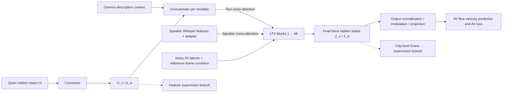
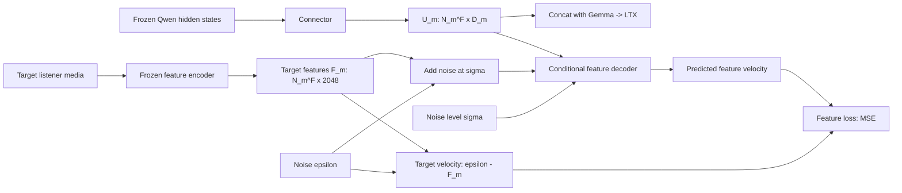

# Feature loss 与 Event loss：监督过程、shape 与结构图画法

记录日期：2026-11-10。

本文保存前面对两项损失的详细讲解，供理解方法、绘制结构图和压缩论文正文时查阅。说明对应 **LTX 原生 attention／FFN LoRA＋Whisper＋AV＋整段 Event＋双路 Feature** 完整版本，已按文末代码核对；不是直接粘贴进论文的长篇方法正文。

版本依据为 [2026-11-08 完整模型配置](../experiments/p2_ltx_all_attention_ffn_lora31_20261108/config.json)及[实现说明](../related/P2_LTX全注意力与FFN_LoRA_20261108.md)。文中的损失权重是该版本的配置值。2026-11-10 的权重搜索是另一路工作，不能把这里的数值视为搜索后的最终最优值。

## 1. 先分清两项损失分别作用在哪里

**Feature loss 约束提供给生成器的条件；Event loss 约束生成器内部的反馈行为表征。**

| 问题 | Feature loss | Event loss |
|---|---|---|
| 希望处理什么困难 | Qwen 的理解表征需要通过 Connector 适配目标倾听者的视听生成 | 连续视听生成目标没有单独明确哪些反馈类别应当出现 |
| 从哪里分支 | Connector 输出的两路条件 `U_v`、`U_a`，与 Gemma 条件拼接之前 | 最后一个 LTX Transformer block 的视频／音频 hidden states，输出归一化和投影之前 |
| 监督依据 | 从真实 listener 视频、音频提取的冻结目标特征 | 从反应描述派生并经过有效性检查的整段类别标签 |
| 辅助模块 | 两路条件特征解码器 | 两路池化与 `LN + MLP` 分类头 |
| 具体目标 | 条件特征空间中的 flow-matching 速度回归 | 整段多标签、带有效性掩码和权重的 BCE |
| 是否要求指定事件时刻 | 不是事件时序分类目标，但条件与目标特征按位置对应 | 不监督事件起止时刻，只监督类别在整段中是否出现 |
| 推理时 | 保留 Connector，移除辅助特征解码与目标特征分支 | 保留 LTX，移除 Event 分类与损失分支 |

这里的“适配条件”和“鼓励类别出现”是设计目的。实际画质、声音反馈、事件检出率等是否改善，需要由最终生成结果和对应消融验证。

## 2. 全局位置与符号

训练时，Qwen 处理 speaker audio、listener 首帧和标注反应描述，产生多层 hidden states `H`。Connector 将其映射为 `U_v`、`U_a`；两路条件分别与同一描述的 Gemma 表征拼接，送入 LTX 原生 text cross-attention。Whisper 分支另外通过 cross-attention 注入 speaker 的声学信息。



虚线表示训练辅助分支的前向连接，不表示梯度被截断。Feature 与 Event 的具体输入分别见下文。

| 符号 | 含义 |
|---|---|
| `B` | 单次前向的 batch 维；对应实现按单条样本组织，通常为 1，与全局多卡 batch 不同 |
| `U_v`, `U_a` | Connector 输出的视频／音频生成条件 |
| `F_v`, `F_a` | 从目标 listener 媒体提取的冻结特征；代码中相关字段仍叫 `teacher` |
| `N_v^F`, `N_a^F` | Feature 分支的视频／音频特征位置数 |
| `Z_v`, `Z_a` | 最后一个 LTX block 的视频／音频 hidden states |
| `T_v`, `H_v`, `W_v` | LTX 视频 latent token 网格的时间、高、宽；不是原视频帧数与像素分辨率 |
| `T_a` | LTX 音频 hidden 的时间 token 数；不是波形采样点数 |
| `C_v`, `C_a` | Event 头的视频／音频类别输出数 |

**不要把 `N_v^F` 画成 `T_v H_v W_v`。** 前者来自 Qwen 目标特征及 Connector 查询的布局，后者来自 LTX 视频 latent 网格。两者属于不同表示空间，不要求 token 数一致。音频也一样。

对应基座的 LTX 视频 hidden 维度为 `32 × 128 = 4096`，音频为 `32 × 64 = 2048`。这两个维度与 `U_v`、`U_a` 的通道数相同，但它们仍是不同位置、不同用途的张量。

## 3. Feature loss：让条件携带与目标 listener 媒体有关的信息

### 3.1 直观理解与目标特征来源

Connector 的条件既送入 LTX，也送入辅助特征解码器。辅助解码器在条件的帮助下学习目标 listener 特征的 flow velocity；由此产生的梯度促使 Connector 保留与目标视听内容有关的信息。

目标特征来自**真实的 listener 视频和经过既定音频处理的 listener 音轨**，由冻结的 Qwen2.5-Omni 视觉／音频编码器提取并缓存。它们不是从生成结果中提取，也不是 speaker Whisper 特征。静音音频仍可提供有效目标特征。

这一过程不能简写成直接比较 `Qwen H` 与目标特征，也不是直接计算 `MSE(U_m, F_m)`。真正比较的是辅助解码器预测的速度和目标速度。

### 3.2 条件与目标特征的 shape

| 张量 | 视频分支 | 音频分支 |
|---|---|---|
| Connector 条件 `U_m` | `[B, N_v^F, 4096]` | `[B, N_a^F, 2048]` |
| 目标特征 `F_m` | `[B, N_v^F, 2048]` | `[B, N_a^F, 2048]` |
| 有效位置 mask | `[B, N_v^F]` | `[B, N_a^F]` |

同一模态的条件与目标特征具有对应的位置索引。Connector 根据相应的特征网格坐标构造查询，音频目标特征按相应时间区间聚合。这种对应关系来自**位置布局**，不能只解释成“用了相同的 prompt”。

视频条件和目标特征的通道数不同也没有问题：辅助解码器分别投影条件和带噪特征，并不要求二者逐通道相等。

### 3.3 从输入到损失的五步

**第一步：选取双方都有效的位置。**

```text
valid = target_feature_valid AND condition_valid
```

设选中 `M_m` 个位置，选取后视频条件为 `[M_v, 4096]`、视频目标为 `[M_v, 2048]`；音频两者均为 `[M_a, 2048]`。这里的有效性针对特征支持与 padding，不是“是否发声”：安静位置不会仅因没有 vocalization 而被排除。

**第二步：重复有效位置，采样噪声与噪声水平。**

该配置的 `diffusion_batch_mul = 16`。每个有效位置的条件与目标重复 16 次，之后为这些行采样噪声及噪声水平，以覆盖不同的特征加噪状态。

```text
视频：U_v [16 M_v, 4096]，F_v [16 M_v, 2048]
音频：U_a [16 M_a, 2048]，F_a [16 M_a, 2048]
```

重复 16 次是辅助损失的噪声采样机制，不是把原视频复制 16 遍输出，也不是推理采样 16 步。

**第三步：在目标特征上构造带噪输入。**

对一个有效位置，记目标特征为 `f`、对应条件为 `u`：

\[
\epsilon\sim\mathcal N(0,I),\qquad \sigma\sim\mathcal U(0,1),\qquad
f_\sigma=(1-\sigma)f+\sigma\epsilon.
\]

`f_sigma` 的通道数仍是 2048。这里的加噪发生在冻结目标特征空间，独立于 LTX 的 AV latent 加噪过程。

**第四步：条件特征解码器预测速度。**

\[
\widehat v=D_m(f_\sigma,1000\sigma,u).
\]

解码器接收三项输入：带噪目标特征、噪声水平、Connector 条件。输出为 `[16 M_m, 2048]`，预测的是特征空间速度。

**第五步：与目标速度比较。**

\[
\mathcal L_{\mathrm{Feature}}^m
=\mathbb E_{f,u,\sigma,\epsilon}
\left[\left\|D_m(f_\sigma,1000\sigma,u)-(\epsilon-f)\right\|_2^2\right].
\]

实现对选中的有效位置、重复的噪声样本和特征通道取均值，随后训练流程按样本／分布式批次汇总。目标特征 `f` 已 detach，条件 `u` 保留梯度。

### 3.4 辅助特征解码器内部如何变化

视频和音频使用独立的解码器，结构相同，条件输入维度分别为 4096 与 2048：

```text
带噪特征 [16 M_m, 2048] ── Linear(2048 → 1024) ──┐
                                                   │
条件 U_m [16 M_m, D_m] ── Linear(D_m → 1024) ──┐   │
                                              +   │
噪声水平 1000σ ── 时间嵌入 [16 M_m, 1024] ─────┘   │
                         │                         │
                         └─ 调制 16 个 AdaLN 残差块 ┘
                                      │
                           输出调制 + Linear(1024 → 2048)
                                      │
                           预测速度 [16 M_m, 2048]
```

这里 `D_v=4096`、`D_a=2048`。AdaLN 使用条件与时间嵌入调制中间特征。它是辅助特征解码器，**不是输出视频或音频的 VAE decoder**。

### 3.5 梯度如何优化，以及图应该怎么画

梯度路径为：

```text
Feature loss → 辅助特征解码器 → U_v / U_a → Connector
```

该损失更新辅助解码器和 Connector。它没有经过 LTX，因此不会通过这条路径直接更新 LTX LoRA 或 Whisper 分支。对应生成训练版本使用冻结／缓存的 Qwen hidden，目标特征编码器也冻结。Qwen 描述规划的 LoRA 微调属于另一个训练阶段，不能画成这项 Feature loss 联合更新 Qwen。

用于论文结构图时，每个模态画下面的关系即可：



具体画法：

1. 从 `U_v`、`U_a` 各引一条线，分叉点位于与 Gemma 拼接之前。原来的生成路径继续向右。
2. 训练分支下方放真实 listener 视频／音频图标，经灰色冻结编码器得到目标特征。
3. 条件、带噪目标特征和噪声水平共同进入 `Conditional feature decoder`。
4. 预测速度与 `ε − F_m` 连接橙色 Feature loss 框。
5. 用 `Training only` 虚线外框围住目标特征提取、加噪、辅助解码和损失部分；Connector 及 `U_m → LTX` 留在外面。

主图可以省略 batch 维、16 次重复及解码器内部的 16 层结构，保留这些细节供子图或补充材料使用。不要画成直接从 `U_m` 到 `F_m` 的逐元素 MSE。

## 4. Event loss：从生成表征中监督整段反馈类别

### 4.1 为什么采用整段存在性监督

当前话语通常会约束回应的情绪或态度方向，例如开心的内容可能引出微笑或共同发笑，摇头可以表达不同意。但同一句话并不唯一决定 listener 的具体动作：何时点头、笑几次、持续多久，都可能存在多种合理实现。

因此，这里监督**某种反馈类别是否在整段中出现**，而不要求生成回应复刻单一参考的事件起止时刻。这为反应时序保留变化空间。AV 目标仍然监督配对媒体；仅有类别存在性也不能保证所有反馈时机和语境适当性都正确。

### 4.2 到底从 LTX block 的哪里引出

准确位置是：**最后一个 Transformer block 完成全部计算后的输出 `va.x`、`aa.x`，在 LTX 最终 output normalization／modulation／projection 之前。**

```text
                 最后一个 LTX Transformer block
                              │
                       Z_v / Z_a hidden states
                              ●  ← 在这里分叉
                             / \
                            /   └─ Clip pooling → Event heads → Event loss
                           ↓
              原生 output normalization / modulation / projection
                           ↓
                    AV flow-velocity prediction
```

不是从某个中间 cross-attention 的注意力矩阵引出，也不是从最终解码后的视频引出。代码中的 `renderer` 已经包含 LTX 生成网络；不要把它理解成接收 hidden 后立即输出最终媒体的 VAE decoder。

### 4.3 视频分支的完整 shape 变化

视频 token 按时间位置及其空间网格展开：

| 步骤 | 操作 | 输出 shape |
|---|---|---|
| 1 | 最后一个 LTX block 输出 | `[B, T_v H_v W_v, 4096]` |
| 2 | 按时间重新组织空间 token | `[B, T_v, H_v W_v, 4096]` |
| 3 | 每个时间位置内，对有效空间 token 取均值 | `[B, T_v, 4096]` |
| 4 | 对有效时间位置取均值 | `[B, 4096]` |
| 5 | LayerNorm | `[B, 4096]` |
| 6 | Linear `4096 → 128`，GELU | `[B, 128]` |
| 7 | Linear `128 → C_v` | `[B, C_v]` |

被核对的配置有 `C_v = 16` 个视觉输出槽位。因此最后输出为 `[B,16]`。它们包括 head nodding、smiling、frowning 等；最终参与损失的类别还受支持量、有效性和冲突屏蔽规则约束，不能理解为每条样本都有 16 个可靠标签。

**空间池化**：把同一 latent 时间位置上的许多空间特征，合为一条向量。

**时间池化**：把整段中有效时间位置的向量，再合为一条整段向量。

视频池化使用 FP32 计算。先按各时间位置的有效空间数量归一化，再对有效时间位置等权平均；不要在图或公式中换成不带 mask 的任意全局平均。

### 4.4 音频分支的完整 shape 变化

音频没有视频那样的二维空间网格：

| 步骤 | 操作 | 输出 shape |
|---|---|---|
| 1 | 最后一个 LTX block 输出 | `[B, T_a, 2048]` |
| 2 | 对有效时间位置取均值 | `[B, 2048]` |
| 3 | LayerNorm | `[B, 2048]` |
| 4 | Linear `2048 → 128`，GELU | `[B, 128]` |
| 5 | Linear `128 → C_a` | `[B, C_a]` |

该配置的 `C_a = 3`，对应 `audible laughter`、`speech`、`vocalization`。多个类别可以同时为正，所以使用独立类别 logits 和多标签 BCE，不使用互斥类别 softmax。

上述 16／3 是此训练版本的输出维度，不自动等于论文最终评测类别表。

### 4.5 哪些 hidden 参与池化

Event pooling 的有效位置由 AV loss mask、媒体实际支持及 hidden layout 的有效性共同确定：

- 视频参考首帧固定，不属于需要生成的位置，排除在池化之外。
- padding 和超出实际片段时间支持的位置排除。
- 保留真实、有效的安静音频位置；“静音”不等于 padding。

需要区分两种 mask：**池化 mask** 决定哪些 hidden token 能进入整段向量；**标签 mask** 决定哪些样本—类别项能计算 Event loss。两者位置和作用不同。

### 4.6 从类别 logits 到 Event loss

训练标签来自反应描述及证据检查：有支持的类别记为正例；只有描述通过相应完整性检查时，未提及类别才作为弱负例；不确定或冲突项屏蔽。

| 标签状态 | `y` | 有效性 `M` | 样本—类别权重 `w` |
|---|---:|---:|---:|
| 接受的正例 | 1 | 1 | 1 |
| 通过检查的未提及类别 | 0 | 1 | 0.1 |
| 不确定、冲突或无法作为负例 | 占位值无监督含义 | 0 | 不计入 |

令 `s_ic` 为样本 `i` 的类别 `c` 的 logit，`α_c` 为根据训练统计得到的正类权重：

\[
\mathcal L_{\mathrm{Event}}=
\frac{1}{|\mathcal C_{\mathrm{eff}}|}
\sum_{c\in\mathcal C_{\mathrm{eff}}}
\frac{\sum_i M_{ic}w_{ic}\,\mathrm{BCE}_{\alpha_c}(s_{ic},y_{ic})}
{\sum_i M_{ic}}.
\]

先对每类累计加权 BCE，再除以该类有效样本数，最后对本批次有有效监督的启用类别取平均。分母使用有效样本数，而不是权重之和，这样弱负例的 0.1 权重不会在归一化时被抵消。分布式实现按对应的全局计数归一化。

`BCEWithLogits` 直接接收 logits。结构图中若画 0–1 类别概率，可标 `Sigmoid (for display)`；实际损失输入不需要额外加一次 sigmoid。

### 4.7 梯度流向与结构图画法

梯度路径为：

```text
Event loss → Event heads → Clip pooling → 最后一个 LTX block 的 hidden
                                                │
                 ┌──────────────────────────────┼─────────────────────┐
                 ↓                              ↓                     ↓
          LTX attention / FFN LoRA       Whisper adapter / CA     条件 U → Connector
```

hidden 读出没有 detach，因此梯度能沿生成计算图传回这些可训练模块。LTX 原始基座权重冻结；冻结权重仍可以传递关于输入的梯度，并不意味着反向路径被阻断。

可以按以下顺序画两条平行分支：

```text
视频 hidden       Spatial + temporal       Visual event head      Visual logits
T_vH_vW_v ×4096 ────── pooling ────── 4096 ── LN + MLP ──→ C_v=16 ──┐
                                                                   │
音频 hidden          Temporal              Audio event head       Audio logits
T_a ×2048 ────────── pooling ──────── 2048 ── LN + MLP ──→ C_a=3 ───┤
                                                                   ↓
Clip-level labels + label masks + weights ───────────────────→ Event loss
```

具体的视觉符号可以这样处理：

1. **Video hidden**：画几组叠起来的小网格；一组代表一个 latent 时间位置，不必放真实人脸。
2. **Spatial pooling**：每组网格汇成一条细长向量，形成一组时间向量。
3. **Temporal pooling**：这些时间向量汇成一条整段向量。音频直接从时间向量进入这一步。
4. **Event head**：普通模块框，标 `Visual event head`／`Audio event head`，框内小字 `LN + MLP`。
5. **Category logits**：几个独立小格，示意 `Nod / Smile / Frown / ...` 或 `Laughter / Speech / Vocalization`。类别可以同时出现。
6. **Loss**：橙色框，同时接收 logits 和整段标签；标签 mask、弱负例权重可以缩写在标签框里。

**`Clip-level category presence` 应标在类别输出旁边。** Pooling 框旁可以标 `Valid generated positions only`。前者解释监督内容，后者解释参与聚合的位置。

## 5. 训练中的一次前向，与推理中的多步采样

### 5.1 是否“每次采样都用 Event loss 监督一次”

需要区分训练的随机噪声采样和推理的迭代采样。

**训练**：每次训练前向构造某个噪声水平的 AV latent，运行 LTX，得到速度预测与最后一层 hidden。AV loss 和 Event loss 复用这次 LTX 前向；Feature 分支另外在目标特征空间采样噪声并计算损失。合成总损失后反向传播，按训练的累积／归约规则更新参数。

这里的 Event hidden 对应当前训练噪声水平，并非先完整生成并解码一个视频再检测事件。为计算 Event loss，不需要额外完成一轮从噪声到媒体的多步生成。

**推理**：每个采样步用 LTX 预测速度并更新 latent，不执行 Event 分类头或 Event loss，也不反向优化模型。Feature 辅助解码器同样不执行。

```text
训练：随机噪声水平 → 一次 LTX 前向 → AV loss + Event loss
                       同批条件 U → Feature loss
                                  → 合并损失 → 反向传播

推理：初始噪声 latent → 多次〔LTX 速度预测 → sampler 更新 latent〕
                                             ↓
                                      最终 AV latent → 解码音视频
```

### 5.2 最后一个 block 的 hidden 是否马上解码为音视频

不会直接把 `Z_v`、`Z_a` 交给 VAE 得到最终媒体。完整推理关系是：

```text
Last LTX block hidden
        ↓
Output normalization / modulation / projection
        ↓
AV flow velocities
        ↓
Sampler updates AV latents
        ↓
回到下一采样步；所有采样步结束后才得到最终 latents
        ↓
Video / audio decoding
        ↓
Listener video + listener audio
```

因此，结构图中 Event 可以从临近 LTX 输出的位置分支，但不能把那个分叉点直接标成“最终音视频”或“VAE latent”。

## 6. 总损失与各模块的训练归属

记录版本的损失为：

\[
\mathcal L=
\mathcal L_{\mathrm{AV}}
+0.05\mathcal L_{\mathrm{Event}}
+0.025\mathcal L_{\mathrm{Feature}}^v
+0.025\mathcal L_{\mathrm{Feature}}^a.
\]

其中 Event 配置为 `clip_weight=1`、`temporal_weight=0`，使用整段分支，不创建时序监督头。

| 参数或模块 | AV 梯度 | Feature 梯度 | Event 梯度 |
|---|---|---|---|
| Connector | 可到达 | 可到达 | 经 LTX 返回 |
| LTX 原生 attention／FFN LoRA | 可到达 | 无此路径 | 可到达 |
| Whisper adapter 与额外 cross-attention | 可到达 | 无此路径 | 可到达 |
| 两路辅助特征解码器 | 无此路径 | 可到达 | 无此路径 |
| 两路 Event heads | 无此路径 | 无此路径 | 可到达 |
| Qwen／Gemma／Whisper 编码器、目标特征编码器、VAE 与 LTX 原始基座权重 | 该生成训练阶段冻结／使用缓存，不更新 | 同左 | 同左 |

“可到达”描述计算图和可训练参数归属，不表示每次前向中每个参数的梯度都必然非零。原生 LTX LoRA 覆盖 attention 与 FFN；新加的 Whisper attention 仍为全参数训练。

## 7. 画论文总图时保留哪些信息

主图建议只保留五件事：

1. `Qwen hidden → Connector → U_v/U_a`，与 Gemma 拼接后通过 text cross-attention 进入 LTX。
2. Whisper speaker audio 通过另一条 cross-attention 路径进入 LTX。
3. Feature 从 `U_v/U_a` 分支，旁边接真实 listener 媒体的冻结目标特征；辅助解码器后计算 Feature loss。
4. Event 从最后一个 LTX block 的 `Z_v/Z_a` 分支，经分模态 clip pooling、`LN + MLP`，计算整段类别 BCE。
5. 主生成路径经过 output heads、采样和媒体解码，输出 listener 音视频；两项辅助损失用 `Training only` 标识。

颜色可统一为：灰色表示冻结模块，蓝色表示可训练模块，橙色表示损失。冻结基座内部的 LoRA 单独画小标签，避免把整个 LTX 误画为全参数更新。不同连线的含义应在图例中写清，尤其不要用同一种虚线同时表示“训练分支”和“stop-gradient”。

用于图注的两句精简表述：

> Feature supervision acts on the connector outputs through auxiliary conditional feature decoders, encouraging the conditions to retain information relevant to the target listener media.
>
> Clip-level event supervision reads the final LTX hidden states and encourages feedback-category presence without imposing event start or end times.

## 8. 代码依据与核对结果

| 说明 | 代码／配置依据 |
|---|---|
| 完整模型保留相同 AV／Feature／Event 前向，扩展原生 LTX LoRA | [p2_ltx_all_lora/model.py](../src/p2_ltx_all_lora/model.py)，[完整配置](../experiments/p2_ltx_all_attention_ffn_lora31_20261108/config.json) |
| 同一 `U` 用于 Feature 和 LTX 条件，Event 改读 LTX hidden | [p2_ltx_events/model.py](../src/p2_ltx_events/model.py)：`LTXHiddenEvents.forward` |
| 最后 block 的读出位置、主输出路径及未 detach 的 hidden | [p2_ltx_events/renderer.py](../src/p2_ltx_events/renderer.py)：`forward_with_hidden` |
| 分模态 masked pooling、LN／MLP、BCE 与总损失 | [p2_ltx_events/heads.py](../src/p2_ltx_events/heads.py)：`pool_time`、`HiddenEventHeads`、`event_sums`、`objective` |
| latent token 分组、固定首帧与实际时长支持 | [p2_ltx_events/layout.py](../src/p2_ltx_events/layout.py)：`make_layout` |
| 每类按有效样本数归一化 | [p2_clip_events/model.py](../src/p2_clip_events/model.py)：`normalized_loss` |
| 弱负例权重与描述派生标签的基础逻辑 | [p2_clip_events/labels.py](../src/p2_clip_events/labels.py)；实际完整版本读取配置指定的 guarded 数值标签缓存 |
| 真实 listener 媒体的冻结目标特征、静音有效 | [p2_matrix16/teacher.py](../src/p2_matrix16/teacher.py)：`extract` |
| Feature 解码器的实例化与优化器归属 | [p2_whisper_event_feature/model.py](../src/p2_whisper_event_feature/model.py)；其旧父类 Event 前向已由 `LTXHiddenEvents.forward` 覆盖，不能照旧注释把 Event 画回 U 上 |
| Feature 的位置对应、坐标查询及冻结 Qwen 输入 | [复用的 connector.py](../../audio-driven-v4/src/omni_av_p2/connector.py) |
| 条件特征 flow matching、噪声重复与 AdaLN 解码器 | [复用的 decoder.py](../../audio-driven-v4/src/omni_av_p2/decoder.py)：`EmbeddingDecoder.loss`、`SimpleMLPAdaLN` |
| Feature 的 2048／4096 通道、解码宽度 1024／深度 16／重复数 16 | [复用的 config.py](../../audio-driven-v4/src/omni_av_p2/config.py)；[当前覆盖逻辑](../src/p2_matrix16/config.py)只覆盖 Connector fusion 设置 |

LTX 的 48 个 block、视频 hidden 4096 与音频 hidden 2048，另经配置指定的本地 `ltx-2.3-22b-dev.safetensors` 元数据核对，仅读取文件头，未加载模型或启动 GPU 计算。

**记录自查：** 两项损失的输入、输出、shape、分支位置和梯度归属有实现依据；一对多时序是整段监督的设计动机；“画质更好”“互动更自然”“类别漏检更少”等效果仍需最终消融和生成评测支持。训练 Event heads 的输出不能替代对最终生成音视频的独立事件评测。
