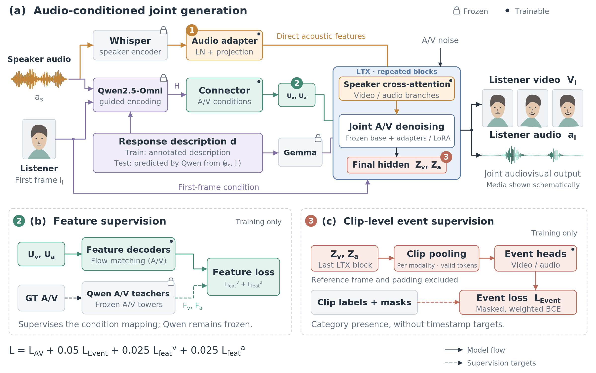

# 方法总览图初稿 v1

日期：2026-11-07。对应[中文初稿第五部分及F3配图规划](../../中文论文初稿_引言与任务数据.md)。这是根据当前实现制作的可编辑矢量草图，人物与波形均为示意，未使用真实生成结果。

文件：[可编辑SVG](method_overview_v1.svg) · [矢量PDF](method_overview_v1.pdf) · [PNG预览](method_overview_v1.png) · [绘图脚本](draw.py)。PDF尺寸为7×4.375英寸；LaTeX中按实际版心宽度缩放，尺寸不代表会议的强制图幅。

**这版的画法。** 借鉴本地GLARE的“总览＋核心监督放大”、OmniPersona的“条件路径与生成器职责分开”、DiffListener的分区结构。保留自己的布局，不复用参考论文的人脸或图形素材。

- 上方(a)先讲完整任务：当前speaker音频和listener首帧，经条件构建及联合生成输出listener音视频。读者先看懂输入输出，再看模块。
- 下方(b)(c)只展开两个关键训练设计。重复使用同名变量与编号，避免跨越整张图的长线。Feature监督条件U；Event读取LTX末block hidden Z，不能把两者画在同一位置。
- 橙色对应直接音频，绿色对应条件映射／Feature，红色对应Event。其余模块使用浅色背景。锁表示冻结，黑点表示可训练模块；LTX内部另注明冻结基座与可训练adapter／LoRA。
- 白底、平面形状、统一字形与线宽、明确的(a)(b)(c)编号。颜色服务于模块职责，不用渐变、立体装饰或大面积阴影。
- 训练用标注描述、推理用预测描述直接标在图中；真实listener媒体和事件标签仅出现在训练面板。整段Event写明排除参考帧／padding、不使用时间戳目标。

这些是结合所读论文做出的设计建议，并非声称CVPR有统一的配色或框图样式。方法图优先表达机制；任务动机图和数据流程图另画，不把三项贡献都塞进同一张架构图。

**英文图注草稿。**

Overview of our framework for audiovisual listening backchannel generation. (a) Given the current speaker audio and the listener's first frame, a frozen Qwen2.5-Omni model provides guided representations that are mapped into video and audio conditions by a trainable connector. The response description also conditions the generator through Gemma. An additional Whisper branch supplies direct acoustic features through modality-specific cross-attention in the LTX blocks. The generator jointly synthesizes listener video and audio. During training, the response description is annotated; at inference, it is predicted by Qwen from the input audio and first frame and then re-encoded. (b) Two auxiliary flow-matching decoders supervise the connector conditions using frozen teacher features of the target listener media. (c) Modality-specific heads predict clip-level event presence from pooled valid hidden tokens of the last LTX block, excluding reference-frame and padding tokens. Feature and event supervision are used only during training. Portraits and waveforms are schematic placeholders.

**中文图注草稿。**

倾听阶段视听backchannel生成框架。(a) 当前speaker音频与listener首帧经冻结Qwen提供条件表征，由可训练Connector映射到视频和音频条件；反应描述同时经Gemma提供文本条件。Whisper分支通过LTX各block中的独立视听cross-attention补充直接声学信息，生成器联合输出listener视频与音频。训练使用标注描述，推理使用Qwen预测并重新编码的描述。(b) 两路辅助flow-matching解码器利用真实listener媒体的冻结teacher特征监督条件映射。(c) 从LTX最后block的有效hidden中分模态整段聚合，预测事件类别存在性；参考帧和补齐位置不参与聚合。两项辅助监督仅用于训练。图中人物与波形为示意素材。

**本版省略的实现细节。** Qwen的预测与guided re-encoding合并表达，具体两次使用流程见图注；LTX各block内部的原生结构、噪声步、VAE编解码以及Feature decoder的带噪teacher输入未逐项展开。图中的Event hidden是训练前向随机噪声步上的hidden，不表示每次训练都先完整生成视频再检测。最终hidden的小框是监督读取位置，不是额外的推理串行模块。若审稿解释需要，可增加独立细节图，不让主图继续膨胀。

**下一轮优先修改。** 先确认模块名称和主要视觉层级；随后用同一真实样例替换首帧、生成帧及波形，明确声音与动作的对应关系。正式排版时按双栏实际尺寸检查字号，可把辅助解释移至图注。不得用示意人脸充当效果对比，不据此图宣称联合生成优于级联。

重新生成：在项目目录运行 `python writing/figures/method_overview_v1/draw.py`。脚本依赖CairoSVG、Pillow与DejaVu字体；SVG文字与形状可在矢量编辑器继续修改，手动修改后不要直接运行脚本覆盖。
