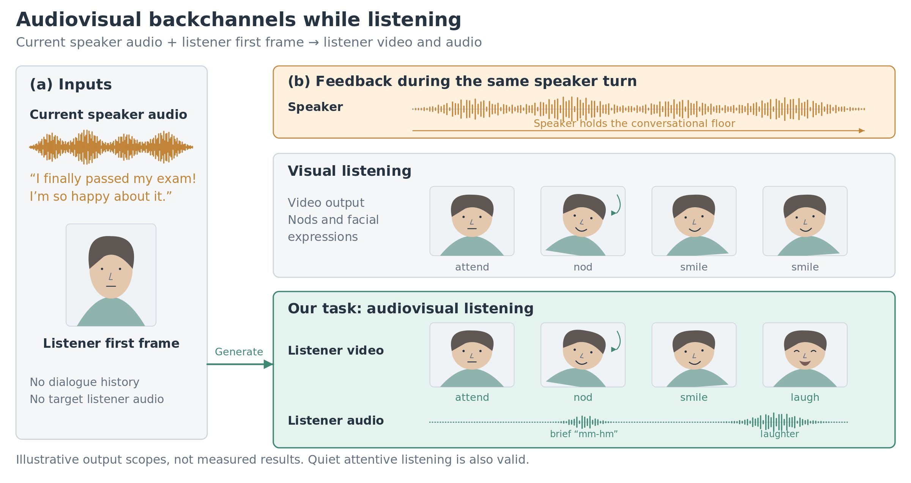
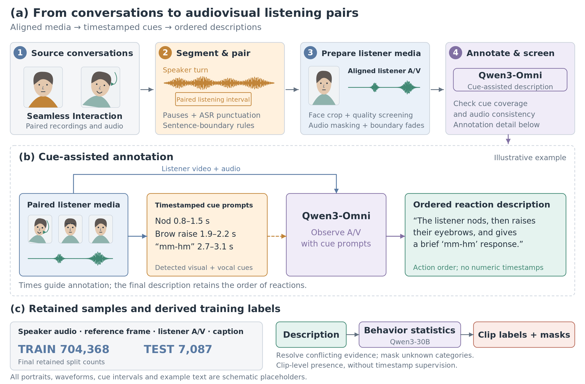

# F1任务与动机图、F2数据构建与标注图：初稿v1

对应[中文主稿的配图规划](../../中文论文初稿_引言与任务数据.md#figures)。两图沿用[F3方法图](../method_overview_v1/README.md)的白底、低饱和配色和矢量模块风格。人物、声音波形、示例话语、线索时间与描述都是绘制的示意素材，不是实际模型输出或标注质量证据。数据数量来自当前主稿D5及其来源记录。

## F1：任务与动机

[可编辑SVG](F1_task_motivation_v1.svg) · [矢量PDF](F1_task_motivation_v1.pdf) · [PNG预览](F1_task_motivation_v1.png)

**图的阅读顺序。** 左侧给出当前speaker音频与listener首帧；右上用同一说话者话轮标明时间背景；右侧两行分别展示视觉倾听和本文视听倾听的输出范围。下行在动作之外保留listener自身的简短附和与笑声，突出“对方仍持有话轮时回应”。

两行是任务输出范围的示意，不将任何具体方法画成虚构的差结果，也不暗示全部前人工作都只能输出视频。视觉倾听这一行本身有点头和表情；本文的差别通过新增声音输出及相应动作表达。图中输入话语仅供读者理解音频含义，不表示模型还需要外部转写输入。没有对话历史，也没有给定listener未来音轨。

**英文图注草稿。**

Audiovisual backchannel generation during listening. Given the current speaker audio and a reference frame of the listener, the task is to generate listener video and audio while the speaker holds the conversational floor. The illustration contrasts visual listening outputs with audiovisual feedback that can include brief vocal acknowledgments and laughter. Quiet attentive listening is also valid. Portraits, waveforms, and utterances are schematic; the two rows illustrate output scopes rather than measured model comparisons.

**中文图注草稿。**

倾听阶段的视听backchannel生成。输入当前说话者语音与倾听者参考首帧，在说话者持有话轮期间生成倾听者音视频。图中分别展示视觉倾听输出与包含简短附和、笑声的视听反馈，安静而专注的倾听同样属于有效回应。人物、波形与话语均为示意，两行用于解释输出范围，不是模型效果对比。

**定稿替换。** 选择一条真实输入及其生成结果，替换首帧、四个代表帧、实际声音波形和转写。若上行改为某基线，必须使用相同输入的真实结果并标明方法；若没有合适对比，保留为任务范围示意即可。最终以完整视频检验声画配合，不能由四个静态帧证明同步质量。

## F2：数据构建与标注

[可编辑SVG](F2_data_annotation_v1.svg) · [矢量PDF](F2_data_annotation_v1.pdf) · [PNG预览](F2_data_annotation_v1.png)

**图的阅读顺序。** 上方四步展示Seamless对话来源、片段切分与配对、listener媒体处理、辅助标注与检查；中间展开最需要解释的标注机制；下方展示最终样本组成、训练／测试数量及描述派生整段标签的过程。

- 输入Qwen3-Omni的内容包含真实listener音视频与带起止时间的视觉／发声线索，两条路径都画出。
- 图中示例为点头、抬眉和“mm-hm”；实际检测还覆盖其他动作与发声候选，示意不代表完整类别表。动作候选不是人工事件真值，抬眉也不自动等于惊讶。
- 最终caption表达行为的先后顺序，不保留数值时间戳。下方的整段训练标签同样不包含时间定位监督。
- 文本行为统计由Qwen3-30B完成，与Qwen3-Omni的视听描述是不同步骤；冲突与未知项用mask处理。这里的标签用于训练，不能直接视为独立人工评测真值。
- 按作者最新要求，图中只列最终train **704,368**、test **7,087**，不展示开发集、修复历史、缓存或未决候选。这是D5的全量筛选通过集口径，不表示当前AV生成器实际使用了全部这些训练样本；具体生成训练选集仍在方法／实验设置中说明。

**英文图注草稿。**

Data construction and cue-assisted annotation. (a) We organize Seamless conversations into speaker–listener pairs using pauses and transcript boundaries, then prepare aligned listener video and audio through face cropping, quality screening, and audio processing. (b) Listener media and timestamped visual and vocal cues are provided to Qwen3-Omni to produce an ordered natural-language reaction description without numeric timestamps. (c) Each retained sample links speaker audio, a listener reference frame, listener audiovisual targets, and a reaction description. The retained training and test sets contain 704,368 and 7,087 samples, respectively. Descriptions also support behavior extraction and conflict masking to construct clip-level training labels. Example media, intervals, and descriptions are schematic.

**中文图注草稿。**

数据构建与反应线索辅助标注流程。(a) 基于停顿和转写边界组织Seamless中的speaker–listener配对片段，并完成人脸裁剪、质量筛查与音轨处理。(b) 将listener音视频与带时间区间的视觉、发声线索共同输入Qwen3-Omni，生成按动作顺序组织、不含数值时间戳的自然语言描述。(c) 最终样本关联speaker音频、listener首帧、listener音视频及描述，保留训练样本704,368条、测试样本7,087条；描述还经行为提取和冲突屏蔽派生整段训练标签。示例媒体、时间区间及描述均为示意。

**定稿替换。** 使用同一真实样本替换中间的三帧、音轨、检测候选及最终caption；确保示例caption确实来自当前流程。如果希望进一步论证辅助线索减少遗漏，可另加“仅音视频／加入线索”的真实标注对照，并配独立人工核验，而不在本图中预填改善幅度。

## 文件与编辑

两图均提供SVG、PDF与2400像素宽PNG。PDF宽度为7英寸，F1高度3.71875英寸，F2高度4.59375英寸；这是草图尺寸，定稿时按论文版心缩放并检查字号，必要时将图内解释移至图注。

[绘图源脚本](draw.py)生成全部资产；[检查记录](CHECK.json)记录PDF页面尺寸、矢量对象数量及文字边界检查。已检查两图预览，PDF不含栅格图片。

重新生成：在项目根目录运行 `python writing/figures/task_data_drafts_v1/draw.py`。依赖CairoSVG、Pillow、PyMuPDF与DejaVu字体。SVG可在矢量编辑器中修改；手工编辑后重新运行脚本会覆盖图文件，应另存版本。

依据：[主稿任务与数据章节](../../中文论文初稿_引言与任务数据.md)、[最新数据说明](../../../related/交接_最后处理完的数据_20261106.md)、[生产打标配置](../../../experiments/listen_j_reaction_vocal_omni_20261103/config.json)。
